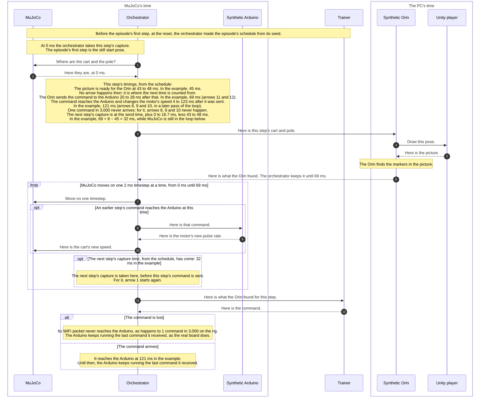

# The real loop's timings: the conclusion for the synthetic loop

**Why this exists:** the policy trains in the synthetic loop, where every
delay is picked at random from a band, and it should train on the delays the
real rig has. `real-timings.md` measured each gap in time on the rig, from
the camera taking a picture to the motor acting on the command made from
it. This file is what those measurements suggest for the synthetic loop:
which delays to pick at random, from what bands, and how the random timings run.

**Status.** The timing model here, marked "(user, 2026-11-08)" where it
was decided, is the user's. Nothing of it is in the loop yet: the loop as it
is today is `synthetic-loop-dia.md`. A change to how the loop works lands
there first, then in the plans and the code (`AGENTS.md`), so the next
thing to do is to write this into `synthetic-loop-dia.md`. *What the change
needs*, at the end, lists what that work must carry out, every point
decided by the user on 2026-11-08. None is left open.

This file replaces the *Suggestions for the synthetic loop* section of
`real-timings.md`, which is an older version: where the two differ, this
file is right. Every number here is from `real-timings.md`, where each
gap's method, result and shape are.

## The gaps, in one line each

The numbers below add up these gaps (`real-timings.md`, *The gaps at a
glance*). A datagram, in gaps 6 and 7, is one small packet sent over WiFi,
with no promise that it arrives: the command travels to the Arduino as one.

| Gap | From | To |
|---|---|---|
| 1, camera | the sensor exposes the picture | the Orin has read the whole picture |
| 2, hand-off | the Orin has the picture | the Python worker has it |
| 3, detection | the worker has the picture | the markers' boxes are back |
| 4, the brain between stages | the boxes are back | the policy's 36 inputs are built |
| 5, policy inference | the inputs go to the policy | its answer, `a`, comes back |
| 6, send | `a` comes back | the command's datagram leaves the Orin |
| 7, WiFi hop | the datagram leaves | the Arduino has it |
| 8, the board applies it | the Arduino has it | the motor runs at the new rate |
| 9, cadence | one command sent | the next command sent |

## Glossary

The names used for the timings, here and in the diagram, the plans, the
settings and the code that follow from this file. Keep them the same in
all of them; when a name changes, change it here first. "Frame" is not
used for any of them: it could mean a picture, a step or a timestep.

| Name | Meaning |
|---|---|
| **step** | the trainer's step: one picture and the command made from it, numbered 0, 1, 2, … within an episode, so 0 to 499 today. `max_episode_steps` counts them |
| **timestep** | 2 ms of simulated physics, MuJoCo's own `timestep`. Every timing is rounded to whole timesteps |
| **picture** | what the camera takes on the rig, and what Unity draws in the synthetic loop |
| **pool** | the Orin's memory of the last 6 pictures: for each, how long ago it was captured and where the Pivot and End markers were, in metres. It is what the policy reads |
| **pre-warm** | filling the pool, before step 0's picture, with entries that found no markers, at the capture times of steps −5 to −1, which the schedule makes like any other step's, so step 0's pool has the same shape as every other (`synthetic-loop-dia.md`, *The initial pool*; *What the change needs*, point 6) |
| **episode** | from a reset until the trainer ends it, at most `max_episode_steps` steps (500 today) |
| **episode seed** | the seed every random timing of an episode is picked from: the run's seed + the episode's number (`env.py`, `seed_of`) |
| **RND(x, y)** | a number picked at random between x and y, every value equally likely, from the orchestrator's seeded generator |
| **schedule** | the table made at the reset: one row per step, holding the step's four timings, each in ms from the episode's start |
| **capture** | the first timing: when the orchestrator reads MuJoCo's cart and pole for the step's picture. On the rig, the camera's exposure |
| **capture state** | MuJoCo's state read at a step's capture: the time, the cart's position and the pole's angle, the site positions, and the pole's speed, angle, centre of mass and hinge point (`synthetic-loop-dia.md`'s own name for it). Unity draws the step's picture from it, and the trainer works out the reward from it |
| **picture ready** | the second timing: capture + stretch 1. When the step's picture reaches the Orin |
| **send** | the third timing: picture ready + stretch 2. When the step's command leaves the Orin. MuJoCo waits here if the PC has not finished |
| **motor change** | the fourth timing: send + stretch 3. When the step's command reaches the Arduino and the motor's rate changes. None if the command is lost |
| **stretch 1** | capture → picture ready: gap 1. Settings `frame_ready_min`, `frame_ready_max` |
| **stretch 2** | picture ready → send: gaps 2–6, the Orin's work until the command goes to the Uno. Settings `to_uno_min`, `to_uno_max` |
| **stretch 3** | send → motor change: gaps 7 + 8. Settings `change_motor_min`, `change_motor_max` |
| **wait** | send → the next step's picture ready: RND(`next_frame_ready_min`, `next_frame_ready_max`), 0 to 16.7 ms today. The next step's capture is its picture ready less its own stretch 1 |
| **lost** | a command whose datagram never reaches the Arduino: 1 in `drop_one_message_in`, a whole number picked from 1 to it coming out 1. It has no motor change |
| **landed** | a command whose motor change has come and been applied |
| **last landed step** | the number of the step whose command landed last, the one number the orchestrator keeps for gobbling |
| **gobbled** | a command whose motor change comes after a newer step's command has landed: skipped, so the newer command keeps running |

The setting names are the user's (2026-11-08; *What the change needs*,
point 1). In `frame_ready_*` and `next_frame_ready_*`, "frame" means the
picture.

## The random timings

RND(x, y) is a number picked at random between x and y, every value in
between equally likely; the orchestrator picks each from one seeded
generator, so the same seed gives the same picks
(`synthetic-loop-dia.md`, *Timing*). A lost command is the same kind of
pick over whole numbers: one from 1 to `drop_one_message_in` (3,000), lost
when it comes out 1, so about once in 3,000.

Today the synthetic loop picks one delay per command, RND(8, 15) ms, from
the picture's capture to the command taking effect, and picks when the
next capture comes, RND(20, 30) Hz. The suggestion (user, 2026-11-08)
splits the delay into the three stretches the rig has, each picked at
random; adds a random pick for a command that never arrives; and places
the next capture the way the rig takes it, instead of picking a rate:

```text
capture ──stretch 1──> the picture is ready ──stretch 2──> the command is sent ──stretch 3──> the motor's rate changes
                                                                                 1 in `drop_one_message_in`: the command is lost
the next capture = the command is sent + the wait for the next picture − the next step's own stretch 1
```

In the table, the standard deviation (std dev) is the spread around the
mean, and "2 std dev" is the mean less and plus twice it: on a bell curve
that holds about 95% of the values.

| # | Random timing | The synthetic loop today | Reality: the gaps it covers, measured | Suggested setting |
|---|---|---|---|---|
| 1 | **Stretch 1: capture → the picture is ready for detection**, RND(a, b) ms | part of RND(8, 15) ms | gap 1: mean 45.403 ms, std dev 0.763 ms, shortest 43.103 ms, longest 47.570 ms | a = 43, b = 48 ms (user, 2026-11-08): the shortest and longest measured, rounded out. 2 std dev would be 43.9 to 46.9 ms |
| 2 | **Stretch 2: the picture is ready → the command is sent**, RND(c, d) ms | part of RND(8, 15) ms | gaps 2–6, measured together: mean 23.895 ms, std dev 1.944 ms, shortest 20.529 ms | 2 std dev: c = 20.5*, d = 27.8 ms |
| 3 | **Stretch 3: the command is sent → the motor's rate changes**, RND(e, f) ms | part of RND(8, 15) ms | gaps 7 + 8: mean 51.265 ms, std dev 36.005 ms, shortest 3.565 ms | 2 std dev: e = 3.6*, f = 123.3 ms |
| 4 | **The wait for the next picture**, after the command is sent, RND(0, 16.7) ms | the next capture is RND(20, 30) Hz after this one | the camera takes a picture every 16.67 ms, at 60 a second, whatever the Orin is doing | 0 to 16.7 ms |
| 5 | **A lost command**, 1 in `drop_one_message_in`: a whole number picked from 1 to it comes out 1, and the cart keeps the last command | every command arrives | 1 datagram of 3,000 lost on the WiFi (`real-timings.md`, gap 7) | 1 in 3,000 |

**The next capture** (user, 2026-11-08). On the rig the camera takes a
picture every 16.67 ms on its own, and the brain, once it has sent its
command, takes the next picture that is ready: that is row 4, 0 to 16.7 ms
after the send. That picture was exposed its own stretch 1, 43 to 48 ms,
before it was ready. So the next step's capture falls before this step's
command is sent, and still always after this step's capture: at the
shortest, 43 + 20.5 + 0 − 48 = 15.5 ms after it. Worked through with the
means: a capture at 0 ms is ready at 45.4 ms, its command is sent at
45.4 + 23.9 = 69.3 ms, the next picture is ready at 69.3 + 8.35 = 77.6 ms,
and that picture was captured at 77.6 − 45.4 = 32.2 ms. This replaces the
command rate's random pick, `command_rate_min` and `command_rate_max`
(`gym.toml` `[env]`).

Where the numbers come from:
- **Row 1:** gap 1. 2 std dev: 45.403 ± 2 × 0.763 = 43.877 to 46.929 ms.
- **Row 2:** gaps 2 to 6 together, `sent − arrived` for each of the 3,000
  pictures in the stage test (`real-timings.md`, gaps 2–6 together). 2 std
  dev: 23.895 ± 2 × 1.944 = 20.007 to 27.783 ms.
- **Row 3:** gaps 7 and 8. Mean 48.3 + 2.965 = 51.265 ms; std dev
  √(36.0² + 0.581²) = 36.005 ms, which adds the two gaps' spreads as if
  each varies independently of the other, not checked. 2 std dev: 51.265 ±
  72.009 = −20.744 to 123.274 ms.
- **Rows 1 to 3's means** add up to the whole latency's 45.403 + 23.895 +
  51.265 = 120.563 ms (`real-timings.md`, *What the trainer needs*).
- **Row 4:** the camera's 60 pictures a second, 1,000 ÷ 60 = 16.67 ms
  between pictures.
- \* Where the 2 std dev range's lower end falls below the shortest time
  measured, it starts there instead, as in `real-timings.md`'s tables: no
  time can be less than the shortest measured. Row 2: 20.007 ms, below
  20.529 ms. Row 3: −20.744 ms, below the 1.6 + 1.965 = 3.565 ms the two
  gaps' shortest add up to.

## How the random timings run: MuJoCo's time and the PC's

(user, 2026-11-08)

- **Simulated time, not the PC's:** each stretch lasts its picked time in
  MuJoCo's time, the simulated clock MuJoCo moves through one timestep at a
  time. If the PC has not finished the stretch's work (the render, the
  detection, the policy) by the end of the picked time, MuJoCo waits for
  it. If the PC has finished early, the next stretch does not begin until
  the picked time has passed. So the PC's own speed never reaches what the
  policy sees: only the random timings do. The loop already works this way
  for its one delay today (`synthetic-loop-dia.md`, *Timing*: MuJoCo
  freezes at the arrival step, there a timestep, until the reply is in).
- **On MuJoCo's 2 ms grid:** every time worked out from the random timings
  is rounded to the nearest timestep. Today the loop takes the first
  timestep later than the picked time instead (*Timing*).
- **Commands in flight:** a command takes effect about 120.6 ms after its
  step's capture, while captures come about 32 ms apart, so a capture comes
  while earlier commands are still on their way. Each waits, in simulated
  time, for its own timestep to act, while the next capture goes ahead. The
  diagram's rule that every command takes effect before the next capture
  (*Timing*) would have to go.

## The loop, in order

How one step goes through the synthetic loop with these random timings
(user, 2026-11-08). The left box runs in MuJoCo's time, which moves only
when the orchestrator moves MuJoCo on a timestep; the right box runs in the
PC's own time. This is a suggestion: the loop as it is today is
`synthetic-loop-dia.md`.

**The episode's schedule, made at the reset.** None of the random timings
depends on what the policy does, only on the episode's seed. So at each
reset, before the episode's first step, the orchestrator works out the
whole episode's timings at once, for up to `max_episode_steps` steps (500
today, `gym.toml` `[env]`). The episode's seed is the one the trainer sends
with the reset: episode k's seed is the run's seed + k
(`__synthetic__/trainer/python/src/env.py`, `seed_of`; the run's seed is
`settings.toml`'s `seed`). For each step k, rounded to the nearest
timestep:
- **capture**: step 0's is 0 ms, the still start pose; every later step's
  comes from the step before, below;
- **picture ready** = capture + stretch 1;
- **send** = picture ready + stretch 2;
- **motor change** = send + stretch 3, or none if the command is lost
  (1 in `drop_one_message_in`);
- **the next step's capture** = send + the wait (row 4) − the next step's
  own stretch 1.

The schedule holds 520 steps (user, 2026-11-08): steps −5 to −1 for the
pre-warm (point 6), steps 0 to 499 for the episode, and steps 500 to 514
spare, since generating more than is needed costs nothing. Its length
follows `max_episode_steps`: 5 + `max_episode_steps` + 15. Only the timings
are known in advance: what happens at each moment (MuJoCo's physics, Unity's picture, the Orin's
detection, the policy's command) is worked out as the episode runs. An
episode that ends early leaves the rest of its schedule unused, and MuJoCo
waiting for a slow PC moves none of it, since MuJoCo's time stops while it
waits.

How to read the diagram. A capture is the moment the orchestrator reads
where MuJoCo's cart and pole are, to be drawn by Unity as the camera's
picture. Every time in the diagram is counted in milliseconds from this
step's capture, which is 0 ms, and read from the episode's schedule. The
example times use each random timing's average.



In the steady state, with the means (stretch 1: 45.403 ms; stretch 2:
23.895 ms; stretch 3: 51.265 ms; the wait, RND(0, 16.7): 16.7 ÷ 2 =
8.35 ms):
- **Captures** come every 45.403 + 23.895 + 8.35 − 45.403 = 32.245 ms. The
  rig measured 33.309 ms between sends (gap 9), so the rig's average wait
  for the next picture is 33.309 − 23.895 = 9.414 ms, 1.06 ms more than the
  8.35 ms an even random pick over 0–16.7 ms gives. Why is not known.
- **Each command** is sent 45.403 + 23.895 = 69.298 ms after its step's
  capture, and changes the motor 51.265 ms after that, 120.563 ms after the
  capture.
- So by the time step n's command is sent, steps n + 1 (32.2 ms) and
  n + 2 (64.5 ms) have already been captured and wait their turn for the
  Orin, and the motor is still running step n − 2's command: n − 1's
  changes the motor at −32.2 + 120.6 = 88.4 ms, after the 69.3 ms send.

Whether a picture shows a given command depends only on which comes first
in MuJoCo's time, the picture's capture or that command's motor change;
the random timings decide it each time.

A command whose motor change comes after a newer step's command has landed
is gobbled (*What the change needs*, point 5).

## What the change needs

What writing this into `synthetic-loop-dia.md`, the plans and the code must
carry out. Every point is the user's decision, with its date.

1. **The settings (user, 2026-11-08).** The three bands, the wait and the
   loss go where `rnd_delay_min` and `rnd_delay_max` are today,
   `__synthetic__/trainer/python/settings.toml` `[orchestrator]`, and
   replace them:

   | Key | Value | Row |
   |---|---|---|
   | `frame_ready_min`, `frame_ready_max` | 43, 48 ms | 1, stretch 1 |
   | `to_uno_min`, `to_uno_max` | 20.5, 27.8 ms | 2, stretch 2 |
   | `change_motor_min`, `change_motor_max` | 3.6, 123.3 ms | 3, stretch 3 |
   | `next_frame_ready_min`, `next_frame_ready_max` | 0, 16.7 ms: a min as well, at no cost, for later | 4, the wait |
   | `drop_one_message_in` | 3,000: one command in this many is lost | 5 |

   The trainer passes each to the orchestrator as a flag of the same name
   with dashes (`--frame-ready-min` and so on), in place of
   `--rnd-delay-min`, `--rnd-delay-max`, `--command-rate-min` and
   `--command-rate-max`. `gym.toml` `[env]` loses `command_rate_min` and
   `command_rate_max`; its comment says a run saved with other rates cannot
   resume, so a run saved before this change cannot resume after it.

2. **The order of the picks (user, 2026-11-08).** The requirement: no
   episode ever gets the same random numbers as another, so a timing in
   episode 5 never repeats its value from episode 14. Each episode has its
   own seed, and the orchestrator's one generator turns each seed into its
   own sequence of random numbers. The generator is SplitMix64
   (`__synthetic__/orchestrator/rust/crates/orchestrator/src/timing/mod.rs`): it
   keeps one number, its state, which starts as the seed; each pick adds
   the same very large odd number to the state and scrambles the result
   into the random number. Two episodes' sequences would only meet if their
   seeds differed by a whole number of those very large steps, so seeds
   that differ by a little, 1 apart today (the run's seed + the episode's
   number), never meet within an episode's picks. At the reset, from the
   episode's seed, the picks come in this order: for each step −5, −4,
   …, 514 in turn (steps −5 to −1 are the pre-warm, point 6), its
   five picks: stretch 1, stretch 2, stretch 3, the wait, the drop. That is
   520 × 5 = 2,600 picks for a 500-step episode. Step k + 1's capture
   needs its own stretch 1, its first pick, so it is worked out once step
   k + 1's picks are made. The same seed gives the same schedule on every
   machine.

3. **The rounding (user, 2026-11-08).** The schedule keeps a running
   total of the exact picks, in ms from the episode's start, and each entry
   (each capture, picture ready, send and motor change) is rounded to the
   nearest multiple of 2 ms, MuJoCo's timestep, as it is written. A time
   exactly halfway (an odd whole ms) goes to the later timestep. Example:
   capture 0 + 45.37 + 23.88 = a send at 69.25 ms, written as 70 ms.
   Rounding the times, not each pick, keeps the rounding from adding up
   over a step. Captures stay in order: the shortest spacing,
   43 + 20.5 + 0 − 48 = 15.5 ms, is more than a timestep.

4. **Two events on one timestep (user, 2026-11-08: step order).** When
   timings of different steps fall on the same timestep, MuJoCo first moves
   on that timestep, then the events go in step order: the earlier step's
   first. One step's own four timings never share a timestep, being at
   least 43, 20.5 and 3.6 ms apart, so this only orders different steps.
   In practice a shared timestep holds an older step's motor change with a
   newer step's send or capture, so the motor change goes first. A motor
   change on a capture's timestep moves the cart from the next timestep on,
   so the picture shows the cart before it, as a change landing during a
   1 ms exposure would barely show on the rig.

5. **Out-of-order commands: gobbled (user, 2026-11-08).** Stretch 3 runs
   from 3.6 to 123.3 ms while commands leave about 32 ms apart, so a later
   step's command can get an earlier motor change than the one before it.
   The schedule's generator stays naive and picks every timing on its own;
   the orchestrator settles it as the episode runs, with one comparison
   when a motor change comes due:

   ```text
   if this step > the last landed step:  apply it, and it becomes the last landed step
   else:                                 skip it: it is gobbled
   ```

   Because the schedule's times are counted from the episode's start, the
   motor changes come due in time order of their own accord, and this one
   comparison is all the gobbling needs. On the rig a late older command
   would override the newer one, since a command's 3 bytes say nothing of
   which was sent first (`real-loop-dia.md`, *Contracts*); the synthetic
   loop gobbles it instead.

6. **The pool's pre-warm (user, 2026-11-08).** Today the Orin's six
   starting gaps (`--pool-gaps`, `synthetic-loop-dia.md` arrow 4 and R6)
   are each 1000 ÷ a command-rate pick, which goes. In its place, the
   schedule generates steps −5 to −1 exactly like every other step, and
   their capture times become the pre-warm entries, before step 0's
   capture at 0 ms; their sends and motor changes are dropped, since no
   command exists before the episode starts. So the spacings between
   pre-warm entries come out like those between real captures, 15.5 to
   49.5 ms, 32.2 ms on average. Step 0's own picture is one of the pool's 6
   entries, so 5 pre-warm entries are all it needs. The Orin's pre-warm
   takes 6 gaps today, and pushing step 0 drops the oldest entry at once,
   so that 6th gap never reaches the policy and any value will do.

7. **The rail's ends: the synthetic Arduino's limit switches and FAULT
   (user, 2026-11-08).** Today the trainer ends an episode when a strike
   face comes within a gap b of its base, and b has a floor worked out from
   the longest latency and the longest time between captures
   (`__synthetic__/trainer/python/src/endings/strike_gap.py`, `floor`;
   `plugins.py`, `longest_gap_ms` and `longest_latency_ms`). Both come from
   settings that go. In its place, the synthetic Arduino owns the rail's
   ends, as the real Uno does:
   - **every 2 ms tick** it checks its limit switches, one fixed rule each
     tick, as the controller firmware does (commit `c1b4bd1b`: a limit
     switch tripped in CALIBRATED or MOVING puts the board in FAULT);
   - **a switch trips** when a strike face comes within
     `calibration_stop_gap` of its base, 5 mm, the setting that already
     "stands for where they would trip" (`settings.toml`);
   - **a tripped switch puts it in FAULT, and FAULT ends the episode.** The
     synthetic Arduino is a library inside the orchestrator (the `arduino`
     crate), not on the WebSocket, so the orchestrator sees FAULT in the
     answer to that tick, at that timestep.

   The trainer's strike-gap end and its floor go: no latency has to be
   added up, since the switch trips where the cart is. Ideally a trained
   policy never brings the cart into FAULT, as on the rig.

8. **What the reward scores: the capture's state (user, 2026-11-08).**
   The reward is worked out from the step's capture state, the same one
   Unity draws the step's picture from: one capture state, used twice, (1)
   by Unity to draw the picture and (2) by the trainer for the reward. That is what the loop
   does today (`synthetic-loop-dia.md`, the note after arrow 17), so the
   reward itself does not change, and `reward-plan.md` with it. What
   changes is how far behind the picture the commands are: today the last
   command, the one the trainer gave for step n − 1, has acted by capture
   n. With commands in flight it has not: at the means, step n − 1's
   command reaches the motor at −32.2 + 120.6 = 88.4 ms after capture n,
   and capture n shows the cart on step n − 4's command, the last to have
   reached the motor by then (−129.0 + 120.6 = −8.4 ms). The policy's
   inputs end with its last 6 commands, more than the about 4 in flight,
   so it can tell which of its commands the picture cannot show yet.
