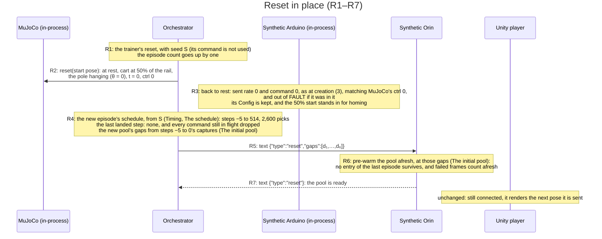
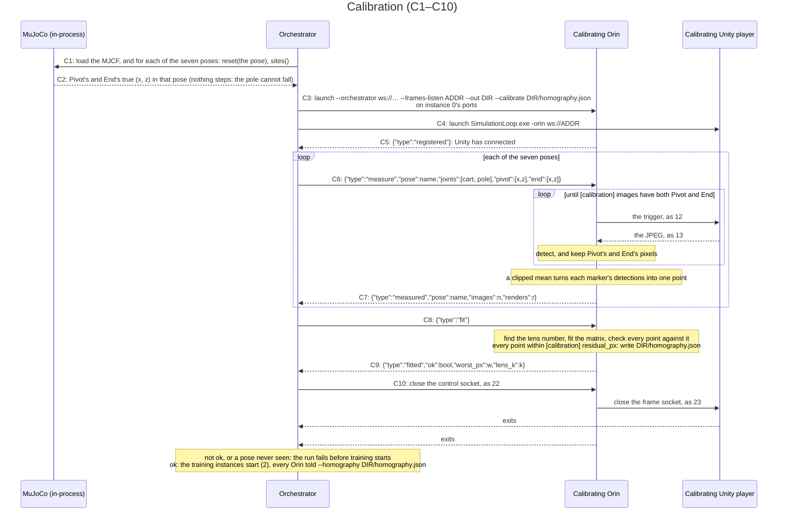

# Synthetic loop — sequence of one run (planned)

The policy will learn inside this loop, so this shows how one picture travels
from MuJoCo's truth to what the robot sees, through the trainer's policy,
and back to the motor. It is the **planned** sequence (decided 2026-10-23;
its timing, *Timing* below, decided 2026-11-08 in
`real-timing-conclusion.md`), what the loop is meant to be: the code is
checked against it, never the reverse. The names of the timings (step,
timestep, picture, capture state, stretch 1–3, wait, lost, landed, gobbled,
…) are that file's *Glossary*'s, here and in every plan and setting that
follows from this one.

Several sources cited below were removed on 2026-11-11 and are in git at
commit `ecced2cc`: `orchestrator-plan.md`, `trainer-observations.md`,
`gymnasium-research.md`, `reward-research.md`, `jump-limit-results.md`
and `rl-rewrite-plan.md`.

The orchestrator stands in for the physical world: MuJoCo and the synthetic
Arduino are libraries inside it, and it is the only participant that sends
MuJoCo anything. The synthetic Orin is the robot's detector: it triggers the
Unity player, its camera, and replies to the orchestrator with the marker
pool only, never any timing. In production the policy runs on the Orin; in
the synthetic loop everything runs on this workstation, so the policy lives
in the trainer, which is where it is trained. The pose rides through the
Orin's sim edge to Unity; detection sees only pixels, and the policy only
the marker pool. The pool reaches the trainer for the policy, and beside
it the capture's MuJoCo time, true site positions and true pole state
(*Contracts*, the pole), for the reward and the record alone, with a
fault flag when the synthetic Arduino ended the episode: the trainer generates the reward and decides continue or stop
itself, and nothing in the control loop touches training. The trainer
starts each run by launching the orchestrator, with the command its
`__synthetic__/trainer/python/settings.toml` names (1). One run holds many episodes (user,
2026-10-24): between episodes the trainer answers reset, which puts the
run back at the start in place, without relaunching the orchestrator, the
Orin or the player (*Reset in place*); stop ends the run. A failed run (3 failed frames in the pool) is different: it
ends training, so the trainer is told the run failed (26) and starts no
further run. Within an instance only one message to another process is
in flight at any moment: MuJoCo waits at a capture for the Orin's reply
and at a send for the trainer's answer (*MuJoCo's time and the PC's*), so
nothing can race.

**Timing** (user, 2026-11-08, `real-timing-conclusion.md`). MuJoCo's time
is the clock, and it runs at a fixed deltatime: its 2 ms **timestep**. The
orchestrator alone decides when anything happens (user, 2026-10-30). None
of the random timings depends on what the policy does, only on the
episode's seed, so the orchestrator works out all of them at once, at each
reset, before the episode's first step: the episode's **schedule**.

**A step's four timings.** A **step** is the trainer's step: one picture
and the command made from it, numbered 0, 1, 2, … within an episode
(`max_episode_steps` counts them). Each step has four timings, in ms from
step 0's capture:

- **capture**: when the orchestrator reads MuJoCo's state for the step's
  picture, the step's **capture state** (9–10). On the rig, the camera's
  exposure. Step 0's is 0 ms, the still start pose.
- **picture ready** = capture + stretch 1: when the picture reaches the
  Orin. Nothing happens at it in the loop: it is where stretch 2 is
  counted from.
- **send** = picture ready + stretch 2: when the step's command leaves the
  Orin. In the loop, the step's pool goes to the trainer here (17) and its
  command comes back (18).
- **motor change** = send + stretch 3: when the command reaches the
  Arduino and the motor's rate changes (19–21). None if the command is
  **lost**.

And the next step's capture = this step's send + the **wait** − the next
step's own stretch 1: on the rig, once the brain has sent its command, it
takes the next picture that is ready, and that picture was exposed its own
stretch 1 before it was ready. So the next capture falls before this
step's send, and still always after this step's capture: at the shortest,
43 + 20.5 + 0 − 48 = 15.5 ms after it.

```text
capture ──stretch 1──> picture ready ──stretch 2──> send ──stretch 3──> motor change
                                                         1 in drop_one_message_in: lost, no motor change
the next step's capture = send + the wait − the next step's own stretch 1
```

**The random timings.** RND(x, y) is a number picked at random between x
and y, every value equally likely, from the orchestrator's one seeded
generator. Every band is the trainer's `settings.toml` `[orchestrator]`,
passed to the orchestrator as a flag of the same name with dashes
(`frame_ready_min` as `--frame-ready-min`, and so on); in `frame_ready_*`
and `next_frame_ready_*`, "frame" means the picture. Each band stands for
gaps measured on the rig (`real-timings.md`; where each number comes from:
`real-timing-conclusion.md`, *The random timings*):

| Timing | Picked as | Settings | Today | On the rig |
|---|---|---|---|---|
| stretch 1, capture → picture ready | RND(min, max) ms | `frame_ready_min`, `frame_ready_max` | 43, 48 | gap 1, the camera: the shortest and longest measured, rounded out |
| stretch 2, picture ready → send | RND(min, max) ms | `to_uno_min`, `to_uno_max` | 20.5, 27.8 | gaps 2–6, the Orin's work until the command goes to the Uno |
| stretch 3, send → motor change | RND(min, max) ms | `change_motor_min`, `change_motor_max` | 3.6, 123.3 | gaps 7 + 8, the WiFi hop and the board applying it |
| the wait, send → the next step's picture ready | RND(min, max) ms | `next_frame_ready_min`, `next_frame_ready_max` | 0, 16.7 | the camera's next picture, one every 1,000 ÷ 60 = 16.67 ms |
| lost | a whole number from 1 to N, lost when it comes out 1 | `drop_one_message_in`, N | 3,000 | 1 datagram of 3,000 lost on the WiFi (gap 7) |

**The loop's means.** Every value of a band is equally likely, so each
pick averages its band's midpoint: stretch 1 (43 + 48) ÷ 2 = 45.5 ms,
stretch 2 (20.5 + 27.8) ÷ 2 = 24.15 ms, stretch 3 (3.6 + 123.3) ÷ 2 =
63.45 ms, the wait (0 + 16.7) ÷ 2 = 8.35 ms. At those means captures come
every 45.5 + 24.15 + 8.35 − 45.5 = 32.5 ms, about 31 steps a second; each
command is sent 45.5 + 24.15 = 69.65 ms after its step's capture and
changes the motor 63.45 ms after that, 133.1 ms after the capture. Every
"at the means" below uses these. They are not the rig's measured means
(`real-timing-conclusion.md`, *The loop, in order*): stretch 1 45.403 ms,
stretch 2 23.895 ms, stretch 3 51.265 ms, the wait 9.414 ms, giving 33.309
ms between sends and 120.563 ms from capture to motor. Stretch 3's band
is the measured mean ± 2 std dev, cut at the shortest measured, so its
midpoint sits 63.45 − 51.265 = 12.185 ms above the rig's mean: on
average the loop's commands reach the motor about 12.5 ms later than the
rig's.

**The schedule** (user, 2026-11-08), made at each reset from the
episode's seed (*Reset in place*, R4; the run's first episode's from
`--seed`, 2). It holds 520 steps, −5 to 514: steps −5 to −1 for the
pre-warm (*The initial pool*), steps 0 to 499 for the episode, and steps
500 to 514 spare, since generating more than is needed costs nothing. Its
length follows `max_episode_steps` (the gym file's `[env]`, 500 today,
passed as `--max-episode-steps`): 5 + `max_episode_steps` + 15. Only the
timings are known in advance: what happens at each moment (MuJoCo's
physics, Unity's picture, the Orin's detection, the policy's command) is
worked out as the episode runs. An episode that ends early leaves the
rest of its schedule unused.

- **The order of the picks.** From the episode's seed, for each step −5,
  −4, …, 514 in turn, its five picks: stretch 1, stretch 2, stretch 3, the
  wait, the drop. That is 520 × 5 = 2,600 picks for a 500-step episode,
  and nothing is picked once the episode runs. Step k + 1's capture needs
  its own stretch 1, its first pick, so it is worked out once step k + 1's
  picks are made. The requirement: no episode ever gets the same random
  numbers as another. Each episode has its own seed, and the generator is
  SplitMix64 (`orchestrator-plan.md`): it keeps one number, its state,
  which starts as the seed; each pick adds the same very large odd number
  to the state and scrambles the result into the random number. Two
  episodes' sequences would only meet if their seeds differed by a whole
  number of those very large steps, so seeds 1 apart, as episodes' are,
  never meet within an episode's picks. The same seed gives the same
  schedule on every machine.
- **The rounding.** The schedule keeps a running total of the exact picks,
  in ms from step 0's capture, and each entry (each capture, picture
  ready, send and motor change) is rounded to the nearest whole timestep,
  2 ms, as it is written. A time exactly halfway (an odd whole ms) goes to
  the later timestep: 69 ms is written as 70, −33 ms as −32. Rounding the
  times, not each pick, keeps the rounding from adding up over a step.
  Steps −5 to −1 are worked out exactly like every other step, from their
  own picks, and their times count from the same step 0 capture, so they
  fall before 0 ms.
- **Worked example**, by hand: step 0's capture is 0 ms. Picks 45.37,
  23.88 and 51.27 ms give picture ready 45.37 → 46 ms, send 45.37 + 23.88
  = 69.25 → 70 ms, and motor change 69.25 + 51.27 = 120.52 → 120 ms. With
  the wait 8.35 ms and step 1's stretch 1 45.40 ms, step 1's capture is
  69.25 + 8.35 − 45.40 = 32.20 → 32 ms.
- **Captures stay in order**: their exact spacing runs from 43 + 20.5 + 0
  − 48 = 15.5 ms to 48 + 27.8 + 16.7 − 43 = 49.5 ms, so on the 2 ms grid
  14 to 50 ms, never 0. Sends stay in order too, at least 20.5 ms apart
  (one send to the next is the wait + the next step's stretch 2). One
  step's own four timings never share a timestep: they are at least 43,
  20.5 and 3.6 ms apart, and two roundings move a difference by less than
  2 ms. And the next capture always comes before this step's send, by at
  least 43 − 16.7 = 26.3 ms. The walk relies on all three, so the
  orchestrator refuses bands that could break them: each stretch's min,
  `frame_ready_min − next_frame_ready_max`, and `frame_ready_min +
  to_uno_min + next_frame_ready_min − frame_ready_max` must each be at
  least one timestep, since an exact gap of a timestep or more never
  rounds to 0.

**MuJoCo's time and the PC's** (user, 2026-11-08). Each stretch lasts its
picked time in MuJoCo's time, the simulated clock MuJoCo moves through one
timestep at a time. The PC's work happens while MuJoCo's time stands
still: at a capture MuJoCo waits until the Orin has sent back what it found
(11–14), which the orchestrator then keeps until the step's send; at a send
it waits until the trainer's command is in (17–18). If the PC finishes
early, the next stretch still begins only once its picked time has passed
in MuJoCo's time. So the PC's own speed never reaches what the policy
sees: only the random timings do. MuJoCo runs far faster than real time,
so in practice it waits at nearly every capture and send, and the run goes
as fast as the Orin's and the trainer's round trips allow.

**Commands in flight** (user, 2026-11-08). A command takes effect about
133.1 ms after its step's capture at the loop's means, while captures
come about 32.5 ms apart, so a capture comes while earlier commands are
still on their way: 133.1 ÷ 32.5 ≈ 4 of them. Each waits, in MuJoCo's
time, for its own motor change's timestep, while the next captures go
ahead. By the time step n's command is sent, at the means, steps n + 1
(32.5 ms) and n + 2 (65.0 ms) have already been captured, and the motor
is running step n − 2's command, which landed at −65.0 + 133.1 = 68.1 ms,
just before the 69.65 ms send: n − 1's changes the motor at −32.5 + 133.1
= 100.6 ms. This
ends the rule (2026-10-30) that every command takes effect before the next
capture, and with it the check that refused a command rate too fast for the
longest latency. A **lost** command never has a motor change: the Arduino
keeps running the last command it received, as the real board does.

**The gobble rule** (user, 2026-11-08). Stretch 3 runs from 3.6 to 123.3
ms while commands leave about 32 ms apart, so a later step's command can
get an earlier motor change than the one before it. The schedule stays
naive and picks every timing on its own; the orchestrator settles it as
the episode runs. It keeps one number, the **last landed step**, the step
whose command landed last (none at a reset), and makes one comparison
when a motor change comes due:

```text
if this step > the last landed step:  apply it (it lands), and it becomes the last landed step
else:                                 skip it: it is gobbled
```

Because the schedule's times count from the episode's start, the motor
changes come due in time order of their own accord, and this one
comparison is all the gobbling needs. Worked example: step 7's motor change
is at 400 ms and step 8's at 380 ms, the last landed step 6. At 380 ms step
8 lands (8 > 6), and the last landed step is 8; at 400 ms step 7 is
gobbled (7 < 8), so step 8's command keeps running. On the rig a late older
command would override the newer one, since a command's 3 bytes say nothing
of which was sent first (`real-loop-dia.md`, *Contracts*); the synthetic
loop gobbles it instead.

**Events on a shared timestep** (user, 2026-11-08: step order). When
timings of different steps fall on the same timestep, MuJoCo first moves
on that timestep, then the events go in step order, the earlier step's
first; then the synthetic Arduino ticks. In practice a shared timestep
holds an older step's motor change with a newer step's send or capture, so
the motor change goes first. Each timestep, in order:

1. MuJoCo moves on one timestep (15–16).
2. Its motor changes, in step order, each landing or gobbled (the gobble
   rule). Several can share a timestep; the last to land is the command
   the Arduino is given at 19.
3. Its send, if one falls there (17–18): at most one, since sends are at
   least 20.5 ms apart.
4. The Arduino's tick (19–21): the landed command, if one did, then the
   limit switches and the ramp; ctrl follows its signals. A FAULT ends the
   episode here (*The rail's ends*).
5. Its capture, if one falls there (11–14): at most one.

This is step order: a send or motor change on a capture's timestep always
belongs to an older step, since every step's send and motor change come
after its own capture and captures stay in order; and a motor change of
step i can share a timestep only with a send of a newer step, since sends
stay in order and each comes before its own motor change. A motor change on
a capture's timestep moves the cart from the next timestep on, so the
picture shows the cart before it, as a change landing during a 1 ms
exposure would barely show on the rig. The send's own command never lands
on its send's timestep: its motor change is at least 3.6 ms later.

**Nothing happens between events** (user, 2026-10-30). Between the
schedule's events there is no render, no detection and no message: only
MuJoCo and the synthetic Arduino run, one timestep and one tick at a time.
So the trainer sees one pool a step, at the step's send, and only the
states the policy acts on.

**Why the rig's spacing** (user, 2026-11-08). The captures used to come at
a random command rate, RND(20, 30) Hz (2026-10-30, `trainer-observations.md`,
*Change 5*), so that each command was held long enough to matter; before
that, every 12.57 ms. Now they come as the rig takes them, so the policy
trains on the delays the real rig has. `command_rate_min` and
`command_rate_max` are gone from the gym file's `[env]`.

**Training instances** (user, 2026-10-24). Data comes faster from several copies of the
loop at once, so the orchestrator will run a fixed group of **training
instances**, each a bundle that is always together: one MuJoCo, one
synthetic Arduino, one synthetic Orin and one Unity player, the Orin's
pool being that MuJoCo's history and the player that Orin's camera. One
orchestrator owns the whole group, so one launch starts it, one place
lays out the windows, and one stop or failure shuts it all down; one
orchestrator per instance would need something above them doing the
same. The number of instances is set per run as `instance_rows` ×
`instance_columns`, at most 12 (user, 2026-10-24: 6, then 12, a 4 × 3 grid
of windows; 2026-10-31: rows and columns replaced `instances`), in the trainer's `settings.toml` `[orchestrator]`.
Instance k (from 0) uses the ports `orin_port + 2k` and `unity_port + 2k`.
This sequence shows one instance; the group works as follows.

- **Each instance is the sequence above, on its own.** Its own MuJoCo
  clock, schedule, Orin, player and episodes; nothing passes between
  instances. Its folder is the run's `--out` / `instance_k/` (its
  `states.csv`, frames and `observations.jsonl`). A training run keeps
  them (user, 2026-10-24, after the first run's were replaced by the next
  run's): each launch of the orchestrator by `train.py` gets `--out`
  `<the training run's folder>/loop_from_<steps>/`, `<steps>` the training
  steps already taken (0 for a new run), so a resume writes beside the
  sessions before it and never over them. Settings.toml's `--out` is the
  folder for runs outside a training run (`env_check`).
- **Rounds.** The trainer link carries a list each way. Every instance
  whose pool the trainer has not yet answered is *pending*. The trainer
  answers any pending instances in one line; the orchestrator advances
  exactly those (a continue puts the command in flight and walks MuJoCo,
  timestep by timestep, to the step's next send; a reset resets in place,
  R1–R7, and walks the new episode to its step 0's send) and replies with
  their new pools in one line. Instances not answered stay frozen at their
  send, as one instance is while the trainer thinks. In a round every
  advanced instance walks at the same time: each waits at its own captures
  for its own Orin (11–14) while the others walk on, so their Orins detect
  at the same time, and the line goes out once every advanced instance has
  reached its next send or a FAULT (*The rail's ends*): a round waits for
  the slowest.
- **Why answer only some.** Episodes end at different times. When
  instance k's episode ends, the trainer answers k alone with reset and
  gets back k's first pool of the new episode, so the next commands for
  all instances are chosen from current pools; the others stay pending
  meanwhile.
- **The lines (17, 18).** Out: `{"pools": [{"instance": k, "id": n,
  "time": t, "pool": [...], "sites": {...}, "pole": {...}, "fault":
  false}, …]}`, one entry per instance advanced, in instance
  order (the first line, after the start, holds all of them). In:
  `{"answers": [{"instance": k, "command": c, "next": …}, …]}`, each a
  pending instance at most once, with the one-instance answer's fields
  (*Contracts*). A stop is for the whole run: a line with a stop answers
  every pending instance with stop.
- **Seeds.** `--seed S` is instance 0's first episode; instance k's
  first is S + k. Every later episode's seed comes with its reset.
- **One fails, all stop.** A failed pool in any instance fails the run
  (26), as for one.
- **The windows** fill the screen as a grid (user, 2026-10-24; sized to
  fill it, user, 2026-10-31), so every player can be watched at once.
  `settings.toml` `[orchestrator]` gives `instance_rows`,
  `instance_columns`, `screen_width` and `screen_height`, which reach the
  orchestrator as `--instance-rows`, `--instance-columns`, `--screen-width`
  and `--screen-height`. The orchestrator, the one place that lays out the
  windows, works out each window's size, in pixels:
  width = ⌊screen width ÷ columns⌋, height = ⌊screen height ÷ rows⌋.
  So 2 rows × 3 columns on 3840×2112 gives windows of 1280×1056. Rounding
  down can leave a few pixels unfilled at the right and bottom edges, fewer
  than the number of columns or rows. The windows are borderless (user,
  2026-10-31): no title bar or frame, so each is all picture, and closing
  one by hand takes Alt+F4.
  It launches instance k's player with `-popupwindow` (borderless),
  `-screen-width` and `-screen-height` (the window's size), all three read
  by Unity's own player, so no script is involved, and
  `-window-position x,y`:
  x = origin x + (k mod columns) × width,
  y = origin y + ⌊k ÷ columns⌋ × height,
  in pixels from the top-left corner of the display the window opens on,
  where the player's `PlayerController` moves its window at startup. The
  origin is `--window-origin x,y` in `command` (default 0,0). Without
  `--screen-width`, the windows open where Windows puts them.
  **`screen_height` is the height to fill, not the display's:** Windows
  keeps a window above the taskbar, borderless too (measured 2026-10-31: a
  1080-tall window asked for at y = 1080 on the 2160-tall display, whose
  taskbar takes 48, opened at y = 1032), so a grid that reached under the taskbar
  would overlap itself. The display's 2160 less the taskbar's 48 is 2112.
  **A window's size never touches the frames:** they render into their own
  728×544 target, and the window only shows that target stretched to fit
  (2 × 3 on 3840×2112 is 9% off in aspect, on screen only). `env_check`'s
  one instance is a 1 × 1 grid: one window filling the area.
  The player must be built without Force Single Instance (user,
  2026-10-24), or every player after the first exits at launch.
- **The players draw only when asked** (2026-10-24, after the resumed
  first run measured six instances no faster than four,
  `trainer-observations.md`). The GPU runs one process at a time, so
  every render, detection and SAC update queues behind the others, and
  each player used to redraw its window nonstop between triggers (about
  2.2 CPU cores each, and a turn on the GPU per redraw). Now a player
  renders the scene only for a trigger (12): the frame it sends is also
  what its window shows, and nothing is rendered between triggers.
  Between triggers the player sleeps until the next one arrives, waking
  at least every 100 ms to keep the window responsive, so a trigger is
  handled as soon as it arrives. The window holds the last frame while
  an instance waits (during a reset, or while the trainer thinks).

```mermaid
---
title: One run of the loop (1–26)
config:
  themeVariables:
    fontSize: 28px
---
sequenceDiagram
    autonumber
    box transparent MuJoCo's time
        participant M as MuJoCo (physics crate, in-process)
        participant O as Orchestrator (Rust)
        participant A as Synthetic Arduino (arduino crate, in-process)
    end
    participant T as Trainer (holds the policy being trained)
    box transparent The PC's time
        participant N as Synthetic Orin (Python + TensorRT, process)
        participant U as Unity player (process, the Orin's camera)
    end

    T->>O: start the run: launch the orchestrator with the command in __synthetic__/trainer/python/settings.toml<br/>its stdin and stdout, the trainer's pipes, are the trainer link (17, 18)
    Note over O,U: first the Calibration (C1–C10, below): one Orin and one player find the matrix, then exit
    Note over M,O: Start: load the MJCF (path, and the joint, actuator and site names, from the trainer's settings.toml [mjcf]),<br/>reset to the start: at rest, cart at 50% of the rail, the pole hanging (θ = 0), t = 0
    O->>M: load + reset(start pose)
    O->>A: new(Config: [drive]'s three drive figures and its jump limit m, the cart top speed from MuJoCo's ctrlrange,<br/>and the tick: MuJoCo's timestep)<br/>the cart starts at 50% of the rail, guaranteed (stands in for homing), at rest: sent rate 0, command 0, not in FAULT
    Note over O: the first episode's schedule, from --seed (Timing, The schedule):<br/>steps −5 to 514, each with its capture, picture ready, send and motor change (or lost),<br/>2,600 picks, every time rounded to the nearest 2 ms timestep<br/>the last landed step: none
    O->>N: launch --orchestrator ws://… --frames-listen ADDR --out DIR --pool-gaps d₁,…,d₆ --homography FILE<br/>d₁ … d₅ the gaps between the captures of steps 0, −1, …, −5 in the schedule (The initial pool), d₆ = d₅<br/>(the Orin picks nothing and holds no timing of its own)
    Note over N: pre-warm: builds the 6-entry pool, slots (−1, −1),<br/>at times −d₁, −(d₁+d₂), …, −(d₁+…+d₆) before t = 0<br/>then opens the frame listener
    N-->>O: connects (control socket: the listener is up)
    O->>U: launch SimulationLoop.exe -orin ws://ADDR
    U-->>N: connects (frame socket)
    N-->>O: text {"type":"registered"}: Unity has registered (the frame socket is up)<br/>the observation side is ready: the trigger to start
    O->>M: time(), pose(), sites(), pole()
    M-->>O: t, qpos (cart m, pole rad), the twelve sites' world positions (m),<br/>the pole state (its speed, angle, centre of mass and hinge point): step 0's capture state, at t = 0
    Note over O,T: the run's values, once, before the loop: the trainer's first stdin line {"request": "run"},<br/>answered by the orchestrator's first stdout line {"run": {"cart_top_speed", "top_pulse_rate", "timestep",<br/>"pole_mass", "pole_com_distance", "pole_inertia", "gravity"}}<br/>from the loaded model and [drive] (Contracts, the run's values), the trainer keeps them for the run

    loop every timestep, from the episode's t = 0, through the run's episodes, until the trainer says stop
        opt step n's capture is on this timestep (step 0's at t = 0, ids n counting across the run's episodes)
            Note over O: capture state = MuJoCo's t, qpos, site positions and pole state on this timestep<br/>(read as at 9–10), held under id n until step n's pool goes out (17)
            O->>N: text {"id":n,"time":t,"joints":[cart, pole]}
            N->>U: text {"id":n,"joints":[cart, pole]} (the trigger)
            U-->>N: binary JPEG, 728×544 greyscale q90: the picture
            Note over N: the JPEG does not decode or is not 728×544: a failed frame,<br/>2 × (−1, −1), the error logged<br/>3 failed frames among the pool's 6 entries: the run fails<br/>else letterbox, TensorRT FP16, slot rule:<br/>4 slots (x, y) or (−1, −1)<br/>Pivot and End through the matrix (Calibration): (x, z) in metres or (−1, −1)<br/>push onto the pool at age 0 ms, every older entry ages<br/>by the time since the previous capture (the oldest drops)<br/>save frame_NNNNNN.jpg, append to observations.jsonl (with any error)
            N-->>O: id n and the pool, no timing:<br/>6 entries, newest first, each keyed by its age: −ms from the current<br/>capture time (newest = 0), Pivot's and End's (x, z) in metres<br/>+ failed, when the run fails
            Note over M,O: MuJoCo waited on this timestep until the reply was in (MuJoCo's time and the PC's)<br/>the orchestrator keeps step n's pool until step n's send<br/>states.csv row (Truth log): id n, capture time t, true cart (m) and pole (rad),<br/>the observed Pivot and End (x, z) of the pool's newest entry
        end
        break the Orin reports failed
            Note over O: the run fails: go to the shutdown (22)
        end
        O->>M: move on one timestep
        M-->>O: t, qpos, the four strike-face sites
        Note over O: the limit switches, from the strike faces: each closed when its gap is at most calibration_stop_gap (The rail's ends)<br/>each motor change on this timestep, in step order (Events on a shared timestep), by the gobble rule:<br/>a step later than the last landed step lands, and becomes the last landed step<br/>any other is gobbled
        opt step n's send is on this timestep
            O->>T: stdout line {"id":n,"time":t,"pool":[…6 rows],"sites":{…12 points},"pole":{speed, angle, com, hinge},"fault":false}:<br/>step n's pool, and capture n's MuJoCo time, true site positions and pole state,<br/>for the reward and the record alone (never the policy's input)
            Note over T: from capture n's sites and pole state:<br/>the reward for the last command (__synthetic__/trainer/python/reward-plan.md), and continue, reset or stop<br/>a fault ends this episode (terminated), with no penalty<br/>the time limit truncates it: reset for the next, or stop<br/>nothing to score on an episode's first pool<br/>then ask the policy for the next command, from the pool and its last commands
            T-->>O: stdin line {"command":c,"next":"continue"|"reset"|"stop"}<br/>+ "seed":S on a reset, the next episode's seed<br/>c: the command (i32, sign = direction, magnitude = pulses/s)<br/>MuJoCo stays on this timestep until it is in
            alt continue
                Note over O: step n's command c is in flight: it lands or is gobbled at step n's motor change, from the schedule,<br/>at least 3.6 ms later, or, lost, never (1 in drop_one_message_in): the Arduino keeps the last command it received
            else reset
                Note over O: the episode ends: Reset in place (R1–R7),<br/>then the loop goes round from the new episode's t = 0, its step 0's capture
            else stop
                Note over O: skip the rest: go to the shutdown (22)
            end
        end
        O->>A: this timestep's tick: the two limit switches,<br/>after receive(the command that landed on this timestep, i32 LE pulses/s) when one did
        Note over A: the command, clamped to ± the top pulse rate (cart top speed ÷ metres per pulse), is what A heads for<br/>the ramp, each tick: the sent rate moves towards the command by at most m × the tick, rounded down<br/>(The acceleration ceiling). The loop's tick is MuJoCo's 2 ms timestep<br/>a closed limit switch puts it in FAULT: the cart stops in one jump (sent rate 0),<br/>no command is applied after it, and only a reset (R3) leaves it
        A-->>O: DM542 signals of the sent rate after the tick: DIR (from the sign), STEP rate (from the magnitude),<br/>and FAULT, when it is in FAULT
        Note over O: cart velocity = STEP rate × metres per pulse ([drive]), m/s, signed by DIR
        O->>M: set_ctrl(the cart velocity): MuJoCo moves on it from this timestep to the next
        opt the Arduino answered FAULT
            Note over O,T: the episode ends on this timestep (The rail's ends): the line owed to the trainer goes out now, as 17,<br/>step n + 1's pool and capture state, n the last step sent, with "fault": true<br/>the trainer pays its reward, ends the episode (terminated) and answers reset or stop, as 18
        end
    end

    O->>N: close the control socket (on the trainer's stop, or a failed run)
    Note over O,N: the close is a handshake (RFC 6455 7.1.1): N answers with its own close frame,<br/>and O drops the connection only once that answer has come, reading until it does.<br/>Dropped with data unread (the Orin's keepalive ping), it is reset, and the reset<br/>discards O's close frame before N reads it (run 1, trainer-observations.md)
    N->>U: close the frame socket
    U-->>O: exits
    N-->>O: exits
    O-->>T: exits, closing stdout: code 0, closed (the Orin and the player have exited),<br/>or code 1, the run failed: training ends
```



**Reset in place** (user, 2026-10-24). Between episodes the run goes back
to the start without relaunching anything: the player's window stays
open, so it can be placed and watched, and an episode pays no launch
(about 3 s each before). The trainer answers a pending pool with
`{"next": "reset", "seed": S}`, S the next episode's seed, and the run
resets:



Then the loop goes round from the new episode's t = 0, its step 0's
capture: the capture state is the start pose, and its pool, at step 0's
send, is the episode's first, which the trainer does not score. Ids keep
counting across the run's episodes, so the Orin's frame files and every
log row stay unique; MuJoCo's time restarts at 0. Captures the last
episode took after its last send (one or two, since the next captures come
before a send) were sent to the Orin and logged, and keep their ids, but
their pools never reach the trainer: the reset drops them with the
commands still in flight. So the ids the trainer sees always rise, but may
skip one or two at a reset. Why the pool is pre-warmed
again: an entry from the last episode would show the policy a pole the
physics never had in this one, a jump from the old pose to the start.
Why the schedule is made afresh from S, the pre-warm's times included: an
episode after a reset is then the same episode as a fresh run with seed S
(*Determinism*), whatever came before it. Only one message is in flight at
a time, so the reset cannot race the loop: the Orin has replied to the
last capture before MuJoCo moved on from it, and so before the trainer
answers.

**Calibration** (user, 2026-11-01). The detector gives pixels, and the policy needs
to know where things are in metres, so before the training instances start the
orchestrator brings up one synthetic Orin and one Unity player and finds the matrix
that turns one into the other. A **homography** is that matrix: three rows of three
numbers that map a flat plane in the world, here the plane the pole swings in, onto
the camera's picture and back (`calibrate-w-homography.md`, *Terms*). MuJoCo holds the
pole still in seven poses, and because MuJoCo knows where every point truly is, each
pose gives pairs of the form "this pixel is this many metres".



**The seven poses.** The cart stands at one of three stops. The left and right stops
are `calibration_stop_gap` (the trainer's `settings.toml` `[orchestrator]`, 5 mm today)
short of where the cart would strike each base, read from MuJoCo's strike-face sites
with the cart centred; the centre stop is halfway between them. The same gap is where
the synthetic Arduino's limit switches trip (*The rail's ends*), as the rig's stops
are where its switches trip.

| Cart | Pole | Why |
|---|---|---|
| left, centre, right | hanging | the three stops, as the rig measures them |
| left | horizontal, pointing left | End's furthest reach to the left |
| right | horizontal, pointing right | End's furthest reach to the right |
| left, right | straight up | End's furthest reach upwards |

Which sign of the pole's angle points left is read from MuJoCo, not assumed. Each pose
gives one Pivot point and one End point: 14 pairs, at 10 different places (Pivot has
only the three stops). **Why not the hanging poses alone:** those cover only the
rail and the hanging pole, while a swinging End reaches about 0.45 m past them on
either side and above. A small error in the points grows with that distance. Modelled
with each point 0.2 px off, the worst error at those extremes was about 13 mm from the
three hanging poses and about 1.3 mm from all seven (a model of the camera, not a
measurement). Measured on 2026-11-01 with all seven, at 13 poses the fit never saw, the
worst single frame was 0.76 mm (`calibrate-w-homography.md`, *In the synthetic loop*).

**The matrix's home.** The Orin holds it, as on the rig. Every instance's Orin reads
`homography.json` once at launch and keeps it in memory. The file sits in the run's
`--out`, so each launch keeps the matrix its observations came through, and each launch
calibrates afresh, so a matrix cannot outlive the scene it was fitted to.

**Each frame** (the note at 13), for Pivot and End: their pixels have the lens's bend
undone with the stored number, and then go through the matrix, giving `(x, z)` in
metres in the pole's plane. A marker not detected stays `(−1, −1)`, unmapped. Left and
Right are dropped (user, 2026-11-01): they sit 55 mm behind the pole's plane, so the
matrix does not fit them, and they never move, so they tell the policy nothing.
`observations.jsonl` still logs all four markers' detected pixels.

**The pool's size.** Three entries are the minimum for the current
position, speed and acceleration; the other three are redundancy, so three
valid entries survive when detections drop out to (−1, −1). A frame that
does not decode, or is not 728×544, is a failed frame: its entry is
2 × (−1, −1) and the error is logged. One failed frame costs about 15 ms
of detection and does not fail the run; 3 among the pool's 6 entries fail
it and end training. Pre-warm entries are no detection, not failed frames.

**Truth log.** `states.csv` pairs MuJoCo's real values at each capture
with what the Orin observed in that picture, one row per capture, for
evaluation after training. Columns: `episode,id,time,cart,pole,pivot_x,pivot_z,
end_x,end_z` — the episode (0 for the
run's first, one more at each reset), the capture time (s, from 0 in each
episode), the
true cart (m) and pole (rad) at capture, and the pool's newest entry,
(−1, −1) where not detected. It joins `observations.jsonl` on `id`. The trainer never sees it, so nothing in the
control loop touches training. An early stop by the orchestrator on a
truth-versus-observation threshold is not in the loop yet.

**Scoring lag** (user, 2026-11-08). To the trainer, each pool is simply
the next state after its last command, and that is what it scores, as a
Gymnasium step returns the next state for the action it was given: step
n − 1's command is scored with capture n's state, the same capture state
Unity drew step n's picture from. Physically, that command has not acted
yet when capture n is taken: capture n comes before step n − 1's send, at
the loop's means (*Timing*) 69.65 − 32.5 = 37.15 ms before it, and step
n − 1's command reaches the motor 100.6 ms after capture n. Capture n shows
the cart on step n − 5's command, the last to have reached the motor by
then (−162.5 + 133.1 = −29.4 ms; step n − 4's lands at −130.0 + 133.1 =
+3.1 ms, just after). At the rig's measured means it would be step n − 4's
(−129.0 + 120.6 = −8.4 ms, `real-timing-conclusion.md`, point 8). That delay is the rig's own, from the camera to the motor, and the
policy learns it as part of the world, as it must on the real rig. Its
inputs end with its last 6 commands, more than the about 4 in flight, so it
can tell which of its commands the picture cannot show yet.

**The trainer link (17, 18, 26)** (user, 2026-10-24): the orchestrator's
stdin and stdout. The trainer launched the orchestrator (1), so it already
holds both as pipes: no port, no socket, and each run's link is its own.
Per observation, one JSON line each way: the pool out on stdout (17), the
answer in on stdin (18): continue with the command, reset with the next
episode's seed (*Reset in place*), or stop. Before the first pool, once
per run, the trainer asks for the run's values and the orchestrator
answers from the model it loaded (the note before the loop; *Contracts*,
the run's values). stdout carries the link and nothing else, so
everything else the orchestrator prints, and everything its children (the
Orin, the player) print, goes to stderr. While the trainer works, MuJoCo
stays frozen at the step's send, so the trainer's speed, like the Orin's,
stays out of simulated time. The run's end (26) is the orchestrator's
exit: stdout closes, and the exit code says closed (0) or failed (1).

**The trainer's environment** (user, 2026-10-24): the trainer reaches the
loop through a Gymnasium `Env`, one run holding many episodes
(`gymnasium-research.md`; user, 2026-10-24). The trainer starts the run
(1), with the first episode's seed as `--seed`, and asks for the run's
values (*Contracts*) before it builds the environment: the observation's
bounds and the action's scale come from them.
The first `reset()` returns the run's first pool (17); `step(a)` answers the pending pool with continue and the
command (18) and returns the next pool (17), terminated when it came with
`"fault": true` (*The rail's ends*); every later `reset()`
answers the pending pool with reset and the episode's seed (*Reset in
place*) and returns the new episode's first pool; `close()` answers it
with stop and waits for the run to close (26). A run that fails (26,
code 1) raises, which ends training. The observation is
the pool, 6 × 5 floats, and the last 6 commands (*The policy sees its last
commands*, below); the action is one value a ∈ [−1, 1], and the
command is a × the top pulse rate (the run's values), rounded to the
`i32`. A step of the environment is one command: from one step's send to
the next. The reward is
computed from the sites (*The reward*, below), and a FAULT terminates the
episode (*The rail's ends*, below). **The time
limit** (user, 2026-10-24, on the agent's recommendation): the gym file's
`[env] max_episode_steps`, 500 today, about 16.3 s of simulated time at
the loop's mean of 32.5 ms between captures (*Timing*; chosen as 460 steps, about 19 s at
the command rate's mean of 41.5 ms; 1,500 steps at 12.57 ms before that),
then the
episode is truncated: time to swing up from hanging and then hold the
pole upright for most of it. Reference tasks run 10 s (DeepMind's cart-pole
swing-up, Gymnasium's `CartPole-v1`) to 40 s (`InvertedPendulum-v5`).

**The policy sees its last commands** (user, 2026-10-24, from NFQ2.0's
real cart-pole, `reward-research.md`; run 2 on). The observation is the
pool's 30 floats, each age divided by `[observation.pool_and_commands]
age_unit_ms` (1,000 today, so in seconds; user, 2026-11-01), then the
actions a of the last 6 commands, newest first: 36 floats. The pool on the
wire keeps its ages in −ms. Why the division: a network multiplies each
input by a weight, so one input hundreds of times larger than the rest
swamps them. In run `20261101_154007` the ages reached −246 while the
marker positions stayed within ±1, and the actor's randomness sat pinned at
its top limit for its first 80,000 steps (`trainer-observations.md`). Before an
episode's first command the actions are 0, the
command for standing still, as a reset leaves the cart. Why the commands:
- **The commands say how the cart is moving.** The command is the
  stepper's pulse rate, so the newest command sets the cart's speed now,
  and the ones before it say how it got there. The markers show that only
  as small changes in the Pivot's x from frame to frame.
- **The newest picture is already old.** It is stretch 1 + stretch 2, 63.5
  to 75.8 ms, old when its pool reaches the trainer, and the cart has
  moved since, on commands the picture cannot show (*Scoring lag*): about 4
  are in flight at any time.
- **NFQ2.0 needed them.** Its real cart-pole, with about 100 ms of delay,
  did not learn from the current state alone. It needed at least the last
  2 states and actions, and 6 was its default.

Not a toy: on the robot the Orin sends the commands, so it has them. The
observation is the network's input, so changing it starts a new run,
run 2: run 1 cannot resume under it.

**The reward** (user, 2026-10-25: every reward calculation from the
sites, never the detected markers; user, 2026-10-28: and from the pole's
state and body, straight from MuJoCo: wherever MuJoCo has a value the
reward needs, the value is MuJoCo's, never worked out from other
numbers). The calculation is `__synthetic__/trainer/python/reward-plan.md`'s, the source of
truth for its terms, constants and values; this section places it in
the loop. Each scored step t, command c_t, is scored with capture t+1's
entry (17), from:

- capture t+1's sites (*Contracts*, the sites): End, Dynamic Target,
  Target, Pivot, Cart and Cart Target;
- capture t+1's pole state (*Contracts*, the pole): its turning speed.

The reward is the product r = r_tip × r_target_speed × r_cart × r_reach
× r_speed, always in (0, 1] (user, 2026-10-30; `__synthetic__/trainer/python/reward-plan.md`):

- r_tip from the distance from End to Dynamic Target, the point
  straight above the pivot that moves with the cart: it pays a pole
  standing straight up the same anywhere on the rail;
- r_target_speed from the pole's turning speed while End is above Pivot
  and within a zone along the rail of Dynamic Target: 1 up to a limit,
  falling towards a floor past it, never reaching it; 1 outside the zone;
- r_cart from the distance from Cart to Cart Target, the cart's
  distance from the middle: 1 inside a free zone, falling towards a
  floor past it, never reaching it;
- r_reach from the distance from End to Target, the point above the
  middle of the rail: 1 on it, falling towards a floor, never reaching
  it;
- r_speed from the pole's turning speed, anywhere: 1 up to a limit above
  any speed a swing-up needs, falling towards a floor past it, never
  reaching it.

Nothing else is paid, and
nothing is subtracted when an episode ends. The commands are not scored
(user, 2026-10-28): how fast the command may change is the drive's
limit, not the reward's (*The acceleration ceiling*). The first step of
an episode: capture 0 is not scored; the first scored step is c_0 with
capture 1. The sites and the pole state never reach the policy: it sees
the pool and its last commands only. Its tunables are the gym file's
`[reward]` tables, one per factor (user, 2026-10-29): `[reward.tip]`
(w), `[reward.target_speed]` (its zone_dx, limit, width and floor),
`[reward.cart]` (its zone, width and floor), `[reward.reach]` (its width
and floor) and `[reward.speed]` (its limit, width and floor).

**The acceleration ceiling** (user, 2026-10-28). The real stepper slips
when its pulse rate changes faster than it can follow, so the drive never
changes the rate faster than that: the firmware, not the policy and not
the reward, keeps the cart within the motor's limit. The limit is m, the
jump limit measured on the rig (`jump-limit-results.md`: 1,210,937
pulses/s², 18.2 m/s² of cart, at 24 V, the DM542 at 2.69 A RMS, 1/32,
pole mounted), the trainer's `settings.toml` `[drive] jump_limit`, which
the orchestrator passes to the synthetic Arduino's `Config` (3). The
firmware holds two rates: the command, the last one received (clamped to
± the top pulse rate), and the sent rate, the one its STEP signal runs
at. Every tick, of length dt:

  sent rate += the change towards the command, at most m × dt,
  rounded down to a whole pulse/s

So a change up to m × dt finishes in one tick, and a bigger one takes
several, never faster than m. In the loop the tick is MuJoCo's 2 ms step
(15–16, 19–21), where m × dt is 2,421 pulses/s; the cart follows the
sent rate. A reset puts both rates back to 0 (R3). It is one fixed rule
per tick, since the Uno makes as few decisions as possible (`AGENTS.md`,
*The real robot*). The policy still sees its commands, not the sent
rate; the sent rate follows from the commands and the pool's ages. The
rule rests on the measurement, not on a source: the rig measured jumps
and a staircase of jumps, never a ramp, and a ramp at m asks the
staircase's average acceleration without its sudden jumps.

**The rail's ends: the synthetic Arduino's limit switches and FAULT**
(user, 2026-11-08). The synthetic Arduino owns the rail's ends, as the real
Uno does, and FAULT is the episode's one end:

- **Every 2 ms tick** (19) it checks its two limit switches, one fixed rule
  each tick, as the controller firmware does (commit `c1b4bd1b`: a limit
  switch tripped in CALIBRATED or MOVING puts the board in FAULT). The
  50% start stands in for the calibration, so the synthetic Arduino is
  calibrated from its creation; it need not tell CALIBRATED from MOVING,
  since a trip in either is a FAULT.
- **A switch trips** when a strike face comes within
  `calibration_stop_gap` of its base, 5 mm today, the setting that already
  stands for where the switches would trip (*Calibration*, *The seven
  poses*). The switches are the physical world's, so the orchestrator,
  which stands in for it, works them out after MuJoCo moves on (16): the
  left switch is closed when Left Cart.x − Left Rail.x is at most
  `calibration_stop_gap`, the right when Right Rail.x − Right Cart.x is
  (*Contracts*, the sites), and it gives both to the tick.
- **A tripped switch puts it in FAULT, and FAULT ends the episode.** In
  FAULT the cart stops in one jump (sent rate 0), no command is applied,
  and only a reset (R3) leaves it, as on the board (`real-loop-dia.md`,
  *The board's states*). The synthetic Arduino is a library inside the
  orchestrator (the `arduino` crate), not on the WebSocket, so the
  orchestrator sees FAULT in the answer to that tick (20), at that
  timestep. The walk stops there, and the line owed to the trainer goes out
  at once, as 17: the pool and capture state of the step after the last one
  sent, already taken (that step's capture came before the last send), with
  `"fault": true`. The trainer pays its reward as for any step, ends the
  episode (terminated), and answers reset or stop; a continue after a fault
  fails the run.

The trainer's strike-gap end and its buffer b are gone: no latency has to
be added up, since the switch trips where the cart is. Ideally a trained
policy never brings the cart into FAULT, as on the rig. There is no
fall-angle end: every episode starts hanging, and a fall is a return to the
swing-up. The time limit is not an end: it truncates.

**The trainer's parts** (user, 2026-10-25, `rl-rewrite-plan.md`). The
reward, the episode end, the observation and the action are each a
plugin, chosen by name and configured in the gym file (`[reward]
scheme`, `[end] plugins`, `[observation] plugin`, `[action] plugin`):
changing one's logic is a new file and its name there. The FAULT end is
not a plugin: it comes from the synthetic Arduino, in the line (*The
rail's ends*), and `[end] plugins` lists any end conditions besides it,
none today. Every scored
step's inputs (the two captures' sites and pole states, c_t, c_(t−1)
and the step index) are recorded with the capture they came from, and kept beside
the step in SAC's replay buffer, so a resume rescores every stored step
through the reward the gym file names then. A resume is refused when
the observation or the end conditions differ from the run's saved
manifest: the observation is the networks' input, and a rescore cannot
move where stored episodes ended.

**The policy learns by SAC** (Soft Actor-Critic, Stable-Baselines3's
`SAC` with its `MlpPolicy`; user, 2026-10-24, on the agent's
recommendation), on one environment, on the 3090. Why SAC: it is made for
one continuous action, and it is off-policy, reusing every stored
observation many times, so it needs the fewest observations of the usual
choices, and each observation costs real time (about 45 a second). Its
updates run between steps, while MuJoCo stays frozen at the step's send,
so they cost wall time, never simulated time. Why the 3090 (user,
2026-10-24): on the CPU, measured over 300 steps through the loop
(2026-10-24), a step took 22 ms (median) before learning started and 46
ms once SAC updated every step, one update of the network (the 54 pool
values, two layers of 256, one action) taking 13.5 ms on 16 threads, so
learning doubled the step's wall time. The 3090 is free for it: the loop
runs one thing at a time, so while SAC updates, Unity and the Orin wait
and the GPU's rendering and detection are idle; and SAC needs about 0.5
GB of its 24 GB (the networks under 10 MB, the rest CUDA's own; the
replay buffer stays in main memory). On the 3090, measured the same way
(2026-10-24): 22.1 ms a step before learning and 46.5 ms after, one
update 16.1 ms, 28 MiB held by PyTorch. The 3090 is no faster than the
CPU here, so the doubled step is not the network's arithmetic. Where
the time went (measured 2026-10-24, `trainer-observations.md`): every
process using the GPU takes turns on it, and the players' nonstop
redraws made SAC's update wait; with the players drawing only when asked,
the trainer's turn is about 17 ms for 1 or 6 instances. A time-limit truncation is
not an end: SAC keeps valuing the state it stopped in, and only the
episode end, a FAULT (*The rail's ends*), ends the value.

**The randomness bonus** (user, 2026-11-01). SAC pays the policy for acting
randomly, on top of the reward. Each step's value is
`Q_target = r + γ (Q_next − α log π)` while the episode continues and
`Q_target = r` at an episode end: `Q` is the critic's score for the situation,
`r` the reward, `γ` the discount, `α` the bonus's weight, and `log π` how sure
the policy was of its action, high when very sure. So when `α log π` is larger
than the reward, each step alive costs more than it earns, and ending the
episode is the better deal. The reward here averages about 0.06 a step, so `α`
starts small, at `[sac] ent_coef`: `"auto_0.1"`, tuned as usual from 0.1.
Stable-Baselines3's own `"auto"` starts at 1.0.

**The discount** (user, 2026-10-24, `reward-research.md`; run 2 on; the
value moved with the command rate, 2026-10-30): γ = 0.9934, `gym.toml`'s
`[sac] gamma`. SAC values an action by the rewards after it, each counted
at γⁿ for n steps ahead, so it counts roughly 1 / (1 − γ) steps ahead. It
is chosen for how far ahead in time that reaches, about 6.3 s, most of a
pump: run 1's pump took 9–15 s to bring the pole to 150°. At the command
rate's mean gap of 41.5 ms, 6.3 s is 152 steps, and 1 / (1 − 0.9934) =
152. Before the command rate the same 6.3 s was 500 steps of 12.57 ms, γ =
0.998. At the loop's mean of 32.5 ms between captures (*Timing*,
2026-11-08) the same 152 steps reach 152 × 32.5 ms ≈ 4.9 s. Both
hardware papers in `reward-research.md` used 0.999, on their own step
lengths.

**The initial pool** (user, 2026-11-08). Before step 0's picture exists,
the pool is pre-warmed: entries with no detection (−1, −1) at the capture
times of steps −5 to −1, which the schedule makes exactly like every other
step's (*Timing*, *The schedule*), before step 0's capture at 0 ms. Their
sends and motor changes are dropped, since no command exists before the
episode starts. So the spacings between pre-warm entries come out like
those between real captures, 15.5 to 49.5 ms, 32.5 ms on average, and on
the same 2 ms grid. The orchestrator hands them to the Orin as gaps, in ms:
d₁ = 0 − C₋₁, d₂ = C₋₁ − C₋₂, …, d₅ = C₋₄ − C₋₅, Cₖ step k's capture,
`--pool-gaps` at launch (4) and the reset's `gaps` afterwards (R5). The
Orin picks nothing. Step 0's own picture is one of the pool's 6 entries,
so 5 pre-warm entries are all it needs. The Orin's pre-warm takes 6 gaps,
and pushing step 0 drops the oldest entry at once, so that 6th gap never
reaches the policy and any value will do: the orchestrator sends d₅ again.
Every picture, step 0's included, is then one push: the newest entry goes
in and the oldest drops, so step 0's pool ages are 0, C₋₁, C₋₂, …, C₋₅.
Worked example: captures at −32, −66, −98, −130 and −162 ms give the gaps
32, 34, 32, 32, 32 and 32 ms, and step 0's ages 0, −32, −66, −98, −130,
−162. A reset pre-warms the pool the same way, from the new episode's
schedule, before its step 0's picture (*Reset in place*).

**Determinism.** Every random timing comes from the orchestrator's one
generator, seeded with the episode's seed (`--seed` for instance 0's first,
S + k for instance k's, then each reset's S): at the reset, the whole
schedule, 2,600 picks in the order of *The schedule*, and nothing once the
episode runs. MuJoCo's waits at the captures and the sends keep the
workstation's speed out of the sim, so the same seed and the same trainer
commands give the same physics: the same ids, schedule, landed and gobbled
commands, and true cart and pole, bit for bit. A reset with seed S makes
the schedule afresh from it, so an episode after a reset repeats a fresh
run with seed S, its ids offset by the captures before it. The observation is not bit-identical, by
decision (user, 2026-10-24): Unity's SSAO (blue noise) changes its noise
pattern on every render, and the player rendered between triggers, so a
frame's shading jittered slightly from run to run. Since the players draw
only when asked (*Training instances*), a run's nth frame is its player's
nth render, so the frames may now repeat bit for bit; not yet checked,
and not required. The detector found every
marker in every frame regardless; run to run, the detections differ by at
most 0.04 px (2026-10-24), and so do `states.csv`'s observed columns and
`observations.jsonl` (which also logs `detect_ms`, a wall-clock time).

Numbers: the drive figures are the trainer's `settings.toml` `[drive]`
(full steps per turn, microsteps, belt travel per pulley turn; 200 × 32
and 96 mm today, 15 µm per pulse), passed to the orchestrator as
`--full-steps-per-rev`, `--microsteps` and `--belt-um-per-rev`. The cart
top speed is the MJCF actuator's `ctrlrange`, set per supply voltage
(`motor-spec.md`) and read from the loaded model by the physics crate;
the top pulse rate is derived, cart top speed ÷ metres per pulse. A
travel limit acts only on the board, whose timer counts the pulses it
sends; the synthetic Arduino receives only the i32 and holds no travel.
In the loop the rail's ends are its limit switches, tripping
`calibration_stop_gap` short of each base and ending the episode in FAULT
(*The rail's ends*). The real board finds its centre by homing: left to the limit
switch, right to the limit switch, then back half the pulses between the
two hits. The synthetic run instead always starts with the cart at 50% of
the rail, a guarantee, so the Arduino is never told a start position. The
pole starts hanging at rest, θ = 0 (user, 2026-10-24), as a pole at rest on
the rig does; upright is θ = π, so the policy must swing the pole up
before it can balance it. The
2 ms step is the MJCF's timestep, and the loop's fixed deltatime. The MJCF
states it, as `<option timestep="0.002" integrator="implicitfast"/>`,
written by the exporter from the rig's StepJointSet, never left to MuJoCo's
defaults: the timestep is both the physics step and the grid every timing
in the schedule rounds to, and `implicitfast` is MuJoCo's recommended
integrator for the cart's `<velocity>` servo. The random timings' bands
(*Timing*, *The random timings*) are the rig's own, measured on the rig and the HAL's
bench (`real-timings.md`): stretch 1 the camera (gap 1, mean
45.403 ms), stretch 2 the Orin's stages (gaps 2–6, 23.895 ms), stretch 3
the WiFi hop and the board (gaps 7 + 8, 51.265 ms), together the rig's
whole latency of 45.403 + 23.895 + 51.265 = 120.563 ms (the loop's picks
average 133.1 ms, *Timing*, *The loop's means*); the wait is the camera's
60 pictures a second, and the loss the WiFi's 1 datagram in 3,000
(`real-timing-conclusion.md`, *Where the numbers come from*). They replace
the 8–15 ms detection time (`rnd_delay_min`, `rnd_delay_max`), which
left out the camera, the policy and the WiFi.

**Contracts** — what the messages carry, in full:

- **The sites:** twelve MJCF `<site>` points, written by the Unity
  exporter from the rig's StepJointSet: one at the centre of each
  marker, Left, Right, Pivot and End; Target, fixed to the world
  where End sits with the cart centred and the pole upright; Dynamic
  Target, on the cart, where End sits with the pole upright wherever
  the cart is (user, 2026-10-29); Cart, on the cart at the slider
  joint, and Cart Target, fixed to the world where Cart sits with the
  cart centred (user, 2026-10-29), so the distance between them is the
  cart's distance from the middle; and the
  four strike faces (user, 2026-10-25): Left Rail and Right Rail, where
  the cart would strike each base, and Left Cart and Right Cart, the
  cart's faces that would strike them. The gaps, Left Cart.x − Left
  Rail.x and Right Rail.x − Right Cart.x, are the cart's clearance to
  each base in meters, 0 at contact. These sites are the truth for where
  the cart meets the bases (user, 2026-10-25), not the slide's
  `range`: from the XML chain the faces meet at cart −0.440 m (left)
  and +0.445 m (right), inside the slide's ±0.45 m, so that range lets
  the cart run 10 mm and 5 mm into the bases until it is re-authored to
  match. The trainer's `[mjcf]` names each
  site by its role (`left_site`, `right_site`, `pivot_site`,
  `end_site`, `target_site`, `dynamic_target_site`, `cart_site`,
  `cart_target_site`, `left_rail_site`, `left_cart_site`,
  `right_rail_site`, `right_cart_site`); the load fails if the model
  lacks one. MuJoCo gives the orchestrator their world positions for
  the current pose (MuJoCo's frame, meters, z up). They are read at
  each capture, from the same MuJoCo timestep as the pose sent for
  that picture (9–11), and held under the capture's id while MuJoCo steps
  on: the stretches apply only to the detected image positions, never to
  these. The orchestrator also reads the four strike faces after every
  timestep, for the limit switches (16; *The rail's ends*). To the
  trainer (17), in that capture's entry:
  `"sites": {"left": [x, y, z], "right": […], "pivot": […], "end": […],
  "target": […], "dynamic_target": […], "cart": […], "cart_target":
  […], "left_rail": […], "left_cart": […], "right_rail": […],
  "right_cart": […]}`. They are the simulator's true state, for the reward
  and the record alone (user, 2026-10-25: every reward calculation
  from these, not from the detected markers; *The reward*), so they never
  enter the observation or anything else the policy sees.
- **The pole** (user, 2026-10-28: the pole's values straight from
  MuJoCo, never worked out from other numbers where MuJoCo has them). The
  pole is everything that swings on the trainer's `[mjcf] pole_joint`:
  the body that holds the joint and every body under it. At each
  capture, from the same MuJoCo step as the sites (9–11), MuJoCo gives
  the orchestrator its state, `pole()`:
  - `speed`: the pole joint's `qvel`, rad/s, MuJoCo's own value for that
    instant, signed about the joint's axis;
  - `angle`: the pole joint's `qpos`, rad, 0 hanging and π upright, as
    in the pose (11); MuJoCo keeps counting past a full turn, so it also
    says how many turns the pole has made;
  - `com`: the pole's centre of mass, its `subtree_com`, a world point in
    the sites' frame (meters, z up);
  - `hinge`: the pole joint's anchor, its `xanchor`, the hinge point in
    the same frame.

  To the trainer (17), in that capture's entry: `"pole": {"speed": ω,
  "angle": θ, "com": [x, y, z], "hinge": [x, y, z]}`, and beside it the
  capture's MuJoCo time, `"time": t`, in s (MuJoCo's `data.time`, from 0
  in each episode). Like the sites, the true state, for the reward and
  the record alone, never the policy's input. The pole's body, which
  never changes with the pose, comes once, in the run's values (below).
- **The pose (11, 12):** `joints` is `[{"name": the cart joint, "qpos":
  cart m}, {"name": the pole joint, "qpos": pole rad}]`, the MJCF joint
  names from the trainer's `[mjcf]` as the keys. The orchestrator sends
  `{"id", "time", "joints"}`; the Orin forwards `{"id", "joints"}`
  unchanged, and Unity drives each joint by its name.
- **The frame (13):** 728×544 greyscale JPEG, quality 90. Greyscale is
  the content, not the channel count: Unity's `GreyscaleEncoder` (the
  dataset generator's own) writes BT.601 luma into all three RGB
  channels, and the Orin decodes it to one channel. The size is exactly
  half the IMX296's native 1456×1088.
- **The detection (13):** 4 slots in class order — 0 Left (tag 376), 1
  Right (596), 2 Pivot (920), 3 End (937), the repo's class-id contract.
  Each slot is the box center `(x, y)`, normalized to [0, 1], or `(−1, −1)`
  when that class was not detected. When a class has several boxes, the
  slot takes the highest-confidence one.
- **The points (each pool entry):** Pivot, then End, each `(x, z)` in
  metres in the pole's plane, from its slot through the matrix
  (*Calibration*), or `(−1, −1)` when not detected: occluded, missed, out
  of frame, or a failed frame. No real point reaches `(−1, −1)`: the
  furthest End goes along the rail is about ±0.9 m, and it is never below
  z = −0.4 m. Every real value lies within ±1.
- **The pool (14, 17):** 6 entries × (1 age + 2 × `(x, z)`) = 30 floats.
  Ages are relative to the current capture so the input never depends on
  absolute clock values, and the policy sees the real spacing between
  captures. On the wire (14), one text message: `{"id": n, "pool":
  [[age_ms, pivot_x, pivot_z, end_x, end_z], …6 rows, newest first],
  "failed": false}` — row 0 is this picture, age 0;
  `failed` is true when 3 of the pool's 6 entries are failed frames. To
  the trainer (17), each instance's entry in the stdout line (*Training
  instances*): `{"instance": k, "id": n, "time": t, "pool": [...],
  "sites": {...}, "pole": {...}, "fault": false}`, the same 6 rows and
  capture n's time, sites and pole state (*The sites*, *The pole*, above)
  and the fault flag (*The fault*, below); no
  `failed`, since a failed pool goes to the shutdown and never reaches
  the trainer.
- **The answer (18):** each instance's entry in the stdin line,
  `{"instance": k, "command": c, "next": "continue"}`, `{"instance": k,
  "command": c, "next": "reset", "seed": S}` or `{"instance": k,
  "command": c, "next": "stop"}`: c is the command below, a JSON integer
  that must fit an `i32`, used only on continue; S, on a reset only, is
  the next episode's seed, a whole number 0 to 2⁶⁴ − 1 like `--seed`.
- **The reset (R5, R7):** on the control socket, the orchestrator sends
  `{"type": "reset", "gaps": [d₁, …, d₆]}`, the new pool's six gaps in ms
  (*The initial pool*), and the Orin replies `{"type": "reset"}` once the
  pool is pre-warmed again.
- **The fault (17):** each pool entry's `"fault"` is `false`, or `true`
  when the synthetic Arduino went into FAULT after the instance's last send
  (*The rail's ends*): the entry is then the next step's pool, its episode
  over. The answer to a fault entry must be reset or stop.
- **The command (18, 19):** one `i32`, in pulses per second; sign =
  direction, never a distance or position offset. To the Arduino (19) it
  travels as 4 bytes, little-endian; fixed length, no id. Its bound is ±
  the top pulse rate (the run's values). Why an `i32`: the top pulse rate
  can pass an `i16`'s 32,767 (at 15 µm a pulse, any cart top speed above
  0.49 m/s does); an `i32` never limits the microstep setting or the
  speed. At 15 µm a pulse, one pulse per second is 0.015 mm/s, finer
  than the slowest motion a balance needs.
- **The cart speed (20, 21):** meters per pulse = belt travel per
  pulley turn ÷ (full steps per turn × microsteps), the trainer's
  `[drive]`: 96 mm ÷ (200 × 32) = 15 µm today. The 96 mm is the CAD
  pulley `pully-gt2-48t-6w-8b`: 48 teeth at GT2's 2 mm pitch. The top
  pulse rate is the MJCF's `ctrlrange` (the cart top speed) ÷ meters per
  pulse, so the command's range and the actuator's are one figure. The
  STEP rate is the sent rate after each tick's ramp, not the command
  (*The acceleration ceiling*).
- **The run's values (the note before the loop):** once per run, on the
  trainer link, before the first pools line. The trainer's first stdin
  line is `{"request": "run"}`; the orchestrator's first stdout line
  answers it, `{"run": {"cart_top_speed": v, "top_pulse_rate": r,
  "timestep": s, "pole_mass": m, "pole_com_distance": l, "pole_inertia":
  I, "gravity": g}}`: the cart top speed in m/s (the MJCF actuator's
  `ctrlrange`, read from the loaded model), the top pulse rate in
  pulses/s (the cart top speed ÷ meters per pulse, rounded down to a
  whole number, the synthetic Arduino's clamp), MuJoCo's timestep in s,
  and the pole's body (*The pole*) from the loaded model: its mass in kg
  (`body_subtreemass`), its centre of mass's distance from the joint's
  axis in m, its moment of inertia about that axis in kg·m² (the pole
  joint's diagonal entry in MuJoCo's inertia matrix), and gravity's size
  in m/s² (the model's `gravity`, which must point straight down, −z).
  None of the four changes with the pose. Every instance loads the same model, so instance 0's values are the
  run's; the model cannot change during the run, so the trainer keeps
  the answer for it.
