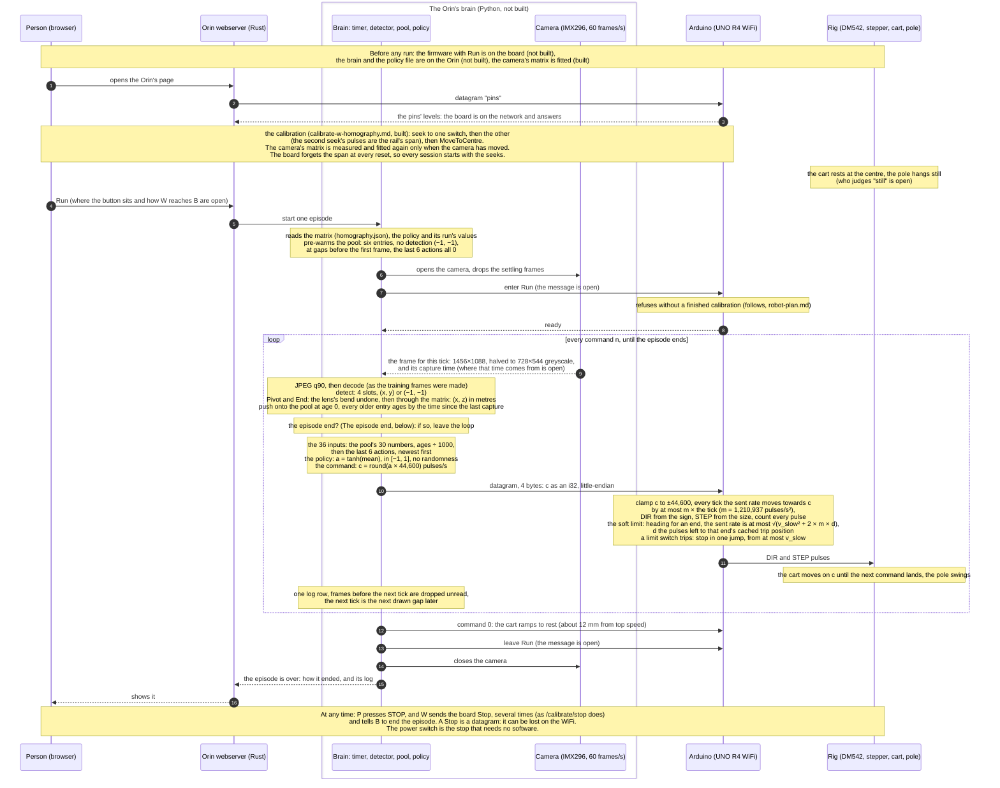

# Real loop: the sequence of one run on the rig (planned)

A policy trained in the synthetic loop is only worth having if the real
robot can run it. This diagram shows how one frame travels on the real rig:
from the camera, through the detector and the trained policy on the Orin, to
the Arduino and the motor. It is the real counterpart of
`synthetic-loop-dia.md`, and it is a **plan**: most of it is not built
(*What exists today*, at the end).

The **policy** is the small neural network that training produced: it reads
36 numbers and answers with one, the command for the cart. On the rig nothing
learns. The policy is fixed, and the run only uses it.

Every statement below is marked by where it stands:

- **Decided**: the user's decision, with its date and the record it is in.
- **Follows**: a consequence of decided things or of measured facts, with
  the sources.
- **Proposed**: the agent's suggestion, not decided.
- **Open**: not decided, and nothing proposes an answer yet.

## The participants

The synthetic loop's participants each stand in for something real
(`AGENTS.md`, *The real robot*). Here are the real things:

| In the synthetic loop | On the rig | What it is |
|---|---|---|
| Orchestrator | nothing (its timer moves into the Orin's brain) | The orchestrator stood in for the physical world. On the rig the world is real, and the Orin runs the command timer itself (decided, `AGENTS.md`, 2026-10-30). |
| MuJoCo | the rig | The DM542 driver, the stepper, the belt, the cart and the pole. |
| Unity player | the camera | The Pi Global Shutter Camera (IMX296) on the Orin, its frame halved to 728×544 greyscale. |
| Synthetic Orin | the Orin's brain | Python on the Jetson Orin Nano Super: camera, detector, the pool and, here, also the policy (decided, `AGENTS.md`). |
| Synthetic Arduino | the Arduino | The UNO R4 WiFi and its firmware. |
| Trainer | nothing | Training happens only in the synthetic loop (`AGENTS.md`). The trained policy runs inside the brain. |

Two more take part on the rig:

- **The person:** someone at the rig with a browser. They start and stop
  each run and can stop the cart at any time. They also have the rig's power
  switch, the only stop that needs no software (the firmware's README, *To
  stop a move*: "don't rely on it in place of the e-stop").
- **The Orin's webserver:** the Rust program in
  `__live__/orin/rust/crates/webserver`, at `http://192.168.0.215:8080`. It
  serves the pages and passes the person's buttons on to the Arduino and the
  Orin's Python. It already does this for the calibration
  (`__live__/orin/rust/README.md`, *Server routes*).

**The brain** is this diagram's name for the program on the Orin that
runs the loop. `robot-plan.md` calls it the `RobotBrain` mode (user,
2026-10-29). It does not exist yet.

## Timing

**The brain alone decides when a frame happens** (decided, `AGENTS.md`,
2026-10-30: "on the rig the Orin runs this timer itself"). The policy
trained on one command every 33.3–50 ms, a rate drawn between 20 and 30 Hz
(`gym.toml` `[env]`). Nothing happens between commands: the policy only ever
saw the frames it acted on (`synthetic-loop-dia.md`, *Nothing happens
between commands*). So on the rig, frames that arrive between two commands
are dropped unread, and the pool is filled only from the frames the brain
acts on (follows, `robot-plan.md`).

**Open: whether the rig draws its rate.** The synthetic loop draws a new
rate for every command, because the policy has to cope with any gap in the
band. Any gap inside 33.3–50 ms is one the policy has seen, so a fixed rate
inside the band would also do. Neither is decided.

**Follows: the camera's own clock.** The camera runs by itself at 60 frames
a second, a frame every 16.7 ms (`__live__/orin/python/settings.toml`
`[camera]`, mode 0). A command can only use a frame that exists, so the gaps
between the frames the brain uses are whole numbers of frames: 33.3 ms (2
frames) or 50 ms (3 frames) inside the trained band. The synthetic loop has
the same kind of grid, but finer: its gaps sit on MuJoCo's 2 ms step.
**Open:** how a drawn gap becomes a frame (the next frame after the drawn
time, or the nearest one), and whether the camera can be triggered instead.

**The delay D** is the time from the moment a frame is exposed to the moment
its command reaches the Arduino. It is made of the camera's transfer, the
halving and JPEG round trip, the detection, the policy, and the WiFi hop
(follows, `robot-plan.md`). The policy trained with 8–15 ms
(`__synthetic__/trainer/python/settings.toml`, `rnd_delay_min` and
`rnd_delay_max`), which was the detection alone. On the Orin the whole Python
detection path, decoding included, measured 11.9–14.5 ms (`detector-plan.md`,
*Results*), so anything added to it puts D at the top of the trained band or
past it. **Open:** D is not measured (*Measuring D*). If it lies outside 8–15
ms, the band in `settings.toml` is set to the measured one and the policy is
trained again (`robot-plan.md`).

## The sequence

## The calibration on the rig

**Built and decided** (`calibrate-w-homography.md`, *The calibration sequence*,
user 2026-10-31 and 2026-11-01). The detector gives pixels, and the policy
needs metres. A **homography** is a matrix of nine numbers that turns a
pixel into a point in metres in the plane the pole swings in. The person runs
it from `http://192.168.0.215:8080/calibrate`:

1. Seek to one limit switch, then to the other. The second seek's pulse count
   is the rail's **span**, the distance between the switches. Half of it
   measured 29,910 pulses on 2026-11-01 (`__live__/orin/rust/settings.toml`,
   `half_span_pulses`).
2. Send the cart to the centre: half the span from the switch.
3. At each of the three stops, measure Pivot and End over many frames. With
   the gaps typed in by hand, fit the matrix and the lens number, and store
   them in `homography.json`.

**Follows: the metres are MuJoCo's.** The live fit places its points with
the MJCF's own numbers: the walls at `10-Left-Rail.Site` and
`12-Right-Rail.Site`, Pivot's height 0.082 m, the pole 0.450 m
(`calibrate-w-homography.md`, *Settings*). The synthetic calibration measures
in MuJoCo's frame too. So both give `x` along the rail, positive to the right
as the camera sees it, and `z` up, which is the frame the policy learned in.
This has not been checked against a frame from the rig.

**Follows: the seeks start every session.** The board forgets the span at
every reset, so the seeks and the move to the centre come before every
session. The matrix is kept until the camera moves (the live README: "measure
all three again after moving it").

## The policy on the Orin

**What the policy is.** Training used SAC (Soft Actor-Critic). It trains two
kinds of network: the **actor**, which picks the command, and the
**critics**, which only teach the actor during training. The rig needs the
actor alone: 36 inputs, two hidden layers of 256 (`gym.toml` `[sac]
net_arch`), and one output.

**No randomness on the rig** (follows). In training, SAC picks each command at
random from a bell curve around the actor's best guess, so that it explores.
On the rig the actor gives its best guess every time: a = tanh(mean), where
`mean` is the middle of the bell curve and tanh squeezes it into [−1, 1]. In
Stable-Baselines3 this is `predict(observation, deterministic=True)`.

**Open: how the policy reaches the Orin** (`trainer-plan.md`, *Not decided by the diagram*).
**Proposed:** save the actor's weights to a numpy file, then work out the action
with numpy on the Orin. The actor is two matrix multiplications, so the Orin
needs no PyTorch. That matters because installing anything needs the user's
permission (`AGENTS.md`, *Python policy*).

**Proposed: the run's values come from the trained run.** Some values must be
the ones the policy trained with:

- the top pulse rate, 44,600 pulses/s;
- the age unit, 1,000 ms;
- the 6 past commands;
- the command band, 20–30 Hz.

All four are in the run's manifest, `runs/<run>/latest.json` (`run_values` and
`gym_toml`). If the brain reads them from the copy shipped beside the weights,
they cannot drift from what the policy learned. 44,600 is the 24 V row of
`motor-spec.md` (*The top pulse rate per supply*): 0.669 m/s at 15 µm a pulse,
the rig's supply today.

## The pool on the rig

The **pool** is the policy's memory of what the camera saw: the last 6 frames,
each with its age and Pivot's and End's positions. It is the same contract as
in the synthetic loop (`synthetic-loop-dia.md`, *Contracts*), with two
differences at the edge.

- **Each entry:** its age in ms (0 for the newest, negative before it), then
  Pivot's (x, z) and End's (x, z) in metres, or (−1, −1) for a marker not
  found. Left and Right are not in the pool. They sit behind the pole's
  plane, so the matrix does not fit them, and they never move
  (`synthetic-loop-dia.md`, *Each frame*).
- **The 36 inputs:** the pool's 30 numbers with every age divided by 1,000,
  so in seconds, then the actions of the last 6 commands, newest first, 0
  before the episode's first (`observations/pool_and_commands.py`). On the
  rig the brain sends the commands, so it has them.
- **Difference 1, the ages come from the camera's capture times**, not from
  MuJoCo's clock (follows, `robot-plan.md`, *To cover*). **Open:** where
  that time comes from. `camera.py` reads raw frames down a pipe and carries no
  time. The camera software's own timestamp is the candidate, and the Orin's
  clock when a frame arrives is the fallback.
- **Difference 2, the frame comes from the camera.** It is halved from
  1456×1088 to 728×544 greyscale, then encoded as JPEG quality 90 and decoded
  again (`__live__/orin/python/settings.toml` `[stream]`), so the detector gets
  what it was trained on. The detector found all four markers in 120 of 120
  real frames on 2026-11-01 (`__live__/orin/python/README.md`).
- **The pre-warm and the failed frames are as in the synthetic loop.** Before
  the first frame, six entries have no detection. 3 failed frames among the 6
  end the episode.

## The command and the Arduino's Run

**The command** is the same as in the synthetic loop (`synthetic-loop-dia.md`,
*Contracts*). It is one `i32` in pulses per second, sign = direction, sent as
4 little-endian bytes in one UDP datagram to `192.168.0.220`, port 4210
(`__live__/README.md`).

**What the board does with it** is the rule the synthetic Arduino already
follows (`__synthetic__/orchestrator/rust/crates/arduino`, `Ramp`). The two are
kept apart, so the rule is copied and not shared (decided, `AGENTS.md`,
2026-11-01):

- the command is clamped to ±44,600;
- every tick, the **sent rate** (the rate STEP actually runs at) moves
  towards the command by at most m × the tick, rounded down. m is the **jump
  limit**, 1,210,937 pulses/s², about 18.2 m/s² of cart, measured on the rig
  (`jump-limit-results.md`; decided 2026-10-28);
- DIR comes from the sign, STEP's rate from the size.

It is one fixed rule per tick, because the Uno makes as few decisions as
possible (decided, `AGENTS.md`, 2026-10-28).

**Follows: the board's edge, which the synthetic Arduino never had** (its
crate's header; `robot-plan.md`, *To cover*):

- **STEP from the hardware timer.** The board's GPT timer makes each pulse
  from whole ticks of 48 MHz (`synthetic-arduino-plan.md`, *The board and the
  top rate*), and `unor4-hal` needs a rate change while running and a pulse
  count.
- **A pulse count**, so the board knows where the cart is between the two
  switches' trip positions, which the seeks measured and the board keeps.
  This is why Run needs a finished calibration (`robot-plan.md`).
- **The interrupt bridge:** the board sleeps until a datagram arrives and is
  never polled (decided, `AGENTS.md`, 2026-10-31).

**The soft limit** (decided, user 2026-11-02). The cart may reach a limit
switch during a live run, but only slowly, never at top speed. The board does
this on its own from its pulse count, so neither the camera nor the WiFi can
make it late. Every tick, while the cart is moving towards an end, the sent
rate is capped at

  v_cap = √(v_slow² + 2 × m × d)

- **v_cap:** the fastest the cart may go now, in pulses/s;
- **v_slow:** the speed at which the cart may meet a switch, in pulses/s;
- **m:** the jump limit, 1,210,937 pulses/s²;
- **d:** the pulses left to that end's cached trip position.

This is the curve along which the ramp, braking as hard as m allows, arrives at
the switch at exactly v_slow. Moving away from an end is never capped. It is
one fixed rule per tick, as the Uno's rules must be (`AGENTS.md`, *The real
robot*). v_slow is a value in the firmware's toml (`AGENTS.md`: tunable values
live in a toml).

- **Proposed: v_slow = `seek_speed`, 2,000 pulses/s (30 mm/s).** The seeks
  already meet the switches at that speed and stop in one jump, and
  `calibration.toml` gives the reason this is safe: "a jump that small cannot
  make the motor slip".
- **Follows: where the slow-down starts.** From the top speed, (44,600² −
  2,000²) ÷ (2 × 1,210,937) = 820 pulses before the trip, 12.3 mm. A switch
  trips about 5 mm from its base (`__synthetic__/trainer/python/settings.toml`,
  `calibration_stop_gap`), so the slow-down begins about 17 mm from the base.
  That is inside the brain's 46 mm episode end (*The episode end*), so a normal
  episode ends before the policy meets the cap. The synthetic Arduino has no cap,
  so the policy has never felt it.
- **Follows: the switch is the final stop.** A switch tripping during Run
  stops the cart in one jump, as in a seek, from at most v_slow.

**Open:**

- **The tick's length on the board.** The synthetic loop ticks every 2 ms,
  MuJoCo's step. At 2 ms, m × the tick is 2,421 pulses/s.
- **DIR's level for a positive command.** A positive command must move the
  cart to the right as the camera sees it (`robot-plan.md`, *Terms*). The user
  chose a Left / Right toggle that sets it at run time (`robot-plan.md`, user
  2026-10-29). The calibration firmware's `[idler]` and `[motor]` guesses have
  not been checked on the rig.
- **The messages that enter and leave Run.** One fact constrains them:
  `Stop` is 4 bytes long, the same length as a command. As an `i32` it reads
  1,886,352,467, which the clamp would turn into full speed to the right. So
  during Run the board cannot tell `Stop` from a command by length alone.
- **What the board does when commands stop coming** (the Orin crashes, or the
  WiFi drops). Today the board would hold the last command until the soft
  limit slowed the cart and the switch stopped it.
- **What STOP can stop during Run** (`robot-plan.md`, *STOP during Run*): if
  the timer makes the pulses, the board can read a datagram without pausing
  them. Not checked on the board.

## The episode start

**Follows: the start pose is the synthetic one.** Every synthetic episode
starts with the cart at rest at the centre and the pole hanging still (θ = 0,
user 2026-10-24). The policy has only ever started from there. On the rig:

- **The cart at the centre:** after the seeks, by `MoveToCentre`. **Open:** how
  the cart gets back there after an episode. `MoveToCentre` today answers
  `not_ready` unless the cart rests on a switch, so it needs a seek first, or a
  return to the centre by the pulse count in Run.
- **The pole hanging still:** after an episode it swings for a while.
  **Open:** who judges that it has stopped. In the calibration the person
  steadies the pole by hand (`calibrate-w-homography.md`). The brain could also
  wait until End stops moving in its frames.

**Proposed: one Run press is one episode,** so the person checks the cart and
the pole before each.

## The episode end

The synthetic episode ends when a **strike gap**, the cart's clearance to the
end of the rail, falls under b = 0.046 m, or it is cut off at the **time
limit**, 500 commands (`gym.toml`). On the rig there are no MuJoCo sites to
measure the gap.

**Proposed, the brain's check (the note after 9):** the cart's position is Pivot's `x`
through the matrix. From it and the wall and cart-face numbers the calibration
already holds (`left_wall_x`, `right_wall_x`, `left_face_to_pivot`,
`right_face_to_pivot`), the brain works out the same two gaps and ends the
episode under b. b was chosen for the synthetic loop's longest gap plus its
longest delay, 68 ms at 0.669 m/s. **Follows:** if D turns out longer, b must
grow with it.

**Proposed: the same time limit,** 500 commands, about 20.8 s. The policy has
no clock among its inputs, so the limit is the experiment's choice, not
something the policy needs.

**Also ends the episode:** 3 failed frames in the pool (as in the synthetic
loop); the person's STOP; a limit switch tripping, which stops the cart
(*The soft limit*).

**At every end, the command 0 (12).** The ramp brings the cart to rest. From
the top speed that takes 0.669 ÷ 18.2 = 37 ms and 0.669² ÷ (2 × 18.2) = 12 mm,
inside b.

## The record

**Proposed:** per episode, a folder on the Orin with one line per command:

- the id;
- the capture time;
- the pool;
- the four detected slots in pixels;
- the 36 inputs;
- the action a and the command c;
- how long each part took: detection, policy, and sending.

Also each frame's JPEG, as the synthetic Orin saves them. Nothing on the rig
knows the true state, so unlike the synthetic `states.csv` there is no truth
column. The frames are the only record of what really happened.

## Measuring D

**Open.** The parts on the Orin can be timed with the Orin's own clock: the
frame's arrival, detection, the policy, and the moment the datagram leaves.
The rest cannot:

- the time from exposure to the frame's arrival;
- the WiFi hop;
- the bridge's hop to the board's processor.

Those need either the camera software's exposure time, or a reply from the
board.

## Contracts

- **The frame:** 728×544 greyscale, JPEG quality 90, from the camera's
  1456×1088 halved on each side (`__live__/orin/python/settings.toml`
  `[stream]`; `src/camera.py`). The exposure is locked at 1 ms and the gain at
  8, to keep the swinging End sharp.
- **The detection:** 4 slots in class order, 0 Left (tag 376), 1 Right (596),
  2 Pivot (920), 3 End (937), each a box centre (x, y) normalized to [0, 1]
  or (−1, −1) (`AGENTS.md`, *Verified contracts*; `synthetic-loop-dia.md`,
  *Contracts*).
- **The points:** Pivot and End, (x, z) in metres in the pole's plane, the
  lens's bend undone with the stored number and then through the stored
  matrix (`calibrate-w-homography.md`, *Per frame*), or (−1, −1).
- **The pool:** 6 entries, newest first, each [age_ms, pivot_x, pivot_z,
  end_x, end_z], 30 floats. The ages are from the capture times, 0 for the
  newest.
- **The policy's input:** 36 floats: the pool with ages ÷ 1,000, then the last
  6 actions a, newest first.
- **The policy's output:** a in [−1, 1]; the command c = round(a × 44,600).
- **The command:** one `i32`, pulses/s, sign = direction, 4 bytes
  little-endian, one UDP datagram to `192.168.0.220:4210`. Fixed length, no
  id.
- **The cart speed:** 15 µm per pulse: 96 mm per pulley turn ÷ (200 full steps
  × 32 microsteps) (`__synthetic__/trainer/python/settings.toml` `[drive]`).

## What exists today

| Part | State |
|---|---|
| Camera to 728×544 greyscale frames | built, `__live__/orin/python/src/camera.py` |
| Detector on the Orin | built, 120 of 120 frames with all four markers (2026-11-01) |
| Seeks, centre, Stop on the board | built, `__live__/arduino/rust/crates/calibration` |
| Camera calibration, lens and matrix | built, the `/calibrate` page and `calibrate_service.py` |
| A trained policy | trained in the synthetic loop, run `20261101_163458` (`trainer-observations.md`) |
| The policy file on the Orin | not built; how is open |
| The brain: timer, pool, policy, sender, end checks, record | not built |
| The board's Run: command, ramp, timer, pulse count, soft limit | not built |
| The Run button and how the webserver starts the brain | not built; where it sits is open |
| D measured | not done |

## References

- `synthetic-loop-dia.md`: the synthetic loop, whose contracts this keeps.
- `robot-plan.md`: the user's 2026-10-29 decisions for the two real
  computers. It predates the 2026-11-01 split of live and synthetic code: its
  "one source built two ways" is out of date (`AGENTS.md`).
- `calibrate-w-homography.md`: the camera's calibration and the per-frame
  mapping.
- `synthetic-arduino-plan.md`: the ramp and the board's timer.
- `jump-limit-results.md`: m.
- `motor-spec.md`: the top pulse rate per supply.
- `__live__/README.md` and each part's README: what runs where today.
