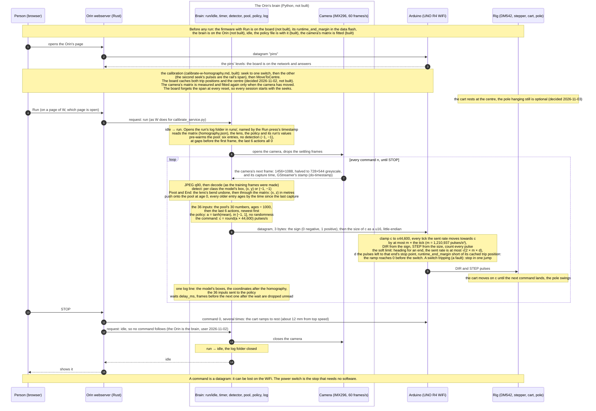

# Real loop: the sequence of one run on the rig (planned)

A policy trained in the synthetic loop is only worth having if the real
robot can run it. This diagram shows how one frame travels on the real rig:
from the camera, through the detector and the trained policy on the Orin, to
the Arduino and the motor. It is the real counterpart of
`synthetic-loop-dia.md`, and it is a **plan**: most of it is not built
(*What exists today*, at the end).

**This diagram is the single source of truth for the real loop** (user,
2026-11-03). Three plans are written from it alone, one per computer:
`real-orin-plan.md` (the brain, the webserver and its pages),
`real-arduino-plan.md` (the board's firmware) and `real-pi-plan.md`
(`arduino-manager`). Where a plan disagrees with this diagram, the diagram is
right and the plan is out of date. A change to the real loop's design lands
here first.

The **policy** is the small neural network that training produced: it reads
36 numbers and answers with one, the command for the cart. On the rig nothing
learns. The policy is fixed, and the run only uses it. **A real run is not a
training run** (user, 2026-11-03): there is no reward and no trainer.

Every statement below is marked by where it stands:

- **Decided**: the user's decision, with its date and the record it is in.
- **Follows**: a consequence of decided things or of measured facts, with
  the sources.
- **Proposed**: the agent's suggestion, not decided.
- **Open**: not decided, and nothing proposes an answer yet.

## The participants

The synthetic loop's participants each stand in for something real
(`AGENTS.md`, *The real robot*). Here are the real things:

| In the synthetic loop | On the rig | What it is |
|---|---|---|
| Orchestrator | nothing (its timer moves into the Orin's brain) | The orchestrator stood in for the physical world. On the rig the world is real, and the Orin runs the command timer itself (decided, `AGENTS.md`, 2026-10-30). |
| MuJoCo | the rig | The DM542 driver, the stepper, the belt, the cart and the pole. |
| Unity player | the camera | The Pi Global Shutter Camera (IMX296) on the Orin, its frame halved to 728×544 greyscale. |
| Synthetic Orin | the Orin's brain | Python on the Jetson Orin Nano Super: camera, detector, the pool and, here, also the policy (decided, `AGENTS.md`). |
| Synthetic Arduino | the Arduino | The UNO R4 WiFi and its firmware. |
| Trainer | nothing | Training happens only in the synthetic loop (`AGENTS.md`). The trained policy runs inside the brain. |

Three more take part on the rig:

- **The person:** someone at the rig with a browser. They start and stop
  each run and can stop the cart at any time. They also have the rig's power
  switch, the only stop that needs no software (the firmware's README, *To
  stop a move*: "don't rely on it in place of the e-stop").
- **The Orin's webserver:** the Rust program in
  `__live__/orin/rust/crates/webserver`, at `http://192.168.0.215:8080`. It
  serves the pages and passes the person's buttons on to the Arduino and the
  Orin's Python. It already does this for the calibration
  (`__live__/orin/rust/README.md`, *Server routes*).
- **The Pi's `arduino-manager`:** the Rust service in
  `__live__/rpi/rust/crates/arduino-manager`, on the Pi plugged into the
  Arduino by USB. It uploads the firmware (`POST /flash`, its README) and,
  once built, the board's settings (*The Uno's settings*). It takes no part in
  a run: the USB cable is kept out while the rig runs (its README: with it in,
  both limit-switch inputs have read open).

**The brain** is this diagram's name for the program on the Orin that
runs the loop. `robot-plan.md` calls it the `RobotBrain` mode (user,
2026-10-29). It does not exist yet.

## Timing

**The brain alone decides when a frame happens** (decided, `AGENTS.md`,
2026-10-30: "on the rig the Orin runs this timer itself"). The policy
trained on one command every 33.3–50 ms, a rate drawn between 20 and 30 Hz
(`gym.toml` `[env]`). Nothing happens between commands: the policy only ever
saw the frames it acted on (`synthetic-loop-dia.md`, *Nothing happens
between commands*). So on the rig, frames that arrive between two commands
are dropped unread, and the pool is filled only from the frames the brain
acts on (follows, `robot-plan.md`).

**Decided: the wait after each command is a setting** (user, 2026-11-02).
The brain takes an image, gets the points from detection, builds the inputs,
asks the policy for a command and sends it at once. Then it waits `delay_ms`
(`__live__/orin/python/settings.toml` `[brain]`, 0 by default) before taking
the next image. At 0 the loop runs as fast as the Orin can, about one command
per camera frame; the policy trained with 33.3–50 ms between commands.

**Follows: the camera's own clock.** The camera runs by itself at 60 frames
a second, a frame every 16.7 ms (`__live__/orin/python/settings.toml`
`[camera]`, mode 0). A command can only use a frame that exists, so the gaps
between the frames the brain uses are whole numbers of frames: 33.3 ms (2
frames) or 50 ms (3 frames) inside the trained band. The synthetic loop has
the same kind of grid, but finer: its gaps sit on MuJoCo's 2 ms step.
**Follows:** the next image is the camera's next frame after the wait.
**Decided: the camera is not triggered** (user, 2026-11-04). It free-runs at
60 frames a second, so each gap between commands is a whole number of frames.
Triggering it would need a change soldered onto the camera's board (the XTR
pad, with resistor R11 removed; Raspberry Pi's Global Shutter Camera
documentation), and no source shows the trigger working on the Orin's camera
software.

**The delay D** is the time from the moment a frame is exposed to the moment
its command reaches the Arduino. It is made of the camera's transfer, the
halving and JPEG round trip, the detection, the policy, and the WiFi hop
(follows, `robot-plan.md`). The policy trained with 8–15 ms
(`__synthetic__/trainer/python/settings.toml`, `rnd_delay_min` and
`rnd_delay_max`), which was the detection alone. On the Orin the whole Python
detection path, decoding included, measured 11.9–14.5 ms (`detector-plan.md`,
*Results*), so anything added to it puts D at the top of the trained band or
past it. **Open:** D is not measured (*Measuring D*). If it lies outside 8–15
ms, the band in `settings.toml` is set to the measured one and the policy is
trained again (`robot-plan.md`).

## The sequence

## The run and idle states

**Decided: the brain holds a run/idle state** (user, 2026-11-03). A page on
the Orin's webserver sends it requests to change state, as the webserver
already does for `calibrate_service.py`: the webserver forwards the page's
request to the Python program on the Orin's own address
(`__live__/orin/rust/crates/webserver/src/live.rs`, `measure::forward`).

**Decided: "Run means RUN and do not stop until stop is requested"** (user,
2026-11-03). One Run press starts one run, and only STOP ends it. There is no
time limit, and no episodes inside a run.

**Decided: the gap to the rail's ends is a Uno guardrail, not a run-ending
event** (user, 2026-11-03). The brain does not measure it and ends nothing on
it; the board's soft limit keeps the cart from the switches (*The soft limit*).

**Follows: what no longer ends a run.** The synthetic loop's ends are not the
rig's:

- **The strike gap** (b = 0.046 m in training): not checked on the rig, by the
  decision above.
- **The time limit** (500 commands in training, `gym.toml` `[env]
  max_episode_steps`): none, by the decision above. The policy has no clock
  among its inputs, so it needs none.
- **Failed frames:** in the synthetic loop, 3 failed frames among the pool's 6
  fail the whole run (`__synthetic__/orin/python/src/synthetic_orin.py`, the
  rules). On the rig a failed frame's entry is (−1, −1), as in the synthetic
  loop, and the run goes on until STOP.

**Follows: STOP is the only way out of run.** The webserver sends the board
the command 0 several times, since a datagram can be lost, and asks the brain
for idle. The brain sends no command after it is idle.

**Open:**

- **Which page carries Run and STOP.**
- **Whether the brain is its own program or part of `calibrate_service.py`.**
  The service runs the camera for the live view, the lens measurement and the
  calibration's measurements, and keeps them from using it together (its
  routes, `live.rs`'s header). The brain needs the camera too.

## The calibration on the rig

**Built and decided** (`calibrate-w-homography.md`, *The calibration sequence*,
user 2026-10-31 and 2026-11-01). The detector gives pixels, and the policy
needs metres. A **homography** is a matrix of nine numbers that turns a
pixel into a point in metres in the plane the pole swings in. The person runs
it from `http://192.168.0.215:8080/calibrate`:

1. Seek to one limit switch, then to the other. The second seek's pulse count
   is the rail's **span**, the distance between the switches. Half of it
   measured 29,910 pulses on 2026-11-01 (`__live__/orin/rust/settings.toml`,
   `half_span_pulses`).
2. Send the cart to the centre: half the span from the switch.
3. At each of the three stops, measure Pivot and End over many frames. With
   the gaps typed in by hand, fit the matrix and the lens number, and store
   them in `homography.json`.

**Follows: the metres are MuJoCo's.** The live fit places its points with
the MJCF's own numbers: the walls at `10-Left-Rail.Site` and
`12-Right-Rail.Site`, Pivot's height 0.082 m, the pole 0.450 m
(`calibrate-w-homography.md`, *Settings*). The synthetic calibration measures
in MuJoCo's frame too. So both give `x` along the rail, positive to the right
as the camera sees it, and `z` up, which is the frame the policy learned in.
This has not been checked against a frame from the rig.

**Follows: the seeks start every session.** The board forgets the span at
every reset, so the seeks and the move to the centre come before every
session. The matrix is kept until the camera moves (the live README: "measure
all three again after moving it").

## The policy on the Orin

**What the policy is.** Training used SAC (Soft Actor-Critic). It trains two
kinds of network: the **actor**, which picks the command, and the
**critics**, which only teach the actor during training. The rig needs the
actor alone: 36 inputs, two hidden layers of 256 (`gym.toml` `[sac]
net_arch`), and one output.

**No randomness on the rig** (follows). In training, SAC picks each command at
random from a bell curve around the actor's best guess, so that it explores.
On the rig the actor gives its best guess every time: a = tanh(mean), where
`mean` is the middle of the bell curve and tanh squeezes it into [−1, 1]. In
Stable-Baselines3 this is `predict(observation, deterministic=True)`.

**How the policy reaches the Orin: a numpy file** (built as proposed,
2026-11-02, on the user's "build a policy file for the Orin"). The trainer's
`export_policy.py` saves the actor's weights to `policy.npz`, and the Orin works
out the action with numpy (`__live__/orin/python/src/policy.py`; its README, *The
policy*). The actor is three matrix multiplications, so the Orin
needs no PyTorch. That matters because installing anything needs the user's
permission (`AGENTS.md`, *Python policy*).

**Follows: the run's values come from `policy.npz` alone.** Some values must be
the ones the policy trained with:

- the top pulse rate, 44,600 pulses/s;
- the age unit, 1,000 ms;
- the 6 past commands;
- the command band, 20–30 Hz.

`policy.npz` carries all four, copied by the export from the run's manifest,
`runs/<run>/latest.json` (`run_values` and `gym_toml`), and `policy.py` already
loads them (`__live__/orin/python/src/policy.py:44-48`, `:65-66`). So they
cannot drift from what the policy learned. 44,600 is the 24 V row of
`motor-spec.md` (*The top pulse rate per supply*): 0.669 m/s at 15 µm a pulse,
the rig's supply today.

## The pool on the rig

The **pool** is the policy's memory of what the camera saw: the last 6 frames,
each with its age and Pivot's and End's positions. It is the same contract as
in the synthetic loop (`synthetic-loop-dia.md`, *Contracts*), with two
differences at the edge.

- **Each entry:** its age in ms (0 for the newest, negative before it), then
  Pivot's (x, z) and End's (x, z) in metres, or (−1, −1) for a marker not
  found. Left and Right are not in the pool. They sit behind the pole's
  plane, so the matrix does not fit them, and they never move
  (`synthetic-loop-dia.md`, *Each frame*).
- **The 36 inputs:** the pool's 30 numbers with every age divided by 1,000,
  so in seconds, then the actions of the last 6 commands, newest first, 0
  before the run's first (`observations/pool_and_commands.py`). On the
  rig the brain sends the commands, so it has them.
- **Difference 1, the ages come from GStreamer's timestamp**, not from
  MuJoCo's clock (follows, `robot-plan.md`, *To cover*). **Decided: the brain
  uses GStreamer's timestamp** (`nvarguscamerasrc` with `do-timestamp`), not
  Argus's sensor timestamp (user, 2026-11-03). `do-timestamp` is the Orin's own
  pipeline clock, read just before GStreamer passes the frame on, so it is not
  the moment of exposure. **Follows:** `camera.py` must carry that stamp with
  each frame; today it reads raw pixels from `gst-launch-1.0` down a pipe,
  which drops it.
- **Difference 2, the frame comes from the camera.** It is halved from
  1456×1088 to 728×544 greyscale, then encoded as JPEG quality 90 and decoded
  again (`__live__/orin/python/settings.toml` `[stream]`), so the detector gets
  what it was trained on. The detector found all four markers in 120 of 120
  real frames on 2026-11-01 (`__live__/orin/python/README.md`).
- **The pre-warm is as in the synthetic loop.** Before the first frame, six
  entries have no detection. A failed frame is an entry of (−1, −1) and ends
  nothing (*The run and idle states*).

## The command and the Arduino's Run

**The command** is the same value as in the synthetic loop
(`synthetic-loop-dia.md`, *Contracts*): a pulse rate in pulses per second,
its sign the direction. Only how it is packed differs on the rig.

**Decided: the command is 3 bytes** (user, 2026-11-03), one UDP datagram to
`192.168.0.220`, port 4210 (`__live__/README.md`):

| Byte | Holds |
|---|---|
| 0 | the sign: 0 negative, 1 positive |
| 1–2 | the rate's size, a `u16` (0 to 65,535), little-endian |

- **Why 3 bytes:** the board tells a command from its text messages by
  length alone. No text message is 3 bytes: `pins` and `Stop` are 4,
  `MoveToCentre` 12, the two seeks 25 (`__live__/arduino/rust/crates/calibration/src/constants.rs`).
  The 4-byte `i32` it replaces could not be told from `pins` or `Stop`, each
  of which reads as full speed to the right.
- **Why a `u16` is enough** (follows): its 65,535 is above every supply's top
  pulse rate in `motor-spec.md`, *The top pulse rate per supply*: 22,266 at
  12 V, 44,600 at 24 V, 55,733 at 30 V. The board still clamps to 44,600.
- **A rate of 0 means rest** whatever the sign byte says (follows), as long
  as the sign byte is 0 or 1.
- **Decided: a sign byte other than 0 or 1 is a fault** (user, 2026-11-06).
  By definition it puts the board in FAULT, from any state, whatever the
  size, during a seek or the move to the centre too; a moving cart stops in
  one jump. This adds a second cause to FAULT, beside entering a protected
  end zone, and replaces "ONLY entering the protected end zone is a fault"
  (user, 2026-11-05, `real-open-issues.md`, issue 5).
- The synthetic loop keeps its 4-byte `i32`. The policy never sees how the
  command is packed, so the change needs no new training (follows).

**What the board does with it** is the rule the synthetic Arduino already
follows (`__synthetic__/orchestrator/rust/crates/arduino`, `Ramp`). The two are
kept apart, so the rule is copied and not shared (decided, `AGENTS.md`,
2026-11-01):

- the command is clamped to ±44,600;
- every tick, the **sent rate** (the rate STEP actually runs at) moves
  towards the command by at most m × the tick, rounded down. m is the **jump
  limit**, 1,210,937 pulses/s², about 18.2 m/s² of cart, measured on the rig
  (`jump-limit-results.md`; decided 2026-10-28);
- DIR comes from the sign, STEP's rate from the size.

**Decided: m is configurable** (user, 2026-11-03). It is a firmware setting in
`calibration.toml`, compiled in like the firmware's other values (the board has
no file system), not a constant in code. **Follows:** it must equal the m the
policy trained with, the trainer's `[drive] jump_limit`
(`__synthetic__/trainer/python/settings.toml`, 1,210,937 today). Changed on the
board alone, the cart ramps differently from training; changed in both, the
policy is trained again. Nothing in `unor4-hal` depends on its value: the
firmware works out each tick's rate from it.

It is one fixed rule per tick, because the Uno makes as few decisions as
possible (decided, `AGENTS.md`, 2026-10-28).

**Decided: the board ticks every 2 ms** (user, 2026-11-03: "If it trained on
2ms, then make it 2ms"). The synthetic loop ticks the ramp once per MuJoCo
step, 2 ms (`synthetic-arduino-plan.md`, A7), so the board ramps as the policy
learned. **Follows:** each tick moves the sent rate by at most m × 2 ms =
1,210,937 × 0.002 = 2,421 pulses/s, rounded down.

**Decided: the board does not know whether a run is going** (user,
2026-11-02: "Orin is the brain, uno is the dumb muscle"). There is no message
to enter or leave a run: the board applies each command as it arrives, and the
command 0 brings the cart to rest. **Follows: STOP during a run sends the
command 0,** not the text `Stop`: the board has no run to stop, and `Stop`
ends only a seek or a move to the centre.

**One firmware holds the seeks and Run** (follows). Every session starts with
the seeks (*The calibration on the rig*), and the USB cable that uploads
firmware is kept out while the rig runs, so the firmware on the board during a
run is the one that did the seeks. Today that is the `calibration` firmware
(`__live__/arduino/rust/crates/calibration`).

**Follows: the board's edge, which the synthetic Arduino never had** (its
crate's header; `robot-plan.md`, *To cover*):

- **STEP from the hardware timer.** The board's GPT timer makes each pulse
  from whole ticks of 48 MHz (`synthetic-arduino-plan.md`, *The board and the
  top rate*), and `unor4-hal` needs a rate change while running and a pulse
  count.
- **A pulse count**, so the board knows where the cart is between the two
  switches' trip positions, which the seeks measured and the board keeps.
  This is why Run needs a finished calibration (`robot-plan.md`).
- **The interrupt bridge:** the board sleeps until a datagram arrives and is
  never polled (decided, `AGENTS.md`, 2026-10-31).

**The soft limit** (decided, user 2026-11-02 and 2026-11-03). During a balance
run the Uno never lets the cart hit a limit switch: it forces a ramp to zero
before the cart reaches one, using the cached positions of each end of the rail
and its count of every pulse ("a software ramp to zero as the cart approaches",
user 2026-11-02; 2026-11-03: the Uno is responsible for it). The board does this
on its own, so neither the camera nor the WiFi can make it late. Every tick,
while the cart is moving towards an end, the sent rate is capped at

  v_cap = √(2 × m × d)

- **v_cap:** the fastest the cart may go now, in pulses/s;
- **m:** the jump limit, 1,210,937 pulses/s²;
- **d:** the pulses left to that end's **stop point**, `runtime_end_margin`
  pulses short of the end's cached trip position; 0 once the cart is there.

This is the curve along which the ramp, braking as hard as m allows, reaches 0
exactly at the stop point, so the switch is never reached. Moving away from an
end is never capped. It is one fixed rule per tick, as the Uno's rules must be
(`AGENTS.md`, *The real robot*).

**Decided: `runtime_end_margin`** (user, 2026-11-03) is the soft limit's gap,
in pulses, short of each switch's cached trip position. It is set from an
Arduino Settings page on the Orin's webserver and saved in the Uno's data
flash, so it survives a reset (*The Uno's settings*). It is the only setting
handled this way for now. It binds balance runs only: calibration's seeks must
violate it to reach the switches. **Open:** its value, found on the rig
through the settings page.

- **Follows: where the slow-down starts.** From the top speed, 44,600² ÷
  (2 × 1,210,937) = 821 pulses before the stop point, 12.3 mm, plus
  `runtime_end_margin` before the trip. A switch trips about 5 mm from its base
  (`__synthetic__/trainer/python/settings.toml`, `calibration_stop_gap`). With
  no margin the slow-down begins about 17 mm from the base.
- **Follows: the policy will meet the cap.** In training an episode ended at
  b = 0.046 m from a base, before the slow-down began, and the synthetic
  Arduino has no cap. On the rig nothing ends a run at the gap (*The run and
  idle states*), so near an end the cart answers the policy's commands more
  slowly than it ever has.
- **Follows: the switch stays the last stop, for a fault** (lost pulses, a
  wrong cache). A switch tripping during a run stops the cart in one jump, as
  in a seek.

**Decided: DIR's level for a positive command is D5 low.** A positive command
must move the cart to the right as the camera sees it, towards the motor's end
(`robot-plan.md`, *Terms*). The level is compiled into the firmware from a
settings file, `dir_positive` in the controller's `config/stepper.toml`, in
place of the Left / Right toggle at run time chosen on 2026-10-29 (user,
2026-11-05, `real-open-issues.md`, issue 4). Low is the level the user always
intended (user, 2026-11-06), and the rig agrees: on 2026-11-06 the idler's
seek, a negative rate, ran with D5 low and the cart went to the motor's end.

**Open:**

- **What the board does when commands stop coming** (the Orin crashes, or the
  WiFi drops). Today's rule would hold the last command until the soft
  limit brought the cart to rest at a stop point.
- **Whether a command reaches the board during a fast move** (`robot-plan.md`,
  *STOP during Run*): if the timer makes the pulses, the board can read a
  datagram without pausing them. Not checked on the board.
- **What the board does with a command after a switch has tripped**, and with
  a command before a calibration has cached the trip positions, when there is
  no soft limit to apply.

## The Uno's settings

**Decided** (user, 2026-11-03): `runtime_end_margin` is held in the Uno's data
flash, set from an Arduino Settings page on the Orin's webserver, and it is the
only setting handled this way for now (*The soft limit*). **Decided:
`arduino-manager` gains three options:**

- pull the settings the Uno holds now;
- upload firmware and settings;
- upload firmware only, leaving the saved settings in flash alone.

**The data flash, as `unor4-hal` reports it** (its reply on current main,
pasted by the user on 2026-11-03; the HAL itself was not read):

- `unor4_hal::dflash::DataFlash` writes the data flash: `take(&Clocks)` once
  per boot, then `read`, `blank_check`, `write`, `erase_block` (blocks 0–7),
  `erase_all`. The caller writes no registers. One flash command at a time is
  enforced by the API (`&mut self`).
- Verified on the UNO R4 WiFi on 2026-10-21: program and read back with 0
  mismatches, a second write to a used byte refused (`NotBlank`), data kept
  across resets, and a firmware upload (`arduino-cli upload`) left the data
  flash intact.
- For the firmware: a byte is written once per erase of its 1 KB block; every
  call blocks for its whole run (measured: 1,024 bytes in 44 ms, one block
  erase in 6 ms); after a power loss or reset during a write or erase, erase
  that area again before trusting it; test erased bytes with `blank_check()`,
  not `read()`.
- Not yet run in the HAL: retention across power-off. Still to test on the
  rig: `arduino-manager`'s firmware-only upload keeping the settings.

**Follows: a setting is changed only when no run is going.** A write blocks the
board for its whole run (44 ms for a block, plus 6 ms to erase it), and while it
blocks the board makes no ramp step.

**Follows: `arduino-manager` reaches the board only by USB**, which is kept out
while the rig runs, so its three options are used with the rig idle.

**Open:**

- **The messages** that set and read `runtime_end_margin` over WiFi, and how the
  board answers them.
- **How `arduino-manager` pulls and uploads the settings.** It speaks to the
  board over the USB serial line; the `calibration` firmware speaks no command
  protocol there today (the manager's README, *What it still needs*).
- **What the board uses when the data flash holds no setting** (a blank flash,
  or one erased by a reset during a write).

## The log

**Decided** (user, 2026-11-03): each real run is logged on the Orin, in a
`runs` directory, one folder per run named by the timestamp of the Run press.
It holds, per frame:

- the raw boxes that come from the object detection model;
- the coordinates after the homography;
- the array sent to the policy.

Nothing on the rig knows the true state, so unlike the synthetic record there
is no truth in it (follows).

**Open:** the log's file format, and the timestamp's form in the folder name.

## Measuring D

**Open.** The parts on the Orin can be timed with the Orin's own clock: the
frame's arrival, detection, the policy, and the moment the datagram leaves.
The rest cannot:

- the time from exposure to the frame's arrival;
- the WiFi hop;
- the bridge's hop to the board's processor.

Those need either the camera software's exposure time, or a reply from the
board.

**Measured: the WiFi round trip** (2026-11-02, `__live__/orin/python/README.md`,
*The WiFi round trip to the Arduino*). The board's `pins` answer, 1,000 times:
median 33.0 ms, 99% within 112.5 ms, 4.2% lost. It is an upper bound for a
command's hop to the board. Pings put the delay at the board's WiFi chip (3.5–125
ms) and not the Orin's side (1.1–2.4 ms to the router).

**Future feature, not now (user, 2026-11-02): turn off the WiFi chip's power
saving.** The bridge firmware (`D:\git\unor4-wifi-interrupt-bridge`, branch
`feature/interrupt`) never sets it, so the chip keeps the ESP32 library's
default, `WIFI_PS_MIN_MODEM`: its radio sleeps between the router's beacons. The
feature is a call to `WiFi.setSleep(false)` in the bridge (or an AT command for
it), the bridge flashed again, and `wifi_round_trip.py` and the pings run again
to show whether the delay and the losses came from the sleep.

## Contracts

- **The frame:** 728×544 greyscale, JPEG quality 90, from the camera's
  1456×1088 halved on each side (`__live__/orin/python/settings.toml`
  `[stream]`; `src/camera.py`). The exposure is locked at 1 ms and the gain at
  18 dB (`gain = 180`), to keep the swinging End sharp. Each frame carries
  GStreamer's timestamp.
- **The detection:** 4 slots in class order, 0 Left (tag 376), 1 Right (596),
  2 Pivot (920), 3 End (937), each a box centre (x, y) normalized to [0, 1]
  or (−1, −1) (`AGENTS.md`, *Verified contracts*; `synthetic-loop-dia.md`,
  *Contracts*).
- **The points:** Pivot and End, (x, z) in metres in the pole's plane, the
  lens's bend undone with the stored lens calibration and then through the
  stored matrix (`calibrate-w-homography.md`, *Per frame*), or (−1, −1).
- **The pool:** 6 entries, newest first, each [age_ms, pivot_x, pivot_z,
  end_x, end_z], 30 floats. The ages are from the capture times, 0 for the
  newest.
- **The policy's input:** 36 floats: the pool with ages ÷ 1,000, then the last
  6 actions a, newest first.
- **The policy's output:** a in [−1, 1]; the command c = round(a × 44,600).
- **The command:** 3 bytes, one UDP datagram to `192.168.0.220:4210`: byte 0
  the sign (0 negative, 1 positive), bytes 1–2 the rate's size in pulses/s as
  a `u16`, little-endian. Fixed length, no id; no text message is 3 bytes.
- **`runtime_end_margin`:** pulses, in the Uno's data flash.
- **The log:** `runs/<the Run press's timestamp>/` on the Orin; per frame the
  model's boxes, the coordinates after the homography and the 36 inputs.
- **The cart speed:** 15 µm per pulse: 96 mm per pulley turn ÷ (200 full steps
  × 32 microsteps) (`__synthetic__/trainer/python/settings.toml` `[drive]`).

## What exists today

| Part | State |
|---|---|
| Camera to 728×544 greyscale frames | built, `__live__/orin/python/src/camera.py`; it does not carry GStreamer's stamp |
| Detector on the Orin | built, 120 of 120 frames with all four markers (2026-11-01) |
| Seeks, centre, Stop on the board | built, `__live__/arduino/rust/crates/calibration` |
| Camera calibration, lens and matrix | built, the `/calibrate` and `/lens` pages and `calibrate_service.py` |
| A trained policy | trained in the synthetic loop, run `20261101_163458` (`trainer-observations.md`) |
| The policy file | built on the PC, the numpy file, `__live__/orin/python/saved/policy.npz` with `src/policy.py` (2026-11-02); goes to the Orin with the folder |
| The brain: run/idle, timer, pool, policy, sender, log | not built (`real-orin-plan.md`) |
| The Run and STOP buttons and how the webserver reaches the brain | not built; which page is open (`real-orin-plan.md`) |
| The Arduino Settings page | not built (`real-orin-plan.md`) |
| The board's Run: command, ramp, timer, pulse count, cached rail, soft limit | not built (`real-arduino-plan.md`) |
| `runtime_end_margin` in the Uno's data flash | not built (`real-arduino-plan.md`) |
| `arduino-manager`'s three settings options | not built (`real-pi-plan.md`) |
| D measured | not done |

## References

- `real-orin-plan.md`, `real-arduino-plan.md`, `real-pi-plan.md`: the plans
  written from this diagram, one per computer.
- `synthetic-loop-dia.md`: the synthetic loop, whose contracts this keeps.
- `robot-plan.md`: the user's 2026-10-29 decisions for the two real
  computers. It predates the 2026-11-01 split of live and synthetic code: its
  "one source built two ways" is out of date (`AGENTS.md`).
- `calibrate-w-homography.md`: the camera's calibration and the per-frame
  mapping.
- `synthetic-arduino-plan.md`: the ramp and the board's timer.
- `jump-limit-results.md`: m.
- `motor-spec.md`: the top pulse rate per supply.
- `__live__/README.md` and each part's README: what runs where today.
