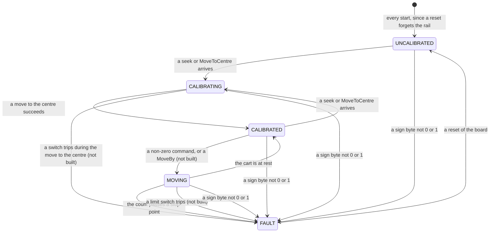

# Real loop: the sequence of one run on the rig (planned)

A policy trained in the synthetic loop is only worth having if the real
robot can run it. This diagram shows how one frame travels on the real rig:
from the camera, through the detector and the trained policy on the Orin, to
the Arduino and the motor. It is the real counterpart of
`synthetic-loop-dia.md`, and it is a **plan**: most of it is not built
(*What exists today*, at the end).

**This diagram is the single source of truth for the real loop** (user,
2026-11-03). Three plans are written from it alone, one per computer:
`real-orin-plan.md` (the brain, the webserver and its pages),
`real-arduino-plan.md` (the board's firmware) and `real-pi-plan.md`
(`arduino-manager`). Where a plan disagrees with this diagram, the diagram is
right and the plan is out of date. A change to the real loop's design lands
here first.

The **policy** is the small neural network that training produced: it reads
36 numbers and answers with one, the command for the cart. On the rig nothing
learns. The policy is fixed, and the run only uses it. **A real run is not a
training run** (user, 2026-11-03): there is no reward and no trainer.

Every statement below is marked by where it stands:

- **Decided**: the user's decision, with its date and the record it is in.
- **Follows**: a consequence of decided things or of measured facts, with
  the sources.
- **Proposed**: the agent's suggestion, not decided.
- **Open**: not decided, and nothing proposes an answer yet.

## The participants

The synthetic loop's participants each stand in for something real
(`AGENTS.md`, *The real robot*). Here are the real things:

| In the synthetic loop | On the rig | What it is |
|---|---|---|
| Orchestrator | nothing (its timer moves into the Orin's brain) | The orchestrator stood in for the physical world. On the rig the world is real, and the Orin runs the command timer itself (decided, `AGENTS.md`, 2026-10-30). |
| MuJoCo | the rig | The DM542 driver, the stepper, the belt, the cart and the pole. |
| Unity player | the camera | The Pi Global Shutter Camera (IMX296) on the Orin, its frame halved to 728×544 greyscale. |
| Synthetic Orin | the Orin's brain | A Rust program on the Jetson Orin Nano Super: camera, the pool and the timer. It calls Python for detection and the policy (decided, `AGENTS.md`; user 2026-11-04, `real-open-issues.md` issue 3). |
| Synthetic Arduino | the Arduino | The UNO R4 WiFi and its firmware. |
| Trainer | nothing | Training happens only in the synthetic loop (`AGENTS.md`). The trained policy runs inside the brain. |

Three more take part on the rig:

- **The person:** someone at the rig with a browser. They start and stop
  each run and can stop the cart at any time. They also have the rig's power
  switch, the only stop that needs no software (the firmware's README, *To
  stop a move*: "don't rely on it in place of the e-stop").
- **The Orin's webserver:** the Rust program in
  `__live__/orin/rust/crates/webserver`, at `http://192.168.0.215:8080`. It
  serves the pages and passes the person's buttons on to the Arduino and the
  Orin's Python. It already does this for the calibration
  (`__live__/orin/rust/README.md`, *Server routes*).
- **The Pi's `arduino-manager`:** the Rust service in
  `__live__/rpi/rust/crates/arduino-manager`, on the Pi plugged into the
  Arduino by USB. It uploads the firmware (`POST /flash`, its README) and,
  once built, the board's settings (*The Uno's settings*). It takes no part in
  a run: the USB cable is kept out while the rig runs (its README: with it in,
  both limit-switch inputs have read open).

**The brain** is this diagram's name for the program on the Orin that
runs the loop. `robot-plan.md` calls it the `RobotBrain` mode (user,
2026-10-29). It is built (2026-11-07) and first ran on the rig on 2026-11-09.
**Decided: the brain is its own program,
a Rust orchestrator** (user, 2026-11-04, `real-open-issues.md` issue 3), a new
crate in `__live__/orin/rust/crates/`. It calls Python only for what has to be
Python or is already built there: finding the markers (detection on the robot
is Python, `AGENTS.md`) and the policy's inference (`policy.py`).

## Timing

**The brain alone decides when a frame happens** (decided, `AGENTS.md`,
2026-10-30: "on the rig the Orin runs this timer itself"). Since 2026-11-08
the policy trains on the rig's own measured timings (`synthetic-loop-dia.md`,
*Timing*; `real-timing-conclusion.md`), each step's drawn from the bands in
`__synthetic__/trainer/python/settings.toml` `[orchestrator]`: the picture is
ready 43–48 ms after its capture (the camera), the command leaves 20.5–27.8 ms
after that (the Orin), it changes the motor 3.6–123.3 ms after that (the WiFi
and the board), and the next picture is the camera's next frame after the
send, 0–16.7 ms later. Before that it trained on one command every 33.3–50 ms,
a rate drawn between 20 and 30 Hz. Nothing happens between commands: the policy only ever
saw the frames it acted on (`synthetic-loop-dia.md`, *Nothing happens
between commands*). So on the rig, frames that arrive between two commands
are dropped unread, and the pool is filled only from the frames the brain
acts on (follows, `robot-plan.md`).

**Decided: the wait after each command is a setting** (user, 2026-11-02).
The brain takes an image, gets the points from detection, builds the inputs,
asks the policy for a command and sends it at once. Then it waits `delay_ms`
(`__live__/orin/rust/settings.toml` `[brain]`, 0 by default; it moved there
from the Python settings with the brain, 2026-11-07) before taking
the next image. At 0 the loop runs as fast as the Orin can, and 0 is what the
policy trains with: its next picture is the camera's next frame after the send
(`next_frame_ready_min` and `next_frame_ready_max`, 0 and 16.7 ms).

**Follows: the camera's own clock.** The camera runs by itself at 60 frames
a second, a frame every 16.7 ms (`__live__/orin/python/settings.toml`
`[camera]`, mode 0). A command can only use a frame that exists, so the gaps
between the frames the brain uses are whole numbers of frames. **Measured on
the rig** (2026-11-09, three runs of the 6M-step policy): 2 frames, 33.3 ms, in
all but 0 to 2 of each run's 219 to 858 gaps. The Orin's own work, about 23 ms
from a frame's arrival to its command, is longer than one frame's 16.7 ms and
shorter than two, so the next frame after the send is nearly always the second. The synthetic loop's gaps sit on
MuJoCo's 2 ms step instead, 15.5 to 49.5 ms apart, 32.5 ms on average.
**Follows:** the next image is the camera's next frame after the wait.
**Decided: the camera is not triggered** (user, 2026-11-04). It free-runs at
60 frames a second, so each gap between commands is a whole number of frames.
Triggering it would need a change soldered onto the camera's board (the XTR
pad, with resistor R11 removed; Raspberry Pi's Global Shutter Camera
documentation), and no source shows the trigger working on the Orin's camera
software.

**The delay D** is the time from the moment a frame is exposed to the moment
its command reaches the Arduino. It is made of the camera's transfer, the
halving and JPEG round trip, the detection, the policy, and the WiFi hop
(follows, `robot-plan.md`). Until 2026-11-08 the policy trained with 8–15 ms
for it (`rnd_delay_min` and `rnd_delay_max`), the detection alone. Since then
it trains with each of D's pieces measured on the rig (`real-timings.md`, gaps
1–8): the camera's 43–48 ms, the Orin's 20.5–27.8 ms, and the WiFi and the
board's 3.6–123.3 ms. **Measured on the rig** (2026-11-09): the Orin's share,
`sent` − `arrived` in the log, was 21.0–26.6 ms, 22.7–22.8 ms on average,
inside its trained band, with one pass of 117.7 ms in the first run. **Open:**
D as a whole, from exposure to the board, is not measured (*Measuring D*).

## The sequence

```mermaid
sequenceDiagram
    autonumber
    participant P as Person (browser)
    participant W as Orin webserver (Rust)
    box transparent The Orin's brain (Rust, built 2026-11-07, first run on the rig 2026-11-09), calling its Python worker for detection and the policy
        participant B as Brain: run/idle, timer, detector, pool, policy, log
        participant C as Camera (IMX296, 60 frames/s)
    end
    participant A as Arduino (UNO R4 WiFi)
    participant R as Rig (DM542, stepper, cart, pole)

    Note over P,R: Before any run: the controller firmware is on the board (built, its runtime_end_margin in the data flash not built),<br/>the brain is on the Orin (built, run there since 2026-11-09), idle, its worker started with it, the engine and the policy file loaded (built), the camera's matrix is fitted (built)

    Note over P,A: the calibration (calibrate-w-homography.md, built): seek to one switch, then the other<br/>(the second seek's pulses are the rail's span), then MoveToCentre.<br/>The board caches both trip positions and the centre (decided 2026-11-02, built in controller).<br/>Only a successful move to the centre makes the board CALIBRATED (The board's states).<br/>The camera's matrix is measured and fitted again only when the camera has moved.<br/>The board forgets the span at every reset, so every session starts with the seeks.
    Note over R: the cart rests at the centre, the pole hanging still is optional (decided 2026-11-03)

    P->>W: opens /run (not built)
    W->>A: datagram "state"
    A-->>W: the board's state (built): /run enables Run only on "calibrated"

    P->>W: Run (on /run)
    W->>B: request: run (as W does for calibrate_service.py)
    Note over B: refuses Run while the calibration service is busy, or the matrix is not ok (The run and idle states)<br/>idle → run. Opens the run's log folder in runs/, named by the Run press's timestamp<br/>reads the matrix (homography.json) and the lens stored with it; the policy's run values came with the worker's ready line<br/>pre-warms the pool: six entries, no detection (−1, −1),<br/>at gaps of [brain] pre_warm_gap_ms before the first frame, the last 6 actions all 0
    B->>C: opens the camera, drops the settling frames

    loop every command n, until STOP or a FAULT
        C-->>B: the camera's next frame: 1456×1088, halved to 728×544 greyscale,<br/>and its capture time, GStreamer's stamp (do-timestamp)
        Note over B: JPEG q90, then decode (as the training frames were made)<br/>detect: per class the model's box, (x, y) or (−1, −1)<br/>Pivot and End: the lens's bend undone, then through the matrix: (x, z) in metres<br/>push onto the pool at age 0, every older entry ages by the time since the last capture
        Note over B: the 36 inputs: the pool's 30 numbers, ages ÷ 1000,<br/>then the last 6 actions, newest first<br/>the policy: a = tanh(mean), in [−1, 1], no randomness<br/>the command: c = round(a × 44,600) pulses/s
        B->>A: datagram, 3 bytes: the sign (0 negative, 1 positive), then the size of c as a u16, little-endian
        Note over A: clamp c to ±44,600, every tick the sent rate moves towards c<br/>by at most m × the tick (m = 1,210,937 pulses/s²),<br/>DIR from the sign, STEP from the size, count every pulse<br/>the soft limit: heading for an end, the sent rate is at most √(2 × m × d),<br/>d the pulses left to that end's stop point, runtime_end_margin short of its cached trip position:<br/>the ramp reaches 0 before the switch (built in controller)
        A->>R: DIR and STEP pulses
        Note over R: the cart moves on c until the next command lands, the pole swings
        opt the board is in FAULT: the count passed a stop point, a limit switch tripped (not built), or a sign byte was not 0 or 1
            Note over A: the cart stopped in one jump, no command is applied
            A-->>B: the FAULT STATE reply, to this and every datagram (built)
            Note over B: stops sending, run → idle, closes the log folder, /run shows the fault (not built)
        end
        Note over B: one line in frames.jsonl: the model's boxes, the coordinates after the homography,<br/>the 36 inputs sent to the policy, the frame's stamp, a and c, arrived and sent<br/>waits delay_ms, frames before the next one after the wait are dropped unread
    end

    P->>W: STOP
    W->>B: request: idle, so no command follows (the Orin is the brain, user 2026-11-02)
    W->>A: command 0, several times, whether or not the brain answered: the cart ramps to rest (about 12 mm from top speed)
    B->>C: closes the camera
    Note over B: run → idle, the log folder closed
    B-->>W: idle
    W-->>P: shows it

    Note over P,R: A command is a datagram: it can be lost on the WiFi. The power switch is the stop that needs no software.
```

## The run and idle states

**Decided: the brain holds a run/idle state** (user, 2026-11-03). A page on
the Orin's webserver sends it requests to change state, as the webserver
already does for `calibrate_service.py`: the webserver forwards the page's
request to the Python program on the Orin's own address
(`__live__/orin/rust/crates/webserver/src/service/live.rs`, `service::forward`).

**Decided: a run ends at STOP or at a fault** (user, 2026-11-04,
`real-open-issues.md` issue 5): "Arduino goes into FAULT STATE on an end
strike of safe zone intrusion. Replied to ANY Orin Wifi Command with a FAULT
STATE response. Orin needs to acknowlege and stop the run." This replaces two
decisions of 2026-11-03: "Run means RUN and do not stop until stop is
requested", and the gap to the rail's ends being "a Uno guardrail, not a
run-ending event". One Run press starts one run. There is no time limit, and
no episodes inside a run. The brain measures no gap; the board's soft limit
keeps the cart from the switches (*The soft limit*), and the board's FAULT
(*The board's states*) is what ends a run early.

**Follows: what no longer ends a run.** The synthetic loop's ends are not the
rig's:

- **The strike gap** (b = 0.046 m in training): not checked on the rig. Only
  the board's FAULT ends a run near an end.
- **The time limit** (500 commands in training, `gym.toml` `[env]
  max_episode_steps`): none. The policy has no clock among its inputs, so it
  needs none.
- **Failed frames:** in the synthetic loop, 3 failed frames among the pool's 6
  fail the whole run (`__synthetic__/orin/python/src/synthetic_orin.py`, the
  rules). On the rig a failed frame's entry is (−1, −1), as in the synthetic
  loop, and the run goes on.

**Follows: two ways out of run.**

- **STOP** (`real-open-issues.md` issue 16): the webserver first asks the
  brain for idle, so it sends no more commands, and only then sends the board
  the command 0 several times, since a datagram can be lost. The zeros go out
  whether or not the brain answered, so a brain that has crashed can't keep
  the cart moving, and nothing sends a command after the zeros.
- **A fault:** on the board's FAULT STATE reply the brain stops sending, goes
  idle, closes the run's log folder, and `/run` shows the fault.

**Decided: Run and STOP are on a new page, `/run`,** on the Orin's webserver
(user, 2026-11-04, `real-open-issues.md` issue 2): a WebAssembly page in its
own folder under `__live__/orin/wasm/`. Its STOP sends the board the command
0, not the text `Stop`, which the board takes only during a seek or the move
to the centre. While a run is going, the webserver refuses the `/calibrate`
moves. **Decided:** `/run` enables Run only when the board's `state` answers
`"calibrated"` (user, 2026-11-04, issue 7), and while Run is disabled it shows
why beside it: the board is not calibrated, the board is in FAULT (reset it,
then calibrate), the board did not answer, the brain did not answer, or a run
is going.

**Decided: `/run` has a Re-centre button** (user, 2026-11-09). It moves the
cart to the rail's centre with the board's `MoveToCentre`, through the
webserver's `/calibrate/centre`, at the board's `seek_speed`.

**Follows:**

- **Re-centre is enabled when Run is:** the board centres from anywhere only
  once it knows the rail, and a run's commands and a move can't share the
  board.
- **`/run`'s STOP also sends `Stop`:** during the move the board takes only
  `Stop` and throws the command 0 away. STOP sends both, the run's stop and
  `/calibrate/stop`; outside a seek or a move to the centre the board drops
  `Stop`, so it changes nothing then.
- **A stopped Re-centre leaves the board CALIBRATING:** only a move to the
  centre that arrives ends the calibration (*The board's states*), so Run
  waits for a Re-centre that finishes.
- **The webserver refuses every `/calibrate` move during a run** (issue 2,
  step 5), Re-centre's included.

**Proposed: how the Rust brain uses Python** (agent, 2026-11-07, the five
points issue 3's plan left open; the plan made the split of each event
between Rust and Python the agent's. Built as proposed in the `brain` crate;
the user has not decided them).

- **Which Python process: a new one, the brain's worker,**
  `__live__/orin/python/src/brain_worker.py`. The brain starts it as a child
  process when the brain itself starts, and it lives as long as the brain.
  It does two things only: find the markers in a frame, and answer the
  policy's 36 inputs with a. It is not `calibrate_service.py`: that
  service's HTTP threads share Python's one lock with whatever runs beside
  them, and its camera jobs are its own. The worker has no camera, no
  server and no threads, so nothing in it runs between a frame and its
  answer.
- **How they talk each frame: the child's own pipes,** binary, fixed sizes,
  no parsing on the way. The brain writes one byte, `F`, then the frame's
  728 × 544 bytes; the worker answers 80 bytes: per class in class order,
  the box's centre, size and confidence as five little-endian `f32`,
  (−1, −1, 0, 0, conf) for a marker not found. The brain writes `P` then
  the 36 inputs as little-endian `f64`; the worker answers a as one `f64`.
  Before any of that, the worker writes one JSON line with the run's values
  from `policy.npz`, or the reason it could not start. **What it adds to
  D:** two pipe round trips and one copy of the frame, about 400 KB, which
  on a pipe is well under a millisecond; the JPEG round trip and the
  detection are the same work as today's Python. The log's `arrived` and
  `sent` measure it on every run (*Measuring D*).
- **What keeps the brain and `calibrate_service.py` from the camera: one
  rule, applied at both ends.** The brain asks the service `GET /busy`
  before it opens the camera at Run, and refuses Run while the service is
  busy, saying so; a service that does not answer is taken as not running,
  as the webserver takes it for the moves. The webserver refuses the
  service's camera jobs, `/live/start`, `/lens/start` and
  `/calibrate/measure`, while the brain reports a run.
- **When the TensorRT engine loads: once, when the brain starts,** in the
  worker, with `policy.npz` beside it, as `calibrate_service.py` loads its
  own copy at its start. The brain does not start until the worker's ready
  line arrives, so a Run press never waits for the load and never fails on
  it. **Not known:** whether the two engines, the service's and the
  worker's, fit the Orin's memory together. YOLO11n in FP16 is small, and
  the Orin has 8 GB; `tegrastats` during a run shows it.
- **What the brain does when `homography.json` is not ok: it refuses Run**
  and stays idle, and its answer says why, for `/run` to show beside Run:
  the matrix did not pass and was not accepted, so calibrate again or accept
  the fit on `/calibrate`. The file has no `"ok"` key: the fit writes
  `"within_limit"`, whether every point is within `residual_px`, and
  `"accepted"`, whether a person accepted a fit over the limit (user,
  2026-11-02; `calibrate_service.py`). The brain takes the matrix when
  either is true. It also refuses a file fitted on frames that are not
  728 × 544.

## The calibration on the rig

**Built and decided** (`calibrate-w-homography.md`, *The calibration sequence*,
user 2026-10-31 and 2026-11-01). The detector gives pixels, and the policy
needs metres. A **homography** is a matrix of nine numbers that turns a
pixel into a point in metres in the plane the pole swings in. The person runs
it from `http://192.168.0.215:8080/calibrate`:

1. Seek to one limit switch, then to the other. The second seek's pulse count
   is the rail's **span**, the distance between the switches. Half of it
   measured 29,910 pulses on 2026-11-01 (`__live__/orin/rust/settings.toml`,
   `half_span_pulses`).
2. Send the cart to the centre, half way between the two trip positions the
   seeks cached. It runs from wherever the cart is, ramped up and braked to
   rest by the same rule as the commands, and the hardware count stop ends it
   on the centre's pulse (built in `controller`, 2026-11-06: centred at
   29,914–29,916 pulses from the idler's trip).
3. At each of the three stops, measure Pivot and End over many frames. With
   the gaps typed in by hand, fit the matrix and the lens number, and store
   them in `homography.json`.

**Follows: the metres are MuJoCo's.** The live fit places its points with
the MJCF's own numbers: the walls at `10-Left-Rail.Site` and
`12-Right-Rail.Site`, Pivot's height 0.082 m, the pole 0.450 m
(`calibrate-w-homography.md`, *Settings*). The synthetic calibration measures
in MuJoCo's frame too. So both give `x` along the rail, positive to the right
as the camera sees it, and `z` up, which is the frame the policy learned in.
**Checked on the rig** (2026-11-09): with the pole hanging still, a run's first
frame read 179.98° from straight up and 0.4502 m from Pivot to End, and over the
whole run the pole's length stayed 0.446–0.452 m.

**Decided: the fit leaves out the poses held by hand, for now** (user,
2026-11-09: "the horizontal and the up points are unreliable"). Of the seven
poses, four are held by hand: the pole horizontal and upright at each end. In
a fit of all seven they were the worst points, up to 24 px from where the
matrix put them, against a limit of 1 px. `[calibration] fit_leave_out` in
`__live__/orin/python/settings.toml` names them, and the fit uses the three
hanging poses alone: 6 points, 12 measurements for the matrix's 8 numbers, all
at or below Pivot's height. Fitted so, the worst point was 0.20 px, and the
length check above held with the pole upright too. A left-out pose need not be
measured; `fit_leave_out = []` fits all seven again.

**Decided: the check, on its own page, `/homography`** (user, 2026-11-05,
`real-open-issues.md` issue 13), not built. A validation page only: the matrix
is still fitted only from the calibration's data on `/calibrate`, which gains
a button linking to `/homography`. With the board CALIBRATED and the cart at
the centre, the board moves by a set pulse count, `MoveBy <±pulses>`, to a
quarter of the span, then three quarters, then back to the centre. At each,
Pivot through the stored matrix must match the `x` the count gives, `x_idler`
+ pulses × 15 µm, within 1 px of the frame, about 2.7 mm. `MoveBy` runs only
from CALIBRATED, in MOVING, and never enters CALIBRATING (user, 2026-11-05).
Its STOP sends the command 0.

**Follows: the seeks start every session.** The board forgets the span at
every reset, so the seeks and the move to the centre come before every
session. The matrix is kept until the camera moves (the live README: "measure
all three again after moving it"). Worked failure (2026-11-09): run with a
matrix fitted before the camera was moved, the hanging pole read 0.65° from
vertical, and the policy, holding what it saw as upright, kept the cart
accelerating one way and lost the pole every 2 to 4 s.

## The policy on the Orin

**What the policy is.** Training used SAC (Soft Actor-Critic). It trains two
kinds of network: the **actor**, which picks the command, and the
**critics**, which only teach the actor during training. The rig needs the
actor alone: 36 inputs, two hidden layers of 256 (`gym.toml` `[sac]
net_arch`), and one output.

**No randomness on the rig** (follows). In training, SAC picks each command at
random from a bell curve around the actor's best guess, so that it explores.
On the rig the actor gives its best guess every time: a = tanh(mean), where
`mean` is the middle of the bell curve and tanh squeezes it into [−1, 1]. In
Stable-Baselines3 this is `predict(observation, deterministic=True)`.

**How the policy reaches the Orin: a numpy file** (built as proposed,
2026-11-02, on the user's "build a policy file for the Orin"). The trainer's
`export_policy.py` saves the actor's weights to `policy.npz`, and the Orin works
out the action with numpy (`__live__/orin/python/src/policy.py`; its README, *The
policy*). The actor is three matrix multiplications, so the Orin
needs no PyTorch. That matters because installing anything needs the user's
permission (`AGENTS.md`, *Python policy*).

**Follows: the run's values come from `policy.npz` alone.** Some values must be
the ones the policy trained with:

- the top pulse rate, 44,600 pulses/s;
- the age unit, 1,000 ms;
- the 6 past commands.

`policy.npz` carries all three, copied by the export from the run's manifest,
`runs/<run>/latest.json` (`run_values` and `gym_toml`), and `policy.py` loads
them (`__live__/orin/python/src/policy.py:44-46`, `:63`). So they cannot drift
from what the policy learned. 44,600 is the 24 V row of `motor-spec.md` (*The
top pulse rate per supply*): 0.669 m/s at 15 µm a pulse, the rig's supply today.

**Decided: the command band left the file** (proposed by the agent, built on
the user's go-ahead, 2026-11-09). The file used to carry a fourth
value, the band of command rates the policy trained at, 20–30 Hz. A run since
2026-11-08 trains on the rig's measured timings (*Timing*) and has no command
rate, so the export refused it. The band was only ever printed when a run
started, never used, so it was dropped from the export, `policy.py`, the
worker's ready line and the brain. A file written before then still loads: its
two extra values are ignored.

**Today's file** is run `20261108_115227`'s last save, 6,000,000 steps, trained
on the rig's timings. Its export checked all 1,999,992 inputs in the run's
replay buffer against Stable-Baselines3; the worst difference was 0.0000095
(2026-11-09). On the rig it swung the pole up in 3.4 s and held it within 10°
of upright for the rest of a 30 s run (2026-11-09, `~/orin-runs/20261109_170128`
on the Orin).

## The pool on the rig

The **pool** is the policy's memory of what the camera saw: the last 6 frames,
each with its age and Pivot's and End's positions. It is the same contract as
in the synthetic loop (`synthetic-loop-dia.md`, *Contracts*), with two
differences at the edge.

- **Each entry:** its age in ms (0 for the newest, negative before it), then
  Pivot's (x, z) and End's (x, z) in metres, or (−1, −1) for a marker not
  found. Left and Right are not in the pool. They sit behind the pole's
  plane, so the matrix does not fit them, and they never move
  (`synthetic-loop-dia.md`, *Each frame*).
- **The 36 inputs:** the pool's 30 numbers with every age divided by 1,000,
  so in seconds, then the actions of the last 6 commands, newest first, 0
  before the run's first (`observations/pool_and_commands.py`). On the
  rig the brain sends the commands, so it has them.
- **Difference 1, the ages come from GStreamer's timestamp**, not from
  MuJoCo's clock (follows, `robot-plan.md`, *To cover*). **Decided: the brain
  uses GStreamer's timestamp** (`nvarguscamerasrc` with `do-timestamp`), not
  Argus's sensor timestamp (user, 2026-11-03). `do-timestamp` is the Orin's own
  pipeline clock, read just before GStreamer passes the frame on, so it is not
  the moment of exposure. **Follows:** the brain must get that stamp with
  each frame. `camera.py` reads raw pixels from `gst-launch-1.0` down a pipe,
  which drops it. **Proposed, built** (agent, 2026-11-07): the brain's own
  camera reader puts `gdppay` at the end of the same pipeline. GDP, the
  GStreamer Data Protocol, writes each frame down the pipe behind a 62-byte
  header that carries the buffer's timestamp, so the stamp and the pixels
  arrive together and nothing is parsed from text (`brain`, `camera/`). It
  needs the `gdp` plugin, from `gstreamer1.0-plugins-bad`:
  `gst-inspect-1.0 gdppay` on the Orin says whether it is there. It is there
  (`gstreamer1.0-plugins-bad` 1.20.3, checked 2026-11-09), and the brain's
  reader has run on the rig since that day.
- **Difference 2, the frame comes from the camera.** It is halved from
  1456×1088 to 728×544 greyscale, then encoded as JPEG quality 90 and decoded
  again (`__live__/orin/python/settings.toml` `[stream]`), so the detector gets
  what it was trained on. The detector found all four markers in 120 of 120
  real frames on 2026-11-01 (`__live__/orin/python/README.md`).
- **The pre-warm is as in the synthetic loop.** Before the first frame, six
  entries have no detection. Their gaps are all one setting, `[brain]
  pre_warm_gap_ms` in the brain's `settings.toml` (proposed, agent,
  2026-11-07), since the rig has no schedule to take them from. **32 ms**
  since 2026-11-09: the synthetic loop's pre-warm gaps are its schedule's own
  gaps between captures, 15.5 to 49.5 ms, 32.5 ms on average, on its 2 ms grid
  (`synthetic-loop-dia.md`, *The initial pool*). It was 40 ms, the middle of
  the old 33.3–50 ms band. So the first frame's ages are 0, −32, −64, −96, −128
  and −160 ms. A failed frame is an entry of
  (−1, −1) and ends nothing (*The run and idle states*).

## The command and the Arduino

**The command** is the same value as in the synthetic loop
(`synthetic-loop-dia.md`, *Contracts*): a pulse rate in pulses per second,
its sign the direction. Only how it is packed differs on the rig.

**Decided: the command is 3 bytes** (user, 2026-11-03), one UDP datagram to
`192.168.0.220`, port 4210 (`__live__/README.md`):

| Byte | Holds |
|---|---|
| 0 | the sign: 0 negative, 1 positive |
| 1–2 | the rate's size, a `u16` (0 to 65,535), little-endian |

- **Why 3 bytes:** the board tells a command from its text messages by
  length alone. No text message is 3 bytes. `controller` takes `Stop` (4
  bytes), `state` (5), `MoveToCentre` (12, or 14–18 with a speed, `MoveToCentre
  44600`) and the two seeks (25) (`__live__/arduino/rust/crates/controller/src/constants.rs`).
  `pins` (4) and the settings messages (8 and more, *The Uno's settings*) are
  not built. The 4-byte `i32` it replaces could not be told from `pins` or
  `Stop`, each of which reads as full speed to the right.
- **Why a `u16` is enough** (follows): its 65,535 is above every supply's top
  pulse rate in `motor-spec.md`, *The top pulse rate per supply*: 22,266 at
  12 V, 44,600 at 24 V, 55,733 at 30 V. The board still clamps to 44,600.
- **A rate of 0 means rest** whatever the sign byte says (follows), as long
  as the sign byte is 0 or 1.
- **Decided: a sign byte other than 0 or 1 is a fault** (user, 2026-11-06).
  By definition it puts the board in FAULT, from any state, whatever the
  size, during a seek or the move to the centre too; a moving cart stops in
  one jump. This adds a second cause to FAULT, beside entering a protected
  end zone, and replaces "ONLY entering the protected end zone is a fault"
  (user, 2026-11-05, `real-open-issues.md`, issue 5). Built in `controller`,
  and checked on the rig on 2026-11-06: a sign byte of 2 got the FAULT STATE
  reply.
- The synthetic loop keeps its 4-byte `i32`. The policy never sees how the
  command is packed, so the change needs no new training (follows).

**What the board does with it** is the rule the synthetic Arduino already
follows (`__synthetic__/orchestrator/rust/crates/arduino`, `Ramp`). The two are
kept apart, so the rule is copied and not shared (decided, `AGENTS.md`,
2026-11-01):

- the command is clamped to ±44,600;
- every tick, the **sent rate** (the rate STEP actually runs at) moves
  towards the command by at most m × the tick, rounded down. m is the **jump
  limit**, 1,210,937 pulses/s², about 18.2 m/s² of cart, measured on the rig
  (`jump-limit-results.md`; decided 2026-10-28);
- DIR comes from the sign, STEP's rate from the size;
- **no command is dropped** (user, 2026-11-04, `real-open-issues.md` issue 6):
  each command becomes the ramp's target as it arrives. A command that arrives
  before the last one is reached re-aims the ramp, which moves towards it by at
  most m × the tick.

Built in `controller` (`cart/ramp.rs`, copied from the synthetic `Ramp`), and
run on the rig on 2026-11-06: ±10,000 and +44,600 commands, and a 0 that
brought a moving cart to rest. After the +44,600 run a seek took 1,007 pulses
from the stop point, so no step was lost (a lost tooth costs about 128).

**Decided: m is configurable** (user, 2026-11-03). It is a firmware setting in
`calibration.toml`, compiled in like the firmware's other values (the board has
no file system), not a constant in code. **Follows:** it must equal the m the
policy trained with, the trainer's `[drive] jump_limit`
(`__synthetic__/trainer/python/settings.toml`, 1,210,937 today). Changed on the
board alone, the cart ramps differently from training; changed in both, the
policy is trained again. Nothing in `unor4-hal` depends on its value: the
firmware works out each tick's rate from it. **Built:** `controller` keeps its
settings one file per part, and m is `jump_limit` in its
`config/motion.toml`, beside `top_rate`, 44,600; the seeks' settings are in
its `config/calibration.toml`.

It is one fixed rule per tick, because the Uno makes as few decisions as
possible (decided, `AGENTS.md`, 2026-10-28).

**Decided: the board ticks every 2 ms** (user, 2026-11-03: "If it trained on
2ms, then make it 2ms"). The synthetic loop ticks the ramp once per MuJoCo
step, 2 ms (`synthetic-arduino-plan.md`, A7), so the board ramps as the policy
learned. **Follows:** each tick moves the sent rate by at most m × 2 ms =
1,210,937 × 0.002 = 2,421 pulses/s, rounded down.

**Decided: the board does not know whether a run is going** (user,
2026-11-02: "Orin is the brain, uno is the dumb muscle"). There is no message
to enter or leave a run. The board applies a command only in CALIBRATED and
MOVING (*The board's states*), and the command 0 brings the cart to rest.
**Follows: STOP during a run sends the command 0,** not the text `Stop`: the
board has no run to stop, and `Stop` ends only a seek or a move to the centre.

**Decided: the board holds the last command until the next one arrives**
(`real-open-issues.md` issue 5, resolved by the decision above). If the
commands stop coming, because the brain or the Orin crashed or the WiFi
dropped, the last one holds until the soft limit brings the cart to rest at a
stop point. A timeout would have the board judge whether the brain is alive,
and that is the brain's job.

**One firmware holds the seeks and the commands** (follows). Every session
starts with the seeks (*The calibration on the rig*), and the USB cable that
uploads firmware is kept out while the rig runs, so the firmware on the board
during a run is the one that did the seeks. It is the `controller` firmware
(`__live__/arduino/rust/crates/controller`), which replaces `calibration`
(user, 2026-11-06, `AGENTS.md`).

**Follows: the board's edge, which the synthetic Arduino never had** (its
crate's header; `robot-plan.md`, *To cover*):

- **STEP from the hardware timer.** The board's GPT timer makes each pulse
  from whole ticks of 48 MHz (`synthetic-arduino-plan.md`, *The board and the
  top rate*), and `unor4-hal` needs a rate change while running and a pulse
  count.
- **A pulse count**, so the board knows where the cart is between the two
  switches' trip positions, which the seeks measured and the board keeps.
  This is why commands need a finished calibration (`robot-plan.md`).
- **The interrupt bridge:** the board sleeps until a datagram arrives and is
  never polled (decided, `AGENTS.md`, 2026-10-31).

All three are built in `controller`: the HAL's step generator makes STEP and
counts the pulses, and the board sleeps between the 2 ms ticks, woken by the
tick, a datagram, a switch or the count stop.

**The soft limit** (decided, user 2026-11-02 and 2026-11-03). During a balance
run the Uno never lets the cart hit a limit switch: it forces a ramp to zero
before the cart reaches one, using the cached positions of each end of the rail
and its count of every pulse ("a software ramp to zero as the cart approaches",
user 2026-11-02; 2026-11-03: the Uno is responsible for it). The board does this
on its own, so neither the camera nor the WiFi can make it late. Every tick,
while the cart is moving towards an end, the sent rate is capped at

  v_cap = √(2 × m × d)

- **v_cap:** the fastest the cart may go now, in pulses/s;
- **m:** the jump limit, 1,210,937 pulses/s²;
- **d:** the pulses left to that end's **stop point**, `runtime_end_margin`
  pulses short of the end's cached trip position; 0 once the cart is there.

This is the curve along which the ramp, braking as hard as m allows, reaches 0
exactly at the stop point, so the switch is never reached. Moving away from an
end is never capped. It is one fixed rule per tick, as the Uno's rules must be
(`AGENTS.md`, *The real robot*).

**Built: how the cap keeps the cart short of the stop point** (`controller`,
`cart/stop_points.rs`; how is the agent's, user 2026-11-05,
`real-open-issues.md` issue 8). A rate queued now runs from the next tick, so
d is taken one tick ahead, less the pulses the running rate covers in one
tick; and one tick may not cover more than that d, so the rate is also at
most d ÷ the tick. On the rig on 2026-11-06, ±10,000 and +44,600 commands
came to rest at the stop points, about 15 mm short of each trip. The move to
the centre brakes by the same curve, with the centre as its one stop point
(*The calibration on the rig*).

**Decided: `runtime_end_margin`** (user, 2026-11-03) is the soft limit's gap,
in pulses, short of each switch's cached trip position. It is set from an
Arduino Settings page on the Orin's webserver and saved in the Uno's data
flash, so it survives a reset (*The Uno's settings*). It is the only setting
handled this way for now. It binds balance runs only: calibration's seeks must
violate it to reach the switches. **Decided: its value is chosen on the rig**
(user, `real-open-issues.md` issue 8), and no design waits on it. **Decided:
the default is 0.015 m, 1,000 pulses, a constant in the Uno's source code**,
used only when the data flash holds no valid setting (user, 2026-11-04, issue
8). With it, the slow-down from top speed starts 1,000 + 821 = 1,821 pulses,
27.3 mm, short of each trip position. **Built:** `controller` runs on the
constant alone (`RUNTIME_END_MARGIN`, `constants.rs`); the data flash is not
built.

- **Follows: where the slow-down starts.** From the top speed, 44,600² ÷
  (2 × 1,210,937) = 821 pulses before the stop point, 12.3 mm, plus
  `runtime_end_margin` before the trip. A switch trips about 5 mm from its base
  (`__synthetic__/trainer/python/settings.toml`, `calibration_stop_gap`). With
  no margin the slow-down begins about 17 mm from the base.
- **Follows: the policy will meet the cap.** In training an episode ended at
  b = 0.046 m from a base, before the slow-down began, and the synthetic
  Arduino has no cap. On the rig the stop points end nothing: only the count
  passing one ends a run, as a FAULT (*The board's states*). So near an end the
  cart answers the policy's commands more slowly than it ever has.
- **Follows: the count passing a stop point is a fault.** The cap brings the
  cart to rest at a stop point and never past it, so a count past one means
  the count or the cache is wrong: the cart has entered that end's **protected
  end zone**, the `runtime_end_margin` pulses between the stop point and the
  cached trip position. The board stops the cart in one jump and goes into
  FAULT (user, 2026-11-04 and 2026-11-05, `real-open-issues.md` issue 5).
  Built in `controller`.
- **Decided: a limit switch hit unexpectedly is a FAULT** (user, 2026-11-06:
  "If a limit switch is hit unexpectedly, it should be a FAULT"). The switch
  stays the last stop, for a wrong count or a wrong cache: the soft limit
  should have kept the cart short of it. A switch tripping while the cart
  follows commands stops it in one jump, and the board goes into FAULT. This
  replaces "a switch trip is not a fault in its own right" (user, 2026-11-05,
  `real-open-issues.md` issues 5 and 7). In CALIBRATING only a trip during the
  move to the centre is a fault (*The board's states*). **Not built:**
  `controller` reads no switch while the cart follows commands.

**Decided: DIR's level for a positive command is D5 low.** A positive command
must move the cart to the right as the camera sees it, towards the motor's end
(`robot-plan.md`, *Terms*). The level is compiled into the firmware from a
settings file, `dir_positive` in the controller's `config/stepper.toml`, in
place of the Left / Right toggle at run time chosen on 2026-10-29 (user,
2026-11-05, `real-open-issues.md`, issue 4). Low is the level the user always
intended (user, 2026-11-06), and the rig agrees: on 2026-11-06 the idler's
seek, a negative rate, ran with D5 low and the cart went to the motor's end.

**Answered** (`real-open-issues.md` issues 5–7), each in its place above or in
*The board's states*:

- **When commands stop coming,** the board holds the last one (above).
- **A command reaches the board during a fast move** (issue 6, answered by
  design): the pulses come from the timer, so the board reads each datagram
  without pausing them, and in MOVING it takes only commands. Seen on the rig
  on 2026-11-06 with single commands up to 44,600 and a 0 mid-move. **Not yet
  run:** issue 6's test, commands at one per camera frame reversing at up to
  44,600 for minutes, then a seek to check the count.
- **Before a calibration** the board is UNCALIBRATED and applies no command;
  **after the cart enters a protected end zone** it is in FAULT and applies
  none (issue 7).

## The board's states

**Decided: the firmware has five states** (user, 2026-11-04; CALIBRATING
added 2026-11-05; `real-open-issues.md` issues 5 and 7). Built in
`controller` (`src/state/`), all but what is marked not built.

- **UNCALIBRATED:** the state at every start, since a reset forgets the rail.
  No command is applied, because without the cached trip positions there is no
  soft limit: each gets the UNCALIBRATED reply.
- **CALIBRATING:** entered from UNCALIBRATED or CALIBRATED when a calibration
  move arrives: a seek or `MoveToCentre`. It lasts until a move to the centre
  succeeds, which goes to CALIBRATED. There is no way back to UNCALIBRATED, so
  the board stays in CALIBRATING between moves, and after a seek that fails or
  is stopped. During a calibration move the board takes only `Stop`.
  **Decided: no issue during CALIBRATING is a fault** (user, 2026-11-06: "ANY
  issue during CALIBRATING is not a fault, but the message in the response to
  the Orin's WASM should be sufficient for the WASM to display an informed
  message about the specifics of the issue. NOT going into FAULT"). The one
  expected trip is a seek's own switch, which ends the seek. Any other issue in
  a seek ends it and is answered, naming the switch in `pin` and saying what
  happened, so the page can tell the person: the other end's switch tripping,
  a switch the cart started on still pressed once it has moved
  `release_pulses`, or no switch in time. **Two exceptions are FAULTs** (user,
  2026-11-06):
  - **a sign byte other than 0 or 1** ("SHOULD NEVER happen, but yes"), as in
    every state (*The command*);
  - **a switch tripping during the move to the centre** ("Move To Centre
    should also be able to fault, ESPECIALLY if custom speed is used"). That
    move runs between two ends the board knows, so a trip means the count is
    wrong, most likely from steps lost at a high asked speed. A switch the
    cart started on still pressed once it has moved `release_pulses` is one
    too: the cart is driving into it.

  **Not built:** `controller` answers a trip during the move to the centre
  `tripped` and forgets the rail, and gives a seek's starting switch still
  pressed the same answer as the other end's switch.
- **CALIBRATED:** entered only when a move to the centre succeeds. Commands
  are applied under the ramp and the soft limit, and a non-zero one starts
  MOVING. Text messages are answered.
- **MOVING:** the board is sending pulses outside CALIBRATING, under the
  commands or, not built, a `MoveBy` (*The calibration on the rig*). It takes
  no datagram but the next command (user, 2026-11-04). When the cart is at
  rest again, it goes back to CALIBRATED.
- **FAULT:** entered when the count passes a stop point, the cart entering a
  protected end zone (*The soft limit*); when a limit switch is hit while the
  cart follows commands or during the move to the centre (user, 2026-11-06,
  *The soft limit* and CALIBRATING above; not built); and, from any state, on
  a command whose sign byte is not 0 or 1 (user, 2026-11-06, *The command*). The cart
  stops in one jump. No command is applied, and every datagram gets the FAULT
  STATE reply, `state` included (user, 2026-11-04 and 2026-11-05). Only a reset
  leaves it, back to UNCALIBRATED. Entering FAULT while the cart follows
  commands, the board sends the FAULT STATE message once, unasked, as soon as
  the cart has stopped; the next datagram gets the same reply, so a lost one
  costs nothing. It goes to whoever sent the latest datagram, normally the
  latest command: the bridge can name no other sender, and asking it takes
  exchanges a moving cart can't spare. Built in `controller`, and checked on
  the rig on 2026-11-06: a sign byte of 2 sent during a +10,000 move got the
  FAULT STATE reply as the cart stopped, `pulses` 39,059.



**The replies** use the board's one answer format, five keys: `status`,
`result`, `message`, `pin` (the switch a move stopped at, or null) and
`pulses`.

- **`state`** (5 bytes), the board's state: `status` 200, `result` one of
  `"uncalibrated"`, `"calibrating"`, `"calibrated"` (issue 7). It is answered
  only with the cart at rest.
- **The UNCALIBRATED reply**, to a command before a calibration: `status` 409,
  `result` `"uncalibrated"`.
- **The FAULT STATE reply**, to every datagram in FAULT: `status` 409, `result`
  `"fault"`, and `pin` the switch that tripped, or null
  (`real-open-issues.md` issue 5, step 2). Built: `pulses` is where the cart
  stopped, counted from the idler's trip position, and `pin` is always null.
- **On either reply the brain** stops sending, goes idle and closes the run's
  log folder, and `/run` shows which: calibrate first, or the fault (not
  built).

## The Uno's settings

**Decided** (user, 2026-11-03): `runtime_end_margin` is held in the Uno's data
flash, set from an Arduino Settings page on the Orin's webserver, and it is the
only setting handled this way for now (*The soft limit*). **Decided:
`arduino-manager` gains three options:**

- pull the settings the Uno holds now;
- upload firmware and settings;
- upload firmware only, leaving the saved settings in flash alone.

**The data flash, as `unor4-hal` reports it** (its reply on current main,
pasted by the user on 2026-11-03; the HAL itself was not read):

- `unor4_hal::dflash::DataFlash` writes the data flash: `take(&Clocks)` once
  per boot, then `read`, `blank_check`, `write`, `erase_block` (blocks 0–7),
  `erase_all`. The caller writes no registers. One flash command at a time is
  enforced by the API (`&mut self`).
- Verified on the UNO R4 WiFi on 2026-10-21: program and read back with 0
  mismatches, a second write to a used byte refused (`NotBlank`), data kept
  across resets, and a firmware upload (`arduino-cli upload`) left the data
  flash intact.
- For the firmware: a byte is written once per erase of its 1 KB block; every
  call blocks for its whole run (measured: 1,024 bytes in 44 ms, one block
  erase in 6 ms); after a power loss or reset during a write or erase, erase
  that area again before trusting it; test erased bytes with `blank_check()`,
  not `read()`.
- Not yet run in the HAL: retention across power-off. Still to test on the
  rig: `arduino-manager`'s firmware-only upload keeping the settings.

**Follows: a setting is changed only when no run is going.** A write blocks the
board for its whole run (44 ms for a block, plus 6 ms to erase it), and while it
blocks the board makes no ramp step.

**Follows: `arduino-manager` reaches the board only by USB**, which is kept out
while the rig runs, so its three options are used with the rig idle.

**Decided: one function writes the setting, fed by two helpers,** one for WiFi
from the Orin and one for USB from the Pi (user, 2026-11-04,
`real-open-issues.md` issue 10). Not built. Its plan (issues 9–11):

- **The messages, one text format for both:** pull with `SETTINGS` (8 bytes);
  change with `SET runtime_end_margin <pulses>`, a whole number from 1 to
  99,999, written to the data flash, then read back. Every message is longer
  than 3 bytes, so none can be taken for a command, and plain text needs no
  JSON parser in the firmware.
- **The answer over WiFi** is the five-key format: `status` 200, `result`
  `"stored"` or `"default"` (which value is in use), `pulses` the value; a
  refused change answers 400, `"bad_value"`. **Over USB** it is the manager's
  form: `OK SETTINGS <stored|default> <pulses>` and `OK SET <pulses>`.
- **The USB helper reads the serial line with the HAL's `UartIrq` on SCI9**,
  so each byte from the Pi wakes the processor. **Built:** `controller` already
  reads that line this way, for `STATUS` (`src/usb/`).
- **The manager's three options:** pull sends `SETTINGS`; firmware and settings
  is `POST /flash`, then, once the board's start-up lines appear, `SET` and a
  pull to confirm; firmware only is today's `POST /flash`.
- **Decided:** while the Orin is in Run mode it accepts no change to the end
  zone, and in MOVING the board drops a settings message unanswered (user,
  2026-11-04, issue 9).
- **With no valid setting in the data flash, the board uses the default**,
  1,000 pulses (user, 2026-11-04, issue 11). At boot it reads the setting's
  block: a value stored with a check value that holds is used; a blank block,
  or one whose check value fails because a reset cut a write short, gives the
  default. The Arduino Settings page shows which one is in use.

## The log

**Decided** (user, 2026-11-03): each real run is logged on the Orin, in a
`runs` directory, one folder per run named by the timestamp of the Run press.
It holds, per frame:

- the raw boxes that come from the object detection model;
- the coordinates after the homography;
- the array sent to the policy.

Nothing on the rig knows the true state, so unlike the synthetic record there
is no truth in it (follows).

**The format** (`real-open-issues.md` issue 12's plan, from the repo's
precedents), built in the `brain` crate:

- **The folder:** `runs/YYYYMMDD_HHMMSS/`, from the Run press, in the
  trainer's form (`runs/20261101_163458`).
- **The file:** `frames.jsonl`, one JSON object per frame, written and flushed
  as each frame happens, so a crash keeps every line before it, as the
  synthetic Orin's `observations.jsonl` does.
- **Each line:** `boxes`, per class in class order the detector's centre and
  size, normalised, and its confidence, or (−1, −1); `points`, Pivot's and
  End's (x, z) in metres, or (−1, −1); `inputs`, the 36 numbers sent to the
  policy. Three more, which `real-orin-plan.md`'s checks need: `stamp`, the
  frame's GStreamer timestamp, in nanoseconds as GStreamer gives it; `a` and
  `c`, the policy's answer and the command sent. With *Measuring D*'s two
  fields, `arrived` and `sent`: milliseconds since the Run press on the
  Orin's monotonic clock, the one that never jumps, so their difference is
  the brain's own share of D. (The folder's name carries the wall-clock time
  of the Run press, in UTC, which the Orin's clock keeps.) Built in the
  `brain` crate, and written by every run since 2026-11-09.

## Measuring D

**Open.** The parts on the Orin can be timed with the Orin's own clock: the
frame's arrival, detection, the policy, and the moment the datagram leaves.
The rest cannot:

- the time from exposure to the frame's arrival;
- the WiFi hop;
- the bridge's hop to the board's processor.

Those need either the camera software's exposure time, or a reply from the
board.

**The method, in two parts** (`real-open-issues.md` issue 1's plan): part 1
has run on the rig since 2026-11-09, part 2 not yet:

1. **The Orin's part, every run:** the brain logs, on the Orin's own clock,
   when each frame arrives and when its datagram leaves: two fields, `arrived`
   and `sent`, in each line of the log (*The log*). Built, and run on the rig
   2026-11-09: 21.0–26.6 ms, 22.7–22.8 ms on average, with one pass of 117.7 ms
   (*Timing*).
2. **The whole of D, once, optically:** the board toggles its LED (D13) each
   time a command arrives, one pin write, a fixed rule per command. With the
   LED in the camera's view, the frame that first shows a toggle, minus the
   frame whose command caused it, is D plus the wait for the next exposure, 0
   to 16.7 ms. Over many commands, the mean D is the mean measured less 8.3 ms.
3. If D lies outside the trained stretches (*Timing*), the bands in
   `__synthetic__/trainer/python/settings.toml` `[orchestrator]` become the
   measured ones and the policy is trained again.

**Measured: the WiFi round trip** (2026-11-02, `__live__/orin/python/README.md`,
*The WiFi round trip to the Arduino*). The board's `pins` answer, 1,000 times:
median 33.0 ms, 99% within 112.5 ms, 4.2% lost. It is an upper bound for a
command's hop to the board. Pings put the delay at the board's WiFi chip (3.5–125
ms) and not the Orin's side (1.1–2.4 ms to the router).

**Future feature, not now (user, 2026-11-02): turn off the WiFi chip's power
saving.** The bridge firmware (`D:\git\unor4-wifi-interrupt-bridge`, branch
`feature/interrupt`) never sets it, so the chip keeps the ESP32 library's
default, `WIFI_PS_MIN_MODEM`: its radio sleeps between the router's beacons. The
feature is a call to `WiFi.setSleep(false)` in the bridge (or an AT command for
it), the bridge flashed again, and `wifi_round_trip.py` and the pings run again
to show whether the delay and the losses came from the sleep.

## Contracts

- **The frame:** 728×544 greyscale, JPEG quality 90, from the camera's
  1456×1088 halved on each side (`__live__/orin/python/settings.toml`
  `[stream]`; `src/camera.py`, and the same values in
  `__live__/orin/rust/settings.toml` `[camera]` for the brain, which must
  match: the matrix was fitted on the Python's frames). The exposure is
  locked at 1 ms and the gain at 18 dB (`gain = 180`), to keep the swinging
  End sharp. Each frame carries GStreamer's timestamp.
- **The brain's worker** (proposed, *The run and idle states*): the brain
  starts `brain_worker.py` as a child and speaks to it over its pipes. In,
  `F` then the 728 × 544 frame bytes; out, 20 little-endian `f32`: per class
  in class order, centre x, centre y, width, height, confidence, with
  (−1, −1, 0, 0) for a marker not found. In, `P` then 36 little-endian `f64`;
  out, a as one `f64`. First of all, one JSON line: `{"ready": true,
  "top_pulse_rate", "age_unit_ms", "past_commands", "source"}`, or
  `{"error": "..."}`. Closing the
  worker's input ends it.
- **The brain's requests** (proposed, as the webserver reaches
  `calibrate_service.py`): on `[brain] address`, the Orin's own address.
  `POST /run` starts a run, or answers 409 with `message` saying why not;
  `POST /idle` ends it, answering once no command will follow; `GET /status`
  answers `state` (`"run"` or `"idle"`), `message` (why the last run ended,
  or why Run was refused), `run_dir` and `frames`. The webserver's `/run/start`,
  `/run/stop` and `/run/status` are its way to them: `/run/stop` asks for
  idle, then sends the board the command 0 `stop_sends` times.
- **The detection:** 4 slots in class order, 0 Left (tag 376), 1 Right (596),
  2 Pivot (920), 3 End (937), each a box centre (x, y) normalized to [0, 1]
  or (−1, −1) (`AGENTS.md`, *Verified contracts*; `synthetic-loop-dia.md`,
  *Contracts*).
- **The points:** Pivot and End, (x, z) in metres in the pole's plane, the
  lens's bend undone with the stored lens calibration and then through the
  stored matrix (`calibrate-w-homography.md`, *Per frame*), or (−1, −1).
- **The pool:** 6 entries, newest first, each [age_ms, pivot_x, pivot_z,
  end_x, end_z], 30 floats. The ages are from the capture times, 0 for the
  newest.
- **The policy's input:** 36 floats: the pool with ages ÷ 1,000, then the last
  6 actions a, newest first.
- **The policy's output:** a in [−1, 1]; the command c = round(a × 44,600).
- **The command:** 3 bytes, one UDP datagram to `192.168.0.220:4210`: byte 0
  the sign (0 negative, 1 positive), bytes 1–2 the rate's size in pulses/s as
  a `u16`, little-endian. Fixed length, no id; no text message is 3 bytes. A
  sign byte other than 0 or 1 is a fault. Outside FAULT and UNCALIBRATED it
  gets no answer.
- **`state`:** 5 bytes; the answer is `status` 200 and the board's state in
  `result`, or, in FAULT, the FAULT STATE reply (*The board's states*).
- **The FAULT STATE and UNCALIBRATED replies:** `status` 409, `result`
  `"fault"` or `"uncalibrated"`, in the five-key format.
- **`runtime_end_margin`:** pulses, in the Uno's data flash; 1,000 when it
  holds no valid setting. Read with `SETTINGS`, changed with `SET
  runtime_end_margin <pulses>` (*The Uno's settings*).
- **The log:** `runs/YYYYMMDD_HHMMSS/frames.jsonl` on the Orin, one JSON
  object per frame: `boxes`, `points`, `inputs`, `stamp`, `a`, `c`, `arrived`
  and `sent` (*The log*).
- **The cart speed:** 15 µm per pulse: 96 mm per pulley turn ÷ (200 full steps
  × 32 microsteps) (`__synthetic__/trainer/python/settings.toml` `[drive]`).

## What exists today

| Part | State |
|---|---|
| Camera to 728×544 greyscale frames | built, `__live__/orin/python/src/camera.py`, which does not carry GStreamer's stamp; and, with the stamp, the brain's own reader (`brain`, `camera/`), run on the rig 2026-11-09 |
| Detector on the Orin | built, 120 of 120 frames with all four markers (2026-11-01) |
| Seeks, the ramped move to the centre, Stop on the board | built, `__live__/arduino/rust/crates/controller` (it replaces `calibration`), checked on the rig 2026-11-06 |
| Camera calibration, lens and matrix | built, the `/calibrate` and `/lens` pages and `calibrate_service.py`; the fit leaves out the hand-held poses (`fit_leave_out`, 2026-11-09) |
| A trained policy | trained in the synthetic loop on the rig's timings, run `20261108_115227`, 6,000,000 steps |
| The policy file | built on the PC, the numpy file, `__live__/orin/python/saved/policy.npz` with `src/policy.py` (2026-11-02; the command band dropped 2026-11-09); goes to the Orin with the folder |
| The brain (Rust): run/idle, timer, pool, policy, sender, log | built, `__live__/orin/rust/crates/brain` with `__live__/orin/python/src/brain_worker.py` (2026-11-07); run on the rig 2026-11-09: it swung the pole up and balanced it for a 30 s run |
| How the webserver reaches the brain: `/run/start`, `/run/stop`, `/run/status` | built in the webserver (2026-11-07); run on the Orin 2026-11-09 |
| `/run` with Run, STOP and Re-centre | built, `__live__/orin/wasm/run`, with the board's `state` added to `/run/status` and the `/calibrate` moves refused during a run (2026-11-09); loaded on the Orin and showed the brain idle and the board calibrated; its buttons not yet pressed on the rig |
| `/homography` and the board's `MoveBy` | not built |
| The Arduino Settings page | not built (`real-orin-plan.md`) |
| The board's commands: ramp, timer, pulse count, cached rail, soft limit | built, `controller`, checked on the rig 2026-11-06 |
| The board's five states, `state`, the UNCALIBRATED and FAULT STATE replies | built, `controller` |
| The board's unasked FAULT STATE message | built, `controller`, checked on the rig 2026-11-06 |
| A switch trip while the cart follows commands: one-jump stop and FAULT | not built |
| A switch trip during the move to the centre: FAULT | not built |
| A seek's answer telling its starting switch still pressed after `release_pulses` from the other end's trip | not built |
| `pins` on `controller`, which the `/arduino` page and the WiFi round trip use | not built |
| `runtime_end_margin` in the Uno's data flash, and the settings messages | not built; `controller` uses the 1,000 default (`real-arduino-plan.md`) |
| `arduino-manager`'s three settings options | not built (`real-pi-plan.md`) |
| D measured | not done |

## References

- `real-orin-plan.md`, `real-arduino-plan.md`, `real-pi-plan.md`: the plans
  written from this diagram, one per computer.
- `synthetic-loop-dia.md`: the synthetic loop, whose contracts this keeps.
- `robot-plan.md`: the user's 2026-10-29 decisions for the two real
  computers. It predates the 2026-11-01 split of live and synthetic code: its
  "one source built two ways" is out of date (`AGENTS.md`).
- `calibrate-w-homography.md`: the camera's calibration and the per-frame
  mapping.
- `synthetic-arduino-plan.md`: the ramp and the board's timer.
- `jump-limit-results.md`: m.
- `motor-spec.md`: the top pulse rate per supply.
- `__live__/README.md` and each part's README: what runs where today.
