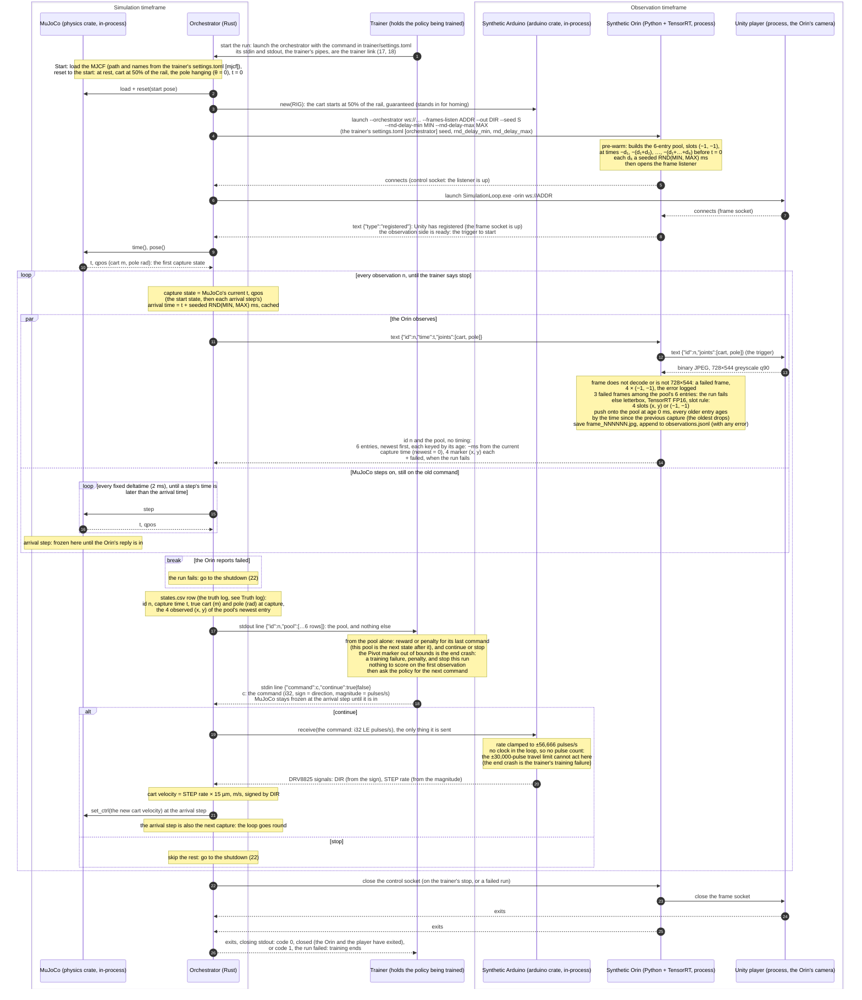

# Synthetic loop — sequence of one run (planned)

The policy will learn inside this loop, so this shows how one frame travels
from MuJoCo's truth to what the robot sees, through the trainer's policy,
and back to the motor. It is the **planned** sequence (decided 2026-10-23),
not today's code: today the player returns each frame to the orchestrator,
which forwards it to the synthetic Orin and steps a fixed
`--frame-interval-ms`.

The orchestrator stands in for the physical world: MuJoCo and the synthetic
Arduino are libraries inside it, and it is the only participant that sends
MuJoCo anything. The synthetic Orin is the robot's detector: it triggers the
Unity player, its camera, and replies to the orchestrator with the marker
pool only, never any timing. In production the policy runs on the Orin; in
the synthetic loop everything runs on this workstation, so the policy lives
in the trainer, which is where it is trained. The pose rides through the
Orin's sim edge to Unity; detection sees only pixels, and the policy only
the marker pool. Only the pool, the current state, reaches the trainer: the
trainer generates the reward or penalty and decides continue or stop
itself, and nothing in the control loop touches training. The trainer
starts each run by launching the orchestrator, with the command its
`trainer/settings.toml` names (1). Stop ends this
run, one episode for now; the trainer itself carries on and starts the
next run (1). A failed run (3 failed frames in the pool) is different: it
ends training, so the trainer is told the run failed (26) and starts no
further run. Only one message to another process is in flight at any
moment, and MuJoCo steps in-process while the Orin works, so nothing can
race.

MuJoCo's time is the clock, and it runs at a fixed deltatime: its 2 ms
timestep. When the orchestrator takes a capture state, it draws the Orin's
latency, a seeded RND(MIN, MAX) ms, and caches the arrival time, the
capture time plus the latency. MIN and MAX are the trainer's
`settings.toml` `[orchestrator]` `rnd_delay_min` and `rnd_delay_max`
(user, 2026-10-24), 8 and 15 today, passed to the orchestrator and on to
the Orin (4). MuJoCo keeps stepping on the old command while the
Orin works, as the real Arduino keeps stepping until the next packet
lands. The observation reaches the trainer at the first step whose time is
later than the arrival time; if MuJoCo gets there before the Orin has
replied, the orchestrator freezes it until the reply is in. MuJoCo runs far
faster than real time, so in practice it waits at the arrival step on
nearly every observation, and the run goes as fast as the Orin's round
trip allows. At that same step the trainer's command takes effect and the
next capture goes out. Captures sit on the 2 ms grid, so the arrival step
rounds the latency up to the next step: at 8–15 ms, the gap between two
captures is 10, 12, 14 or 16 ms. The latency is drawn at random because the policy
cannot observe it directly: the range is the band it trains in.

Not yet in the loop: more than one episode per run.

**The pool's size.** Three entries are the minimum for the current
position, speed and acceleration; the other three are redundancy, so three
valid entries survive when detections drop out to (−1, −1). A frame that
does not decode, or is not 728×544, is a failed frame: its entry is
4 × (−1, −1) and the error is logged. One failed frame costs about 15 ms
of detection and does not fail the run; 3 among the pool's 6 entries fail
it and end training. Pre-warm entries are no detection, not failed frames.

**Truth log.** `states.csv` pairs MuJoCo's real values at each capture
with what the Orin observed in that frame, one row per observation, for
evaluation after training. Columns: `id,time,cart,pole,left_x,left_y,
right_x,right_y,pivot_x,pivot_y,end_x,end_y` — the capture time (s), the
true cart (m) and pole (rad) at capture, and the pool's newest entry,
(−1, −1) where not detected. It joins `observations.jsonl` on `id`. The trainer never sees it, so nothing in the
control loop touches training. An early stop by the orchestrator on a
truth-versus-observation threshold is not in the loop yet.

**Scoring lag.** To the trainer, each pool is simply the next state after
its last command, and that is what it scores, as a Gymnasium step returns
the next state for the action it was given. Physically, that command has
not acted yet when the frame is taken: it is set at 21, at the arrival step
that is also the next capture, and drives the cart only during the
following steps (15–16). That delay is the real latency of the Orin's
object detection, the only perception in the loop, and the policy learns it
as part of the world, as it must on the real rig.

**The trainer link (17, 18, 26)** (user, 2026-10-24): the orchestrator's
stdin and stdout. The trainer launched the orchestrator (1), so it already
holds both as pipes: no port, no socket, and each run's link is its own.
Per observation, one JSON line each way: the pool out on stdout (17), the
answer in on stdin (18). stdout carries the link and nothing else, so
everything else the orchestrator prints, and everything its children (the
Orin, the player) print, goes to stderr. While the trainer works, MuJoCo
stays frozen at the arrival step, so the trainer's speed, like the Orin's,
stays out of simulated time. The run's end (26) is the orchestrator's
exit: stdout closes, and the exit code says closed (0) or failed (1).

**The trainer's environment** (user, 2026-10-24): the trainer reaches the
loop through a Gymnasium `Env`, one run per episode
(`gymnasium-research.md`). `reset()` starts a run (1) and returns its
first pool (17, n = 0); `step(a)` answers the pending pool with continue
and the command (18) and returns the next pool (17); a `reset()` or
`close()` while a run is open answers the pending pool with stop, waits
for the run to close (26), and `reset()` then starts the next run. A run
that fails (26, code 1) raises, which ends training. The observation is
the pool, 6 × 9 floats; the action is one value a ∈ [−1, 1], and the
command is a × 56,666 (the top rate), rounded to the `i32`. The reward is
graded (below), and the end crash terminates the episode. The time limit
is not decided yet: until it is, a placeholder length truncates the
episode.

**The reward is graded** (user, 2026-10-24), from the pool alone, in two
parts: the pole, low hanging down and rising to high upright, so every
gain in height pays on the way up from the hanging start; and the cart,
low with the Pivot marker close to a support (an end of the slide) and
high in the middle. Both are read from the markers: the pole's angle is
the Pivot-to-End direction in the image, and the cart's place is the
Pivot marker's x (`trainer-plan.md`, *What the trainer sees*). The shapes
and their sum (user, 2026-10-24): the pole part is (1 − cos θ) / 2, θ the
image angle, 0 hanging and 1 upright; the cart part is 1 − u², u the Pivot
marker's offset from the middle of the end-crash bounds as a fraction of
their half-span, 1 in the middle and 0 at a bound; the reward is their
weighted sum, so the cart part teaches even while the pole hangs. The
values (user, 2026-10-24, all in the trainer's `gym.toml`): weights 1.0
for the pole and 0.5 for the cart, so a step scores 0.5 hanging in the
middle and 1.5 upright in the middle; the end-crash bounds are Pivot x
0.26325 to 0.72639, the slide's ends less the 13.6 mm margin, measured; the
end crash scores −10 and terminates the episode. Each step is scored from
the newest pool entry with both Pivot and End detected, and scores 0 when
no entry has them.

**The policy learns by SAC** (Soft Actor-Critic, Stable-Baselines3's
`SAC` with its `MlpPolicy`; user, 2026-10-24, on the agent's
recommendation), on one environment, on the 3090. Why SAC: it is made for
one continuous action, and it is off-policy, reusing every stored
observation many times, so it needs the fewest observations of the usual
choices, and each observation costs real time (about 45 a second). Its
updates run between steps, while MuJoCo stays frozen at the arrival step,
so they cost wall time, never simulated time. Why the 3090 (user,
2026-10-24): on the CPU, measured over 300 steps through the loop
(2026-10-24), a step took 22 ms (median) before learning started and 46
ms once SAC updated every step, one update of the network (the 54 pool
values, two layers of 256, one action) taking 13.5 ms on 16 threads, so
learning doubled the step's wall time. The 3090 is free for it: the loop
runs one thing at a time, so while SAC updates, Unity and the Orin wait
and the GPU's rendering and detection are idle; and SAC needs about 0.5
GB of its 24 GB (the networks under 10 MB, the rest CUDA's own; the
replay buffer stays in main memory). On the 3090, measured the same way
(2026-10-24): 22.1 ms a step before learning and 46.5 ms after, one
update 16.1 ms, 28 MiB held by PyTorch. The 3090 is no faster than the
CPU here, so the doubled step is not the network's arithmetic; where
the time goes is not yet measured. A time-limit truncation is
not a crash: SAC keeps valuing the state it stopped in, and only the end
crash ends the value.

**The initial pool.** At startup, before any frame exists, the Orin
pre-warms the pool: six entries with no detection (−1, −1) at cumulative
times before the first capture (t = 0), each gap a fresh draw dₖ of
RND(MIN, MAX) ms from the Orin's generator, seeded with `--seed`. These gaps
are not rounded to the 2 ms grid, unlike the live gaps; it barely
matters, since pre-warm entries hold no detection. Every frame, the first
included, is then one push: the newest entry goes in and the oldest
drops, so frame 0's pool ages are 0, −d₁, −(d₁+d₂), …, −(d₁+…+d₅).

**Determinism.** The orchestrator's latency draws and the Orin's pre-warm
gaps both come from `--seed`, and the freeze at the arrival step keeps the
workstation's speed out of the sim, so the same seed and the same trainer
commands give the same physics: the same ids, capture times, latencies and
true cart and pole, bit for bit. The observation is not bit-identical, by
decision (user, 2026-10-24): Unity's SSAO (blue noise) changes its noise
pattern on every render, and the player renders between triggers, so a
frame's shading jitters slightly from run to run. The detector found every
marker in every frame regardless; run to run, the detections differ by at
most 0.04 px (2026-10-24), and so do `states.csv`'s observed columns and
`observations.jsonl` (which also logs `detect_ms`, a wall-clock time).

Numbers: `arduino::RIG` (200 steps × 32 microsteps, 96 mm per pulley turn:
15 µm per pulse, ±30,000 pulses of travel, 56,666 pulses/s top rate,
0.85 m/s, the motor's estimated corner speed on the rig's 30 V supply,
user 2026-10-24, `mujoco-plan.md`). The
travel limit acts only on the board, whose timer counts the pulses it
sends; the synthetic Arduino receives only the i32, so in the loop the
MJCF slide's ±0.45 m range is what stops the cart. The end crash is
therefore a training failure, judged by the trainer from the pool: the
Pivot marker out of bounds means penalty, and stop this run. The bounds
(*The reward is graded*) sit inside the slide's ends by more than the
cart can travel between a capture and the stop taking effect, at most
0.85 m/s (56,666 pulses/s × 15 µm) × 16 ms (the longest gap to the
arrival step at 8–15 ms) ≈ 13.6 mm, or the simulated cart reaches the
slide's end first. The real board finds its centre by homing: left to the limit
switch, right to the limit switch, then back half the pulses between the
two hits. The synthetic run instead always starts with the cart at 50% of
the rail, a guarantee, so the Arduino is never told a start position. The
pole starts hanging at rest, θ = 0 (user, 2026-10-24), as a pole at rest on
the rig does; upright is θ = π, so the policy must swing the pole up
before it can balance it. The
2 ms step is the MJCF's timestep, and the loop's fixed deltatime. The MJCF
states it, as `<option timestep="0.002" integrator="implicitfast"/>`,
written by the exporter from the rig's StepJointSet, never left to MuJoCo's
defaults: the timestep is both the physics step and the grid the latency
rounds to, and `implicitfast` is MuJoCo's recommended integrator for the
cart's `<velocity>` servo. The Orin latency's range, 8–15 ms today
(`rnd_delay_min`, `rnd_delay_max`), is the detection time measured on
the Orin Nano Super over 250 frames (2026-10-23, `detector-plan.md`
*Results*: TensorRT FP16 8.4–10.4 ms, the whole Python path with
decoding 11.9–14.5 ms). It stands for D = detection + policy + WiFi:
the policy's inference and the WiFi hop to the Arduino are not measured
yet (`orchestrator-plan.md`, *Placeholders*).

**Contracts** — what the messages carry, in full:

- **The pose (11, 12):** `joints` is `[{"name": the cart joint, "qpos":
  cart m}, {"name": the pole joint, "qpos": pole rad}]`, the MJCF joint
  names from the trainer's `[mjcf]` as the keys. The orchestrator sends
  `{"id", "time", "joints"}`; the Orin forwards `{"id", "joints"}`
  unchanged, and Unity drives each joint by its name.
- **The frame (13):** 728×544 greyscale JPEG, quality 90. Greyscale is
  the content, not the channel count: Unity's `GreyscaleEncoder` (the
  dataset generator's own) writes BT.601 luma into all three RGB
  channels, and the Orin decodes it to one channel. The size is exactly
  half the IMX296's native 1456×1088 (`DATASETS.md`, *Image spec*).
- **The marker frame (each pool entry):** 4 slots in class order — 0
  Left (tag 376), 1 Right (596), 2 Pivot (920), 3 End (937), the repo's
  class-id contract. Each slot is the box center `(x, y)`, normalized to
  [0, 1], or `(−1, −1)` when that class was not detected; −1 lies outside
  the valid range, so "not detected" can never be a real position. When
  a class has several boxes, the slot takes the highest-confidence one.
  `(−1, −1)` means *not detected*, whatever the cause: occluded, missed,
  out of frame, or a failed frame.
- **The pool (14, 17):** 6 entries × (1 age + 4 × `(x, y)`) = 54 floats.
  Ages are relative to the current capture so the input never depends on
  absolute clock values, and the policy sees the real spacing between
  frames. On the wire (14), one text message: `{"id": n, "pool":
  [[age_ms, x0, y0, x1, y1, x2, y2, x3, y3], …6 rows, newest first],
  "failed": false}` — row 0 is this frame, age 0; slot k is class k;
  `failed` is true when 3 of the pool's 6 entries are failed frames. To
  the trainer (17), one stdout line: `{"id": n, "pool": [...]}`, the same
  6 rows; no `failed`, since a failed pool goes to the shutdown and never
  reaches the trainer.
- **The answer (18):** one stdin line, `{"command": c, "continue":
  true}` (or `false`, stop): c is the command below, a JSON integer that
  must fit an `i32`. On a stop the command is not used.
- **The command (18, 19):** one `i32`, in pulses per second; sign =
  direction, never a distance or position offset. To the Arduino (19) it
  travels as 4 bytes, little-endian; fixed length, no id. Why an `i32`: at 1/32 microstepping the
  top rate is 0.85 m/s ÷ 15 µm = 56,666 pulses/s, past an `i16`'s
  32,767; an `i32` never limits the microstep setting or the speed. One
  pulse per second is 0.015 mm/s, finer than the slowest motion a
  balance needs.
- **The cart speed (20, 21):** meters per pulse = belt travel per
  pulley turn ÷ (full steps per turn × microsteps) = 96 mm ÷ (200 × 32)
  = 15 µm. The 96 mm is the CAD pulley `pully-gt2-48t-6w-8b`: 48 teeth
  at GT2's 2 mm pitch. The MJCF's `ctrlrange` (±0.85 m/s) matches the
  top rate, 56,666 pulses/s × 15 µm.
