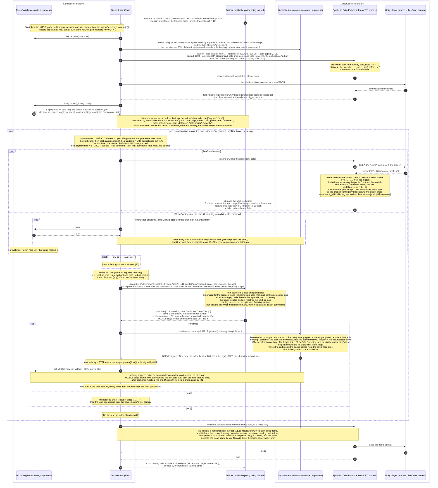
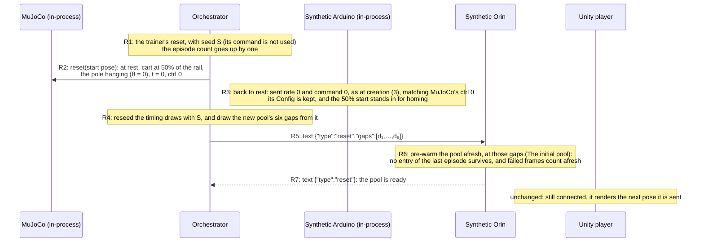

# Synthetic loop — sequence of one run (planned)

The policy will learn inside this loop, so this shows how one frame travels
from MuJoCo's truth to what the robot sees, through the trainer's policy,
and back to the motor. It is the **planned** sequence (decided 2026-10-23),
not today's code: today the player returns each frame to the orchestrator,
which forwards it to the synthetic Orin and steps a fixed
`--frame-interval-ms`.

The orchestrator stands in for the physical world: MuJoCo and the synthetic
Arduino are libraries inside it, and it is the only participant that sends
MuJoCo anything. The synthetic Orin is the robot's detector: it triggers the
Unity player, its camera, and replies to the orchestrator with the marker
pool only, never any timing. In production the policy runs on the Orin; in
the synthetic loop everything runs on this workstation, so the policy lives
in the trainer, which is where it is trained. The pose rides through the
Orin's sim edge to Unity; detection sees only pixels, and the policy only
the marker pool. The pool reaches the trainer for the policy, and beside
it the capture's MuJoCo time, true site positions and true pole state
(*Contracts*, the pole), for the reward, the episode end and the record
alone: the trainer generates the reward and decides continue or stop
itself, and nothing in the control loop touches training. The trainer
starts each run by launching the orchestrator, with the command its
`trainer/settings.toml` names (1). One run holds many episodes (user,
2026-10-24): between episodes the trainer answers reset, which puts the
run back at the start in place, without relaunching the orchestrator, the
Orin or the player (*Reset in place*); stop ends the run. A failed run (3 failed frames in the pool) is different: it
ends training, so the trainer is told the run failed (26) and starts no
further run. Only one message to another process is in flight at any
moment, and MuJoCo steps in-process while the Orin works, so nothing can
race.

MuJoCo's time is the clock, and it runs at a fixed deltatime: its 2 ms
timestep. The orchestrator alone decides when a frame happens (user,
2026-10-30). When it takes a capture state, it draws two seeded numbers,
in this order, from one generator:

- **The Orin's latency**, RND(MIN, MAX) ms, which gives the arrival time:
  the capture time plus the latency. MIN and MAX are the trainer's
  `settings.toml` `[orchestrator]` `rnd_delay_min` and `rnd_delay_max`
  (user, 2026-10-24), 8 and 15 today.
- **The command rate**, RND(`command_rate_min`, `command_rate_max`) Hz,
  which gives the next capture's time: the capture time plus 1000 ÷ the
  rate ms. The two rates are the gym file's `[env]` (user, 2026-10-30),
  20 and 30 by default, so the next capture is 33.3–50 ms later.

MuJoCo keeps stepping on the old command while the Orin works, as the real
Arduino keeps stepping until the next packet lands, the cart ramping towards
that command at the drive's acceleration ceiling (*The acceleration
ceiling*). The observation reaches the trainer at the first step whose time
is later than the arrival time: the arrival step. If MuJoCo gets there
before the Orin has replied, the orchestrator freezes it until the reply is
in. MuJoCo runs far faster than real time, so in practice it waits at the
arrival step on nearly every observation, and the run goes as fast as the
Orin's round trip allows. At that same step the trainer's command takes
effect.

**Nothing happens between commands** (user, 2026-10-30). From the arrival
step MuJoCo steps on the new command to the first step later than the next
capture's time: that step is the next capture. On the way there is no
render, no detection and no message: only MuJoCo and the synthetic Arduino
run. So the trainer sees only the states it should act on, one a command.
The policy decides at the first capture after a drawn time, so the
gaps between captures sit on the 2 ms grid: at 20–30 Hz, 34 to 50 ms in
steps of 2 ms (52 ms only for a draw of exactly 20 Hz), 41.5 ms on average,
about 24 commands a second. The cart holds each command for the rest of
that gap.

Both numbers are drawn at random because the policy cannot observe them
directly: the ranges are the bands it trains in. The shortest gap must be
longer than the longest latency, so that every command acts for at least
one step before the next capture: 1000 ÷ `command_rate_max` must be at
least `rnd_delay_max` + one timestep, and the orchestrator refuses less.
At 8–15 ms and a 2 ms timestep, `command_rate_max` is at most 58.8 Hz.

**Why a command rate** (user, 2026-10-30, `trainer-observations.md`,
*Change 5*). Until then a capture and a command came every 12.57 ms. One
command then changed the critic's score far less than the random timing
did, measured at 460,000 steps: 0.022 against 0.145. Holding each command
for longer gives each decision more effect on what follows.

**Training instances** (user, 2026-10-24). Data comes faster from several copies of the
loop at once, so the orchestrator will run a fixed group of **training
instances**, each a bundle that is always together: one MuJoCo, one
synthetic Arduino, one synthetic Orin and one Unity player, the Orin's
pool being that MuJoCo's history and the player that Orin's camera. One
orchestrator owns the whole group, so one launch starts it, one place
lays out the windows, and one stop or failure shuts it all down; one
orchestrator per instance would need something above them doing the
same. The number of instances is set per run as `instance_rows` ×
`instance_columns`, at most 12 (user, 2026-10-24: 6, then 12, a 4 × 3 grid
of windows; 2026-10-31: rows and columns replaced `instances`), in the trainer's `settings.toml` `[orchestrator]`.
Instance k (from 0) uses the ports `orin_port + 2k` and `unity_port + 2k`.
This sequence shows one instance; the group works as follows.

- **Each instance is the sequence above, on its own.** Its own MuJoCo
  clock, timing draws, Orin, player and episodes; nothing passes between
  instances. Its folder is the run's `--out` / `instance_k/` (its
  `states.csv`, frames and `observations.jsonl`). A training run keeps
  them (user, 2026-10-24, after the first run's were replaced by the next
  run's): each launch of the orchestrator by `train.py` gets `--out`
  `<the training run's folder>/loop_from_<steps>/`, `<steps>` the training
  steps already taken (0 for a new run), so a resume writes beside the
  sessions before it and never over them. Settings.toml's `--out` is the
  folder for runs outside a training run (`env_check`).
- **Rounds.** The trainer link carries a list each way. Every instance
  whose pool the trainer has not yet answered is *pending*. The trainer
  answers any pending instances in one line; the orchestrator advances
  exactly those (a continue sets the command, steps MuJoCo to the next
  capture and runs that observation; a reset resets in place, R1–R7, and
  runs the new episode's first) and replies with their new pools in one line. Instances not
  answered stay frozen at their arrival step, as one instance is while
  the trainer thinks. In a round the orchestrator first sends every
  advanced instance's pose (11), so their Orins detect at the same time,
  then steps each MuJoCo and collects each reply: a round waits for the
  slowest Orin.
- **Why answer only some.** Episodes end at different times. When
  instance k's episode ends, the trainer answers k alone with reset and
  gets back k's first pool of the new episode, so the next commands for
  all instances are chosen from current pools; the others stay pending
  meanwhile.
- **The lines (17, 18).** Out: `{"pools": [{"instance": k, "id": n,
  "time": t, "pool": [...], "sites": {...}, "pole": {...}}, …]}`, one entry per instance advanced, in instance
  order (the first line, after the start, holds all of them). In:
  `{"answers": [{"instance": k, "command": c, "next": …}, …]}`, each a
  pending instance at most once, with the one-instance answer's fields
  (*Contracts*). A stop is for the whole run: a line with a stop answers
  every pending instance with stop.
- **Seeds.** `--seed S` is instance 0's first episode; instance k's
  first is S + k. Every later episode's seed comes with its reset.
- **One fails, all stop.** A failed pool in any instance fails the run
  (26), as for one.
- **The windows** fill the screen as a grid (user, 2026-10-24; sized to
  fill it, user, 2026-10-31), so every player can be watched at once.
  `settings.toml` `[orchestrator]` gives `instance_rows`,
  `instance_columns`, `screen_width` and `screen_height`, which reach the
  orchestrator as `--instance-rows`, `--instance-columns`, `--screen-width`
  and `--screen-height`. The orchestrator, the one place that lays out the
  windows, works out each window's size, in pixels:
  width = ⌊screen width ÷ columns⌋, height = ⌊screen height ÷ rows⌋.
  So 2 rows × 3 columns on 3840×2112 gives windows of 1280×1056. Rounding
  down can leave a few pixels unfilled at the right and bottom edges, fewer
  than the number of columns or rows. The windows are borderless (user,
  2026-10-31): no title bar or frame, so each is all picture, and closing
  one by hand takes Alt+F4.
  It launches instance k's player with `-popupwindow` (borderless),
  `-screen-width` and `-screen-height` (the window's size), all three read
  by Unity's own player, so no script is involved, and
  `-window-position x,y`:
  x = origin x + (k mod columns) × width,
  y = origin y + ⌊k ÷ columns⌋ × height,
  in pixels from the top-left corner of the display the window opens on,
  where the player's `PlayerController` moves its window at startup. The
  origin is `--window-origin x,y` in `command` (default 0,0). Without
  `--screen-width`, the windows open where Windows puts them.
  **`screen_height` is the height to fill, not the display's:** Windows
  keeps a window above the taskbar, borderless too (measured 2026-10-31: a
  1080-tall window asked for at y = 1080 on the 2160-tall display, whose
  taskbar takes 48, opened at y = 1032), so a grid that reached under the taskbar
  would overlap itself. The display's 2160 less the taskbar's 48 is 2112.
  **A window's size never touches the frames:** they render into their own
  728×544 target, and the window only shows that target stretched to fit
  (2 × 3 on 3840×2112 is 9% off in aspect, on screen only). `env_check`'s
  one instance is a 1 × 1 grid: one window filling the area.
  The player must be built without Force Single Instance (user,
  2026-10-24), or every player after the first exits at launch.
- **The players draw only when asked** (2026-10-24, after the resumed
  first run measured six instances no faster than four,
  `trainer-observations.md`). The GPU runs one process at a time, so
  every render, detection and SAC update queues behind the others, and
  each player used to redraw its window nonstop between triggers (about
  2.2 CPU cores each, and a turn on the GPU per redraw). Now a player
  renders the scene only for a trigger (12): the frame it sends is also
  what its window shows, and nothing is rendered between triggers.
  Between triggers the player sleeps until the next one arrives, waking
  at least every 100 ms to keep the window responsive, so a trigger is
  handled as soon as it arrives. The window holds the last frame while
  an instance waits (during a reset, or while the trainer thinks).

**Reset in place** (user, 2026-10-24). Between episodes the run goes back
to the start without relaunching anything: the player's window stays
open, so it can be placed and watched, and an episode pays no launch
(about 3 s each before). The trainer answers a pending pool with
`{"next": "reset", "seed": S}`, S the next episode's seed, and the run
resets:

Then the loop goes round from the new episode's first capture (8): the
capture state is the start pose at t = 0, and its pool is the episode's
first, which the trainer does not score. Observation ids keep counting
across the run's episodes, so the Orin's frame files and every log row
stay unique; MuJoCo's time restarts at 0. Why the pool is pre-warmed
again: an entry from the last episode would show the policy a pole the
physics never had in this one, a jump from the old pose to the start.
Why S reseeds every timing draw, the pre-warm's included: an episode after a
reset is then the same episode as a fresh run with seed S (*Determinism*),
whatever came before it. Only one message is in flight at a time, so the
reset cannot race the loop: the Orin has replied to the last observation
before the trainer answers it.

**The pool's size.** Three entries are the minimum for the current
position, speed and acceleration; the other three are redundancy, so three
valid entries survive when detections drop out to (−1, −1). A frame that
does not decode, or is not 728×544, is a failed frame: its entry is
4 × (−1, −1) and the error is logged. One failed frame costs about 15 ms
of detection and does not fail the run; 3 among the pool's 6 entries fail
it and end training. Pre-warm entries are no detection, not failed frames.

**Truth log.** `states.csv` pairs MuJoCo's real values at each capture
with what the Orin observed in that frame, one row per observation, for
evaluation after training. Columns: `episode,id,time,cart,pole,left_x,left_y,
right_x,right_y,pivot_x,pivot_y,end_x,end_y` — the episode (0 for the
run's first, one more at each reset), the capture time (s, from 0 in each
episode), the
true cart (m) and pole (rad) at capture, and the pool's newest entry,
(−1, −1) where not detected. It joins `observations.jsonl` on `id`. The trainer never sees it, so nothing in the
control loop touches training. An early stop by the orchestrator on a
truth-versus-observation threshold is not in the loop yet.

**Scoring lag.** To the trainer, each pool is simply the next state after
its last command, and that is what it scores, as a Gymnasium step returns
the next state for the action it was given. Physically, that command has
acted for only part of the gap when the frame is taken: it is set at 21, at
the arrival step, so the cart runs on the old command from the capture to
the arrival step, and on the new one from there to the next capture. That
delay is the real latency of the Orin's object detection, the only
perception in the loop, and the policy learns it as part of the world, as
it must on the real rig.

**The trainer link (17, 18, 26)** (user, 2026-10-24): the orchestrator's
stdin and stdout. The trainer launched the orchestrator (1), so it already
holds both as pipes: no port, no socket, and each run's link is its own.
Per observation, one JSON line each way: the pool out on stdout (17), the
answer in on stdin (18): continue with the command, reset with the next
episode's seed (*Reset in place*), or stop. Before the first pool, once
per run, the trainer asks for the run's values and the orchestrator
answers from the model it loaded (the note before the loop; *Contracts*,
the run's values). stdout carries the link and nothing else, so
everything else the orchestrator prints, and everything its children (the
Orin, the player) print, goes to stderr. While the trainer works, MuJoCo
stays frozen at the arrival step, so the trainer's speed, like the Orin's,
stays out of simulated time. The run's end (26) is the orchestrator's
exit: stdout closes, and the exit code says closed (0) or failed (1).

**The trainer's environment** (user, 2026-10-24): the trainer reaches the
loop through a Gymnasium `Env`, one run holding many episodes
(`gymnasium-research.md`; user, 2026-10-24). The trainer starts the run
(1), with the first episode's seed as `--seed`, and asks for the run's
values (*Contracts*) before it builds the environment: the observation's
bounds, the action's scale and the episode end's floor come from them.
The first `reset()` returns the run's first pool (17); `step(a)` answers the pending pool with continue and the
command (18) and returns the next pool (17); every later `reset()`
answers the pending pool with reset and the episode's seed (*Reset in
place*) and returns the new episode's first pool; `close()` answers it
with stop and waits for the run to close (26). A run that fails (26,
code 1) raises, which ends training. The observation is
the pool, 6 × 9 floats, and the last 6 commands (*The policy sees its last
commands*, below); the action is one value a ∈ [−1, 1], and the
command is a × the top pulse rate (the run's values), rounded to the
`i32`. A step of the environment is one command: the gap between two
captures. The reward is
computed from the sites (*The reward*, below), and the strike-gap end
terminates the episode (*The episode end*, below). **The time
limit** (user, 2026-10-24, on the agent's recommendation): 460 steps,
about 19 s of simulated time at the mean gap of 41.5 ms (1,500 steps at
12.57 ms before the command rate), then the
episode is truncated: time to swing up from hanging and then hold the
pole upright for most of it. Reference tasks run 10 s (DeepMind's cart-pole
swing-up, Gymnasium's `CartPole-v1`) to 40 s (`InvertedPendulum-v5`).

**The policy sees its last commands** (user, 2026-10-24, from NFQ2.0's
real cart-pole, `reward-research.md`; run 2 on). The observation is the
pool's 54 floats, then the actions a of the last 6 commands, newest
first: 60 floats. Before an episode's first command they are 0, the
command for standing still, as a reset leaves the cart. Why:
- **The commands say how the cart is moving.** The command is the
  stepper's pulse rate, so the newest command sets the cart's speed now,
  and the ones before it say how it got there. The markers show that only
  as small changes in the Pivot's x from frame to frame.
- **The newest frame is already old.** It is 8–15 ms old when it arrives
  (the latency), and the cart has moved since, on the last command. On
  the rig the delay will be longer (policy inference and WiFi, still
  open).
- **NFQ2.0 needed them.** Its real cart-pole, with about 100 ms of delay,
  did not learn from the current state alone. It needed at least the last
  2 states and actions, and 6 was its default.

Not a toy: on the robot the Orin sends the commands, so it has them. The
observation is the network's input, so changing it starts a new run,
run 2: run 1 cannot resume under it.

**The reward** (user, 2026-10-25: every reward calculation from the
sites, never the detected markers; user, 2026-10-28: and from the pole's
state and body, straight from MuJoCo: wherever MuJoCo has a value the
reward needs, the value is MuJoCo's, never worked out from other
numbers). The calculation is `trainer/reward-plan.md`'s, the source of
truth for its terms, constants and values; this section places it in
the loop. Each scored step t, command c_t, is scored with capture t+1's
entry (17), from:

- capture t+1's sites (*Contracts*, the sites): End, Dynamic Target,
  Target, Pivot, Cart and Cart Target;
- capture t+1's pole state (*Contracts*, the pole): its turning speed.

The reward is the product r = r_tip × r_target_speed × r_cart × r_reach
× r_speed, always in (0, 1] (user, 2026-10-30; `trainer/reward-plan.md`):

- r_tip from the distance from End to Dynamic Target, the point
  straight above the pivot that moves with the cart: it pays a pole
  standing straight up the same anywhere on the rail;
- r_target_speed from the pole's turning speed while End is above Pivot
  and within a zone along the rail of Dynamic Target: 1 up to a limit,
  falling towards a floor past it, never reaching it; 1 outside the zone;
- r_cart from the distance from Cart to Cart Target, the cart's
  distance from the middle: 1 inside a free zone, falling towards a
  floor past it, never reaching it;
- r_reach from the distance from End to Target, the point above the
  middle of the rail: 1 on it, falling towards a floor, never reaching
  it;
- r_speed from the pole's turning speed, anywhere: 1 up to a limit above
  any speed a swing-up needs, falling towards a floor past it, never
  reaching it.

Nothing else is paid, and
nothing is subtracted when an episode ends. The commands are not scored
(user, 2026-10-28): how fast the command may change is the drive's
limit, not the reward's (*The acceleration ceiling*). The first step of
an episode: capture 0 is not scored; the first scored step is c_0 with
capture 1. The sites and the pole state never reach the policy: it sees
the pool and its last commands only. Its tunables are the gym file's
`[reward]` tables, one per factor (user, 2026-10-29): `[reward.tip]`
(w), `[reward.target_speed]` (its zone_dx, limit, width and floor),
`[reward.cart]` (its zone, width and floor), `[reward.reach]` (its width
and floor) and `[reward.speed]` (its limit, width and floor).

**The acceleration ceiling** (user, 2026-10-28). The real stepper slips
when its pulse rate changes faster than it can follow, so the drive never
changes the rate faster than that: the firmware, not the policy and not
the reward, keeps the cart within the motor's limit. The limit is m, the
jump limit measured on the rig (`jump-limit-results.md`: 1,210,937
pulses/s², 18.2 m/s² of cart, at 24 V, the DM542 at 2.69 A RMS, 1/32,
pole mounted), the trainer's `settings.toml` `[drive] jump_limit`, which
the orchestrator passes to the synthetic Arduino's `Config` (3). The
firmware holds two rates: the command, the last one received (clamped to
± the top pulse rate), and the sent rate, the one its STEP signal runs
at. Every tick, of length dt:

  sent rate += the change towards the command, at most m × dt,
  rounded down to a whole pulse/s

So a change up to m × dt finishes in one tick, and a bigger one takes
several, never faster than m. In the loop the tick is MuJoCo's 2 ms step
(15–16, 19–21), where m × dt is 2,421 pulses/s; the cart follows the
sent rate. A reset puts both rates back to 0 (R3). It is one fixed rule
per tick, since the Uno makes as few decisions as possible (`AGENTS.md`,
*The real robot*). The policy still sees its commands, not the sent
rate; the sent rate follows from the commands and the pool's ages. The
rule rests on the measurement, not on a source: the rig measured jumps
and a staircase of jumps, never a ramp, and a ramp at m asks the
staircase's average acceleration without its sudden jumps.

**The episode end**. An episode ends when
either strike-face gap, Left Cart.x − Left Rail.x or Right Rail.x −
Right Cart.x (*Contracts*, the sites), is under b, checked on capture
t+1's sites after r is paid. b is the gym file's `[end.strike_gap]
buffer`, at least the cart's travel past a check that passed (*Numbers*:
the cart top speed × the longest gap between captures and the longest
latency, 68 ms at 20–30 Hz and 8–15 ms). There is no fall-angle end: every episode starts
hanging, and a fall is a return to the swing-up. The time limit is not
an end: it truncates.

**The trainer's parts** (user, 2026-10-25, `rl-rewrite-plan.md`). The
reward, the episode end, the observation and the action are each a
plugin, chosen by name and configured in the gym file (`[reward]
scheme`, `[end] plugins`, `[observation] plugin`, `[action] plugin`):
changing one's logic is a new file and its name there. Every scored
step's inputs (the two captures' sites and pole states, c_t, c_(t−1)
and the step index) are recorded with the capture they came from, and kept beside
the step in SAC's replay buffer, so a resume rescores every stored step
through the reward the gym file names then. A resume is refused when
the observation or the end conditions differ from the run's saved
manifest: the observation is the networks' input, and a rescore cannot
move where stored episodes ended.

**The policy learns by SAC** (Soft Actor-Critic, Stable-Baselines3's
`SAC` with its `MlpPolicy`; user, 2026-10-24, on the agent's
recommendation), on one environment, on the 3090. Why SAC: it is made for
one continuous action, and it is off-policy, reusing every stored
observation many times, so it needs the fewest observations of the usual
choices, and each observation costs real time (about 45 a second). Its
updates run between steps, while MuJoCo stays frozen at the arrival step,
so they cost wall time, never simulated time. Why the 3090 (user,
2026-10-24): on the CPU, measured over 300 steps through the loop
(2026-10-24), a step took 22 ms (median) before learning started and 46
ms once SAC updated every step, one update of the network (the 54 pool
values, two layers of 256, one action) taking 13.5 ms on 16 threads, so
learning doubled the step's wall time. The 3090 is free for it: the loop
runs one thing at a time, so while SAC updates, Unity and the Orin wait
and the GPU's rendering and detection are idle; and SAC needs about 0.5
GB of its 24 GB (the networks under 10 MB, the rest CUDA's own; the
replay buffer stays in main memory). On the 3090, measured the same way
(2026-10-24): 22.1 ms a step before learning and 46.5 ms after, one
update 16.1 ms, 28 MiB held by PyTorch. The 3090 is no faster than the
CPU here, so the doubled step is not the network's arithmetic. Where
the time went (measured 2026-10-24, `trainer-observations.md`): every
process using the GPU takes turns on it, and the players' nonstop
redraws made SAC's update wait; with the players drawing only when asked,
the trainer's turn is about 17 ms for 1 or 6 instances. A time-limit truncation is
not an end: SAC keeps valuing the state it stopped in, and only the
episode end (*The episode end*) ends the value.

**The discount** (user, 2026-10-24, `reward-research.md`; run 2 on; the
value moved with the command rate, 2026-10-30): γ = 0.9934, `gym.toml`'s
`[sac] gamma`. SAC values an action by the rewards after it, each counted
at γⁿ for n steps ahead, so it counts roughly 1 / (1 − γ) steps ahead. It
is chosen for how far ahead in time that reaches, about 6.3 s, most of a
pump: run 1's pump took 9–15 s to bring the pole to 150°. At the mean gap
of 41.5 ms, 6.3 s is 152 steps, and 1 / (1 − 0.9934) = 152. Before the
command rate the same 6.3 s was 500 steps of 12.57 ms, γ = 0.998. Both
hardware papers in `reward-research.md` used 0.999, on their own step
lengths.

**The initial pool.** Before any frame exists, the pool is pre-warmed: six
entries with no detection (−1, −1) at cumulative times before the first
capture (t = 0). The orchestrator draws each gap dₖ, 1000 ÷ a seeded
RND(`command_rate_min`, `command_rate_max`) ms, and hands them to the Orin:
`--pool-gaps` at launch (4), the reset's `gaps` afterwards (R5). The Orin
draws nothing. These gaps
are not rounded to the 2 ms grid, unlike the live gaps; it barely
matters, since pre-warm entries hold no detection. Every frame, the first
included, is then one push: the newest entry goes in and the oldest
drops, so frame 0's pool ages are 0, −d₁, −(d₁+d₂), …, −(d₁+…+d₅).
A reset pre-warms the pool the same way, its gaps drawn from the reset's
seed, before the new episode's first frame (*Reset in place*).

**Determinism.** Every timing draw comes from the orchestrator's one
generator, seeded with `--seed`: at the start of an episode the pool's six
gaps, then at each capture its latency and its command rate. The freeze at
the arrival step keeps the workstation's speed out of the sim, so the same
seed and the same trainer commands give the same physics: the same ids,
capture times, latencies and true cart and pole, bit for bit. A reset with
seed S reseeds it, so an
episode after a reset repeats a fresh run with seed S, its ids offset by
the observations before it. The observation is not bit-identical, by
decision (user, 2026-10-24): Unity's SSAO (blue noise) changes its noise
pattern on every render, and the player rendered between triggers, so a
frame's shading jittered slightly from run to run. Since the players draw
only when asked (*Training instances*), a run's nth frame is its player's
nth render, so the frames may now repeat bit for bit; not yet checked,
and not required. The detector found every
marker in every frame regardless; run to run, the detections differ by at
most 0.04 px (2026-10-24), and so do `states.csv`'s observed columns and
`observations.jsonl` (which also logs `detect_ms`, a wall-clock time).

Numbers: the drive figures are the trainer's `settings.toml` `[drive]`
(full steps per turn, microsteps, belt travel per pulley turn; 200 × 32
and 96 mm today, 15 µm per pulse), passed to the orchestrator as
`--full-steps-per-rev`, `--microsteps` and `--belt-um-per-rev`. The cart
top speed is the MJCF actuator's `ctrlrange`, set per supply voltage
(`motor-spec.md`) and read from the loaded model by the physics crate;
the top pulse rate is derived, cart top speed ÷ metres per pulse. A
travel limit acts only on the board, whose timer counts the pulses it
sends; the synthetic Arduino receives only the i32 and holds no travel,
so in the loop the MJCF slide's ±0.45 m range is what stops the cart.
The episode end is therefore the trainer's, judged from the strike-face
sites (*The episode end*): a gap under b. b must exceed what the cart
can travel from a check that passed to the stop taking effect: the next
capture is at most 52 ms later (1000 ÷ `command_rate_min`, 50 ms at 20 Hz,
rounded to the first step later), and its stop takes effect at its arrival
step, at most 16 ms after that (8–15 ms, the same rounding). That is at
most the cart top speed × 68 ms, or the simulated cart reaches a base first. The real board finds its centre by homing: left to the limit
switch, right to the limit switch, then back half the pulses between the
two hits. The synthetic run instead always starts with the cart at 50% of
the rail, a guarantee, so the Arduino is never told a start position. The
pole starts hanging at rest, θ = 0 (user, 2026-10-24), as a pole at rest on
the rig does; upright is θ = π, so the policy must swing the pole up
before it can balance it. The
2 ms step is the MJCF's timestep, and the loop's fixed deltatime. The MJCF
states it, as `<option timestep="0.002" integrator="implicitfast"/>`,
written by the exporter from the rig's StepJointSet, never left to MuJoCo's
defaults: the timestep is both the physics step and the grid the latency
rounds to, and `implicitfast` is MuJoCo's recommended integrator for the
cart's `<velocity>` servo. The Orin latency's range, 8–15 ms today
(`rnd_delay_min`, `rnd_delay_max`), is the detection time measured on
the Orin Nano Super over 250 frames (2026-10-23, `detector-plan.md`
*Results*: TensorRT FP16 8.4–10.4 ms, the whole Python path with
decoding 11.9–14.5 ms). It stands for D = detection + policy + WiFi:
the policy's inference and the WiFi hop to the Arduino are not measured
yet (`orchestrator-plan.md`, *Placeholders*).

**Contracts** — what the messages carry, in full:

- **The sites:** twelve MJCF `<site>` points, written by the Unity
  exporter from the rig's StepJointSet: one at the centre of each
  marker, Left, Right, Pivot and End; Target, fixed to the world
  where End sits with the cart centred and the pole upright; Dynamic
  Target, on the cart, where End sits with the pole upright wherever
  the cart is (user, 2026-10-29); Cart, on the cart at the slider
  joint, and Cart Target, fixed to the world where Cart sits with the
  cart centred (user, 2026-10-29), so the distance between them is the
  cart's distance from the middle; and the
  four strike faces (user, 2026-10-25): Left Rail and Right Rail, where
  the cart would strike each base, and Left Cart and Right Cart, the
  cart's faces that would strike them. The gaps, Left Cart.x − Left
  Rail.x and Right Rail.x − Right Cart.x, are the cart's clearance to
  each base in meters, 0 at contact. These sites are the truth for where
  the cart meets the bases (user, 2026-10-25), not the slide's
  `range`: from the XML chain the faces meet at cart −0.440 m (left)
  and +0.445 m (right), inside the slide's ±0.45 m, so that range lets
  the cart run 10 mm and 5 mm into the bases until it is re-authored to
  match. The trainer's `[mjcf]` names each
  site by its role (`left_site`, `right_site`, `pivot_site`,
  `end_site`, `target_site`, `dynamic_target_site`, `cart_site`,
  `cart_target_site`, `left_rail_site`, `left_cart_site`,
  `right_rail_site`, `right_cart_site`); the load fails if the model
  lacks one. MuJoCo gives the orchestrator their world positions for
  the current pose (MuJoCo's frame, meters, z up). They are read at
  each capture step, from the same MuJoCo step as the pose sent for
  that frame (9–11), and held under the capture's id while MuJoCo steps
  on: the Orin's delay applies only to the detected image positions,
  never to these. To the trainer (17), in that capture's entry:
  `"sites": {"left": [x, y, z], "right": […], "pivot": […], "end": […],
  "target": […], "dynamic_target": […], "cart": […], "cart_target":
  […], "left_rail": […], "left_cart": […], "right_rail": […],
  "right_cart": […]}`. They are the simulator's true state, for the reward
  and the episode end alone (user, 2026-10-25: every reward calculation
  from these, not from the detected markers; *The reward*, *The episode
  end*), so they never enter the observation or anything else the policy
  sees.
- **The pole** (user, 2026-10-28: the pole's values straight from
  MuJoCo, never worked out from other numbers where MuJoCo has them). The
  pole is everything that swings on the trainer's `[mjcf] pole_joint`:
  the body that holds the joint and every body under it. At each
  capture, from the same MuJoCo step as the sites (9–11), MuJoCo gives
  the orchestrator its state, `pole()`:
  - `speed`: the pole joint's `qvel`, rad/s, MuJoCo's own value for that
    instant, signed about the joint's axis;
  - `angle`: the pole joint's `qpos`, rad, 0 hanging and π upright, as
    in the pose (11); MuJoCo keeps counting past a full turn, so it also
    says how many turns the pole has made;
  - `com`: the pole's centre of mass, its `subtree_com`, a world point in
    the sites' frame (meters, z up);
  - `hinge`: the pole joint's anchor, its `xanchor`, the hinge point in
    the same frame.

  To the trainer (17), in that capture's entry: `"pole": {"speed": ω,
  "angle": θ, "com": [x, y, z], "hinge": [x, y, z]}`, and beside it the
  capture's MuJoCo time, `"time": t`, in s (MuJoCo's `data.time`, from 0
  in each episode). Like the sites, the true state, for the reward and
  the record alone, never the policy's input. The pole's body, which
  never changes with the pose, comes once, in the run's values (below).
- **The pose (11, 12):** `joints` is `[{"name": the cart joint, "qpos":
  cart m}, {"name": the pole joint, "qpos": pole rad}]`, the MJCF joint
  names from the trainer's `[mjcf]` as the keys. The orchestrator sends
  `{"id", "time", "joints"}`; the Orin forwards `{"id", "joints"}`
  unchanged, and Unity drives each joint by its name.
- **The frame (13):** 728×544 greyscale JPEG, quality 90. Greyscale is
  the content, not the channel count: Unity's `GreyscaleEncoder` (the
  dataset generator's own) writes BT.601 luma into all three RGB
  channels, and the Orin decodes it to one channel. The size is exactly
  half the IMX296's native 1456×1088 (`DATASETS.md`, *Image spec*).
- **The marker frame (each pool entry):** 4 slots in class order — 0
  Left (tag 376), 1 Right (596), 2 Pivot (920), 3 End (937), the repo's
  class-id contract. Each slot is the box center `(x, y)`, normalized to
  [0, 1], or `(−1, −1)` when that class was not detected; −1 lies outside
  the valid range, so "not detected" can never be a real position. When
  a class has several boxes, the slot takes the highest-confidence one.
  `(−1, −1)` means *not detected*, whatever the cause: occluded, missed,
  out of frame, or a failed frame.
- **The pool (14, 17):** 6 entries × (1 age + 4 × `(x, y)`) = 54 floats.
  Ages are relative to the current capture so the input never depends on
  absolute clock values, and the policy sees the real spacing between
  frames. On the wire (14), one text message: `{"id": n, "pool":
  [[age_ms, x0, y0, x1, y1, x2, y2, x3, y3], …6 rows, newest first],
  "failed": false}` — row 0 is this frame, age 0; slot k is class k;
  `failed` is true when 3 of the pool's 6 entries are failed frames. To
  the trainer (17), each instance's entry in the stdout line (*Training
  instances*): `{"instance": k, "id": n, "time": t, "pool": [...],
  "sites": {...}, "pole": {...}}`, the same 6 rows and capture n's time,
  sites and pole state
  (*The sites*, *The pole*, above); no
  `failed`, since a failed pool goes to the shutdown and never reaches
  the trainer.
- **The answer (18):** each instance's entry in the stdin line,
  `{"instance": k, "command": c, "next": "continue"}`, `{"instance": k,
  "command": c, "next": "reset", "seed": S}` or `{"instance": k,
  "command": c, "next": "stop"}`: c is the command below, a JSON integer
  that must fit an `i32`, used only on continue; S, on a reset only, is
  the next episode's seed, a whole number 0 to 2⁶⁴ − 1 like `--seed`.
- **The reset (R5, R7):** on the control socket, the orchestrator sends
  `{"type": "reset", "gaps": [d₁, …, d₆]}`, the new pool's six gaps in ms,
  and the Orin replies `{"type": "reset"}` once the pool is pre-warmed
  again.
- **The command (18, 19):** one `i32`, in pulses per second; sign =
  direction, never a distance or position offset. To the Arduino (19) it
  travels as 4 bytes, little-endian; fixed length, no id. Its bound is ±
  the top pulse rate (the run's values). Why an `i32`: the top pulse rate
  can pass an `i16`'s 32,767 (at 15 µm a pulse, any cart top speed above
  0.49 m/s does); an `i32` never limits the microstep setting or the
  speed. At 15 µm a pulse, one pulse per second is 0.015 mm/s, finer
  than the slowest motion a balance needs.
- **The cart speed (20, 21):** meters per pulse = belt travel per
  pulley turn ÷ (full steps per turn × microsteps), the trainer's
  `[drive]`: 96 mm ÷ (200 × 32) = 15 µm today. The 96 mm is the CAD
  pulley `pully-gt2-48t-6w-8b`: 48 teeth at GT2's 2 mm pitch. The top
  pulse rate is the MJCF's `ctrlrange` (the cart top speed) ÷ meters per
  pulse, so the command's range and the actuator's are one figure. The
  STEP rate is the sent rate after each tick's ramp, not the command
  (*The acceleration ceiling*).
- **The run's values (the note before the loop):** once per run, on the
  trainer link, before the first pools line. The trainer's first stdin
  line is `{"request": "run"}`; the orchestrator's first stdout line
  answers it, `{"run": {"cart_top_speed": v, "top_pulse_rate": r,
  "timestep": s, "pole_mass": m, "pole_com_distance": l, "pole_inertia":
  I, "gravity": g}}`: the cart top speed in m/s (the MJCF actuator's
  `ctrlrange`, read from the loaded model), the top pulse rate in
  pulses/s (the cart top speed ÷ meters per pulse, rounded down to a
  whole number, the synthetic Arduino's clamp), MuJoCo's timestep in s,
  and the pole's body (*The pole*) from the loaded model: its mass in kg
  (`body_subtreemass`), its centre of mass's distance from the joint's
  axis in m, its moment of inertia about that axis in kg·m² (the pole
  joint's diagonal entry in MuJoCo's inertia matrix), and gravity's size
  in m/s² (the model's `gravity`, which must point straight down, −z).
  None of the four changes with the pose. Every instance loads the same model, so instance 0's values are the
  run's; the model cannot change during the run, so the trainer keeps
  the answer for it.
