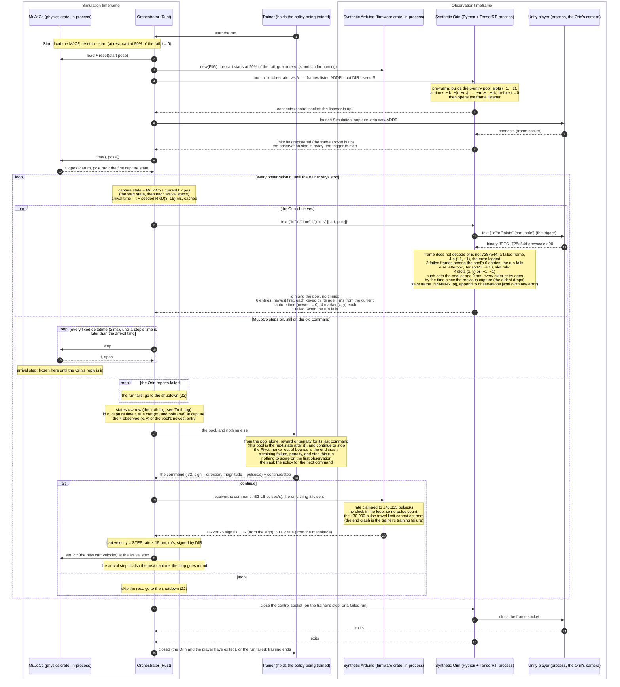

# Synthetic loop — sequence of one run (planned)

The policy will learn inside this loop, so this shows how one frame travels
from MuJoCo's truth to what the robot sees, through the trainer's policy,
and back to the motor. It is the **planned** sequence (decided 2026-10-23),
not today's code: today the player returns each frame to the orchestrator,
which forwards it to the synthetic Orin and steps a fixed
`--frame-interval-ms`.

The orchestrator stands in for the physical world: MuJoCo and the synthetic
Arduino are libraries inside it, and it is the only participant that sends
MuJoCo anything. The synthetic Orin is the robot's detector: it triggers the
Unity player, its camera, and replies to the orchestrator with the marker
pool only, never any timing. In production the policy runs on the Orin; in
the synthetic loop everything runs on this workstation, so the policy lives
in the trainer, which is where it is trained. The pose rides through the
Orin's sim edge to Unity; detection sees only pixels, and the policy only
the marker pool. Only the pool, the current state, reaches the trainer: the
trainer generates the reward or penalty and decides continue or stop
itself, and nothing in the control loop touches training. Stop ends this
run, one episode for now; the trainer itself carries on and starts the
next run (1). A failed run (3 failed frames in the pool) is different: it
ends training, so the trainer is told the run failed (26) and starts no
further run. Only one message to another process is in flight at any
moment, and MuJoCo steps in-process while the Orin works, so nothing can
race.

MuJoCo's time is the clock, and it runs at a fixed deltatime: its 2 ms
timestep. When the orchestrator takes a capture state, it draws the Orin's
latency, a seeded RND(8, 15) ms, and caches the arrival time, the capture
time plus the latency. MuJoCo keeps stepping on the old command while the
Orin works, as the real Arduino keeps stepping until the next packet
lands. The observation reaches the trainer at the first step whose time is
later than the arrival time; if MuJoCo gets there before the Orin has
replied, the orchestrator freezes it until the reply is in. MuJoCo runs far
faster than real time, so in practice it waits at the arrival step on
nearly every observation, and the run goes as fast as the Orin's round
trip allows. At that same step the trainer's command takes effect and the
next capture goes out. Captures sit on the 2 ms grid, so the arrival step
rounds the latency up to the next step: the gap between two captures is
10, 12, 14 or 16 ms.

Not yet in the loop: more than one episode per run.

**The pool's size.** Three entries are the minimum for the current
position, speed and acceleration; the other three are redundancy, so three
valid entries survive when detections drop out to (−1, −1). A frame that
does not decode, or is not 728×544, is a failed frame: its entry is
4 × (−1, −1) and the error is logged. One failed frame costs about 15 ms
of detection and does not fail the run; 3 among the pool's 6 entries fail
it and end training. Pre-warm entries are no detection, not failed frames.

**Truth log.** `states.csv` pairs MuJoCo's real values at each capture
with what the Orin observed in that frame, one row per observation, for
evaluation after training. The trainer never sees it, so nothing in the
control loop touches training. An early stop by the orchestrator on a
truth-versus-observation threshold is not in the loop yet.

**Scoring lag.** To the trainer, each pool is simply the next state after
its last command, and that is what it scores, as a Gymnasium step returns
the next state for the action it was given. Physically, that command has
not acted yet when the frame is taken: it is set at 21, at the arrival step
that is also the next capture, and drives the cart only during the
following steps (15–16). That delay is the real latency of the Orin's
object detection, the only perception in the loop, and the policy learns it
as part of the world, as it must on the real rig.

**The initial pool.** At startup, before any frame exists, the Orin
pre-warms the pool: six entries with no detection (−1, −1) at cumulative
times before the first capture (t = 0), each gap a fresh draw dₖ of
RND(8, 15) ms from the Orin's generator, seeded with `--seed`. These gaps
are not rounded to the 2 ms grid, unlike the live gaps; it barely
matters, since pre-warm entries hold no detection. Every frame, the first
included, is then one push: the newest entry goes in and the oldest
drops, so frame 0's pool ages are 0, −d₁, −(d₁+d₂), …, −(d₁+…+d₅).

**Determinism.** The orchestrator's latency draws and the Orin's pre-warm
gaps both come from `--seed`, and the freeze at the arrival step keeps the
workstation's speed out of the sim, so the same seed and the same trainer
commands give byte-identical `observations.jsonl` and `states.csv`.

Numbers: `firmware::RIG` (200 steps × 32 microsteps, 96 mm per pulley turn:
15 µm per pulse, ±30,000 pulses of travel, 45,333 pulses/s top rate). The
travel limit acts only on the board, whose timer counts the pulses it
sends; the synthetic Arduino receives only the i32, so in the loop the
MJCF slide's ±0.45 m range is what stops the cart. The end crash is
therefore a training failure, judged by the trainer from the pool: the
Pivot marker out of bounds means penalty, and stop this run. The bounds
are not set yet; they must sit inside the slide's ends by more than the
cart can travel between a capture and the stop taking effect, at most
0.68 m/s (45,333 pulses/s × 15 µm) × 16 ms (the longest gap to the
arrival step) ≈ 11 mm, or the simulated cart reaches the slide's end
first. The real board finds its centre by homing: left to the limit
switch, right to the limit switch, then back half the pulses between the
two hits. The synthetic run instead always starts with the cart at 50% of
the rail, a guarantee, so the Arduino is never told a start position. The
2 ms step is the MJCF's timestep, and the loop's fixed deltatime: it sets
no `<option>`, so MuJoCo's default applies. The Orin latency's range,
8–15 ms, is actual object-detection inference time over 250 test images,
a placeholder for D = detection + policy + WiFi (`loop-plan.md`,
*Timing*).
